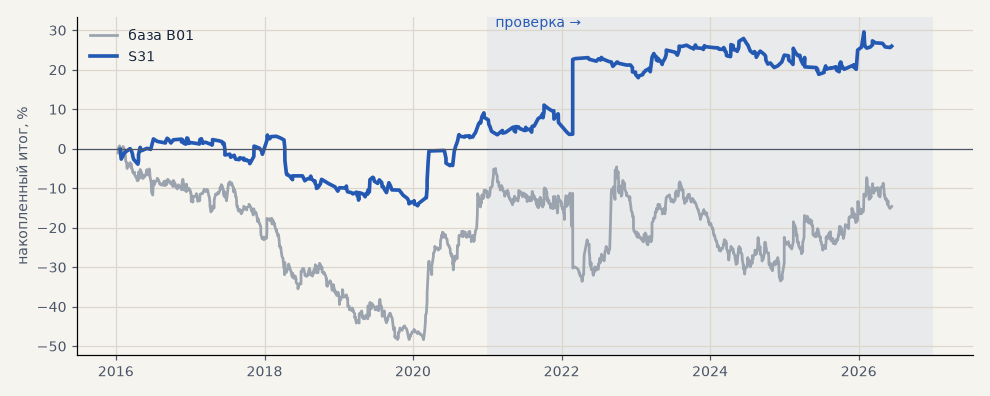

# S31. Вход по пробою 55-дневного уровня

**Семейство:** стратегия без ML (импульс) · **база:** B01 · **гипотеза:** H47 · **вердикт:** в пределах шума: портфель 4 лучше, металлы хуже базы

**Что проверяли.** Новый вход: первое закрытие часа выше максимума 55 прошлых дней — лонг, ниже минимума — шорт, по гейту C («Черепахи», система 2, параметры из учебника). Выход как у базы.

**Зачем.** Пробой давнего уровня — классический сигнал начала тренда.

**Итог простыми словами.** Сделок в 4 раза меньше. На выборе и проверке в плюсе во всех срезах; на проверке портфель 4 +18% (PF 1.25) против −2% у базы, все рынки +13% против −19%, но металлы +16% против +41%; без 2 лучших сделок около нуля, t < 1 — от шума не отличить. Пробой вчерашнего дня и 20 дней хуже.

**Издержки:** профиль `base` (спред и свопы брокера)

Подробности: [results/trend_filter_tz.md](../../results/trend_filter_tz.md)

Проверка — сделки, открытые с 1 января 2021 года; выбор — до 2021. В скобках — база на тех же инструментах.

| срез | период | сделок | итог % | выигрышей | ожидание на сделку | PF | без 2 лучших | просадка | t | лет в плюсе |
|---|---|---|---|---|---|---|---|---|---|---|
| все инструменты | проверка | 440 (1924) | +13.4 (-18.9) | 43% (41%) | +0.244% (-0.078%) | 1.15 (0.95) | +4.0 (-27.9) | -8.5 (-32.5) | 0.91 (-0.70) | 4/6 (1/6) |
| все инструменты | выбор | 329 (1196) | +0.1 (-41.1) | 45% (39%) | +0.003% (-0.275%) | 1.00 (0.79) | -4.2 (-45.8) | -12.1 (-59.1) | 0.02 (-3.02) | 1/5 (1/5) |
| портфель 4 | проверка | 209 (896) | +18.0 (-2.3) | 42% (42%) | +0.345% (-0.010%) | 1.25 (0.99) | -0.9 (-17.7) | -9.1 (-28.9) | 0.93 (-0.07) | 4/6 (3/6) |
| портфель 4 | выбор | 191 (665) | +7.9 (-12.3) | 43% (41%) | +0.166% (-0.074%) | 1.12 (0.94) | -0.8 (-21.8) | -17.9 (-49.1) | 0.53 (-0.55) | 2/5 (1/5) |
| металлы (серебро + золото) | проверка | 115 (506) | +16.0 (+41.3) | 47% (44%) | +0.278% (+0.163%) | 1.26 (1.17) | -1.5 (+23.2) | -20.0 (-28.5) | 0.79 (1.18) | 3/6 (5/6) |
| металлы (серебро + золото) | выбор | 95 (461) | +39.6 (-11.5) | 57% (38%) | +0.834% (-0.050%) | 2.42 (0.94) | +22.2 (-30.4) | -4.5 (-55.8) | 2.33 (-0.41) | 3/5 (1/5) |
| серебро | проверка | 57 (243) | +10.8 (+58.1) | 46% (46%) | +0.189% (+0.239%) | 1.13 (1.18) | -24.2 (+21.9) | -28.7 (-51.2) | 0.30 (0.94) | 2/6 (5/6) |
| серебро | выбор | 47 (218) | +53.3 (+25.4) | 47% (37%) | +1.135% (+0.117%) | 2.22 (1.11) | +18.5 (-12.4) | -13.5 (-66.8) | 1.63 (0.52) | 3/5 (2/5) |
| золото | проверка | 58 (263) | +21.1 (+24.5) | 48% (42%) | +0.365% (+0.093%) | 1.56 (1.15) | +4.1 (-2.2) | -17.3 (-39.2) | 1.15 (0.73) | 3/6 (2/6) |
| золото | выбор | 48 (243) | +25.9 (-48.4) | 67% (40%) | +0.539% (-0.199%) | 3.14 (0.73) | +17.6 (-63.4) | -2.5 (-69.1) | 2.79 (-1.80) | 5/5 (2/5) |
| LKOH | проверка | 46 (214) | +0.0 (-59.3) | 41% (40%) | +0.000% (-0.277%) | 1.00 (0.80) | -11.7 (-80.9) | -23.8 (-89.9) | 0.00 (-1.23) | 3/6 (1/6) |
| LKOH | выбор | 51 (132) | -29.0 (-2.6) | 37% (45%) | -0.569% (-0.020%) | 0.67 (0.99) | -51.8 (-28.8) | -32.5 (-48.4) | -1.04 (-0.06) | 1/5 (2/5) |
| GAZP | проверка | 55 (219) | -7.8 (-23.3) | 35% (42%) | -0.142% (-0.106%) | 0.92 (0.94) | -53.9 (-83.4) | -31.6 (-112.1) | -0.17 (-0.22) | 1/6 (3/6) |
| GAZP | выбор | 47 (154) | +17.0 (-14.2) | 47% (40%) | +0.363% (-0.092%) | 1.29 (0.93) | -5.1 (-41.0) | -16.9 (-52.8) | 0.63 (-0.34) | 3/5 (3/5) |
| SBER | проверка | 51 (220) | +69.2 (+15.2) | 47% (37%) | +1.356% (+0.069%) | 2.41 (1.06) | +15.5 (-12.0) | -15.0 (-45.1) | 1.51 (0.30) | 4/6 (2/6) |
| SBER | выбор | 46 (161) | -9.6 (-57.8) | 43% (45%) | -0.208% (-0.359%) | 0.89 (0.79) | -29.5 (-82.3) | -36.1 (-89.8) | -0.30 (-1.21) | 1/5 (2/5) |
| MOEX | проверка | 52 (227) | +13.8 (-93.7) | 38% (37%) | +0.265% (-0.413%) | 1.16 (0.71) | -22.8 (-117.4) | -25.6 (-93.7) | 0.34 (-1.93) | 3/6 (1/6) |
| MOEX | выбор | 38 (153) | +2.7 (-75.4) | 50% (39%) | +0.071% (-0.493%) | 1.08 (0.70) | -6.5 (-93.1) | -12.5 (-102.6) | 0.19 (-1.79) | 4/5 (1/5) |
| MTSS | проверка | 55 (196) | -10.2 (-48.1) | 36% (39%) | -0.186% (-0.245%) | 0.87 (0.83) | -27.7 (-86.9) | -24.7 (-54.5) | -0.39 (-0.93) | 2/6 (2/6) |
| MTSS | выбор | 52 (135) | -59.3 (-155.9) | 29% (32%) | -1.141% (-1.155%) | 0.43 (0.39) | -72.0 (-171.3) | -61.7 (-155.9) | -2.50 (-4.42) | 0/5 (0/5) |
| ETH | проверка | 66 (342) | +10.7 (-24.2) | 48% (44%) | +0.162% (-0.071%) | 1.05 (0.98) | -37.9 (-82.2) | -52.5 (-115.3) | 0.15 (-0.17) | 4/6 (4/6) |

Журнал сделок: `trades.csv.gz` (инструмент, прогон, сторона, вход, выход, цены, результат после издержек, причина выхода).
