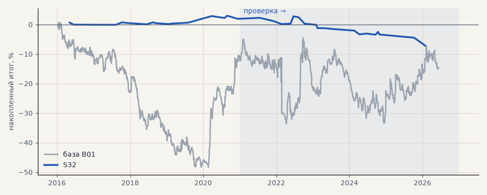

# S32. Вход по ложному пробою 20-дневного уровня

**Семейство:** стратегия без ML (импульс) · **база:** B01 · **гипотеза:** H47 · **вердикт:** хуже базы

**Что проверяли.** Новый вход против пробоя (Turtle Soup): час вышел за максимум 20 прошлых дней, но закрылся ниже него — шорт; зеркально — лонг. По гейту C, выход как у базы.

**Зачем.** Ложный пробой — сигнал возврата во флэте.

**Итог простыми словами.** Сделок мало, на проверке хуже базы на всех срезах; без гейта сильно убыточно.

**Издержки:** профиль `base` (спред и свопы брокера)

Подробности: [results/trend_filter_tz.md](../../results/trend_filter_tz.md)

Проверка — сделки, открытые с 1 января 2021 года; выбор — до 2021. В скобках — база на тех же инструментах.

| срез | период | сделок | итог % | выигрышей | ожидание на сделку | PF | без 2 лучших | просадка | t | лет в плюсе |
|---|---|---|---|---|---|---|---|---|---|---|
| все инструменты | проверка | 44 (1924) | -3.9 (-18.9) | 41% (41%) | -0.705% (-0.078%) | 0.55 (0.95) | -6.0 (-27.9) | -4.9 (-32.5) | -1.37 (-0.70) | 0/6 (1/6) |
| все инструменты | выбор | 30 (1196) | +2.4 (-41.1) | 57% (39%) | +0.644% (-0.275%) | 1.74 (0.79) | +0.4 (-45.8) | -0.8 (-59.1) | 1.13 (-3.02) | 4/5 (1/5) |
| портфель 4 | проверка | 21 (896) | -9.1 (-2.3) | 24% (42%) | -1.735% (-0.010%) | 0.31 (0.99) | -12.5 (-17.7) | -10.0 (-28.9) | -1.90 (-0.07) | 0/6 (3/6) |
| портфель 4 | выбор | 16 (665) | +1.9 (-12.3) | 44% (41%) | +0.481% (-0.074%) | 1.51 (0.94) | -1.2 (-21.8) | -1.1 (-49.1) | 0.60 (-0.55) | 3/5 (1/5) |
| металлы (серебро + золото) | проверка | 18 (506) | -17.4 (+41.3) | 28% (44%) | -1.936% (+0.163%) | 0.17 (1.17) | -20.3 (+23.2) | -17.4 (-28.5) | -2.64 (1.18) | 1/6 (5/6) |
| металлы (серебро + золото) | выбор | 10 (461) | +2.3 (-11.5) | 40% (38%) | +0.460% (-0.050%) | 1.63 (0.94) | -3.0 (-30.4) | -1.5 (-55.8) | 0.50 (-0.41) | 2/4 (1/5) |
| серебро | проверка | 11 (243) | -30.2 (+58.1) | 18% (46%) | -2.744% (+0.239%) | 0.14 (1.18) | -35.1 (+21.9) | -30.2 (-51.2) | -2.50 (0.94) | 0/6 (5/6) |
| серебро | выбор | 5 (218) | -1.4 (+25.4) | 20% (37%) | -0.287% (+0.117%) | 0.70 (1.11) | -4.8 (-12.4) | -3.0 (-66.8) | -0.27 (0.52) | 1/3 (2/5) |
| золото | проверка | 7 (263) | -4.7 (+24.5) | 43% (42%) | -0.667% (+0.093%) | 0.33 (1.15) | -6.9 (-2.2) | -4.7 (-39.2) | -1.19 (0.73) | 1/4 (2/6) |
| золото | выбор | 5 (243) | +6.0 (-48.4) | 60% (40%) | +1.207% (-0.199%) | 3.43 (0.73) | -2.2 (-63.4) | -2.2 (-69.1) | 0.78 (-1.80) | 1/3 (2/5) |
| LKOH | проверка | 2 (214) | -1.2 (-59.3) | 0% (40%) | -0.589% (-0.277%) | 0.00 (0.80) | -1.2 (-80.9) | -1.2 (-89.9) | -1.28 (-1.23) | 0/1 (1/6) |
| LKOH | выбор | 3 (132) | +2.5 (-2.6) | 67% (45%) | +0.834% (-0.020%) | 2.75 (0.99) | -1.4 (-28.8) | -1.4 (-48.4) | 0.69 (-0.06) | 1/2 (2/5) |
| GAZP | проверка | 5 (219) | -10.6 (-23.3) | 40% (42%) | -2.118% (-0.106%) | 0.15 (0.94) | -12.5 (-83.4) | -12.5 (-112.1) | -1.20 (-0.22) | 1/4 (3/6) |
| GAZP | выбор | 5 (154) | +9.4 (-14.2) | 60% (40%) | +1.875% (-0.092%) | 2.79 (0.93) | -2.7 (-41.0) | -4.2 (-52.8) | 0.85 (-0.34) | 2/3 (3/5) |
| SBER | проверка | 3 (220) | +5.5 (+15.2) | 33% (37%) | +1.835% (+0.069%) | 2.27 (1.06) | -3.6 (-12.0) | -4.3 (-45.1) | 0.45 (0.30) | 1/3 (2/6) |
| SBER | выбор | 3 (161) | -2.7 (-57.8) | 33% (45%) | -0.915% (-0.359%) | 0.20 (0.79) | -2.6 (-82.3) | -2.7 (-89.8) | -0.96 (-1.21) | 1/3 (2/5) |
| MOEX | проверка | 6 (227) | +3.2 (-93.7) | 67% (37%) | +0.536% (-0.413%) | 1.67 (0.71) | -2.9 (-117.4) | -2.5 (-93.7) | 0.50 (-1.93) | 3/4 (1/6) |
| MOEX | выбор | 6 (153) | +1.6 (-75.4) | 67% (39%) | +0.268% (-0.493%) | 1.18 (0.70) | -5.7 (-93.1) | -6.7 (-102.6) | 0.17 (-1.79) | 1/2 (1/5) |
| MTSS | проверка | 8 (196) | -1.5 (-48.1) | 50% (39%) | -0.189% (-0.245%) | 0.57 (0.83) | -3.1 (-86.9) | -2.7 (-54.5) | -0.59 (-0.93) | 3/5 (2/6) |
| MTSS | выбор | 3 (135) | +4.0 (-155.9) | 100% (32%) | +1.327% (-1.155%) | — (0.39) | +0.1 (-171.3) | +0.0 (-155.9) | 1.63 (-4.42) | 2/2 (0/5) |
| ETH | проверка | 2 (342) | +8.4 (-24.2) | 100% (44%) | +4.195% (-0.071%) | — (0.98) | +8.4 (-82.2) | +0.0 (-115.3) | 1.51 (-0.17) | 2/2 (4/6) |

Журнал сделок: `trades.csv.gz` (инструмент, прогон, сторона, вход, выход, цены, результат после издержек, причина выхода).
