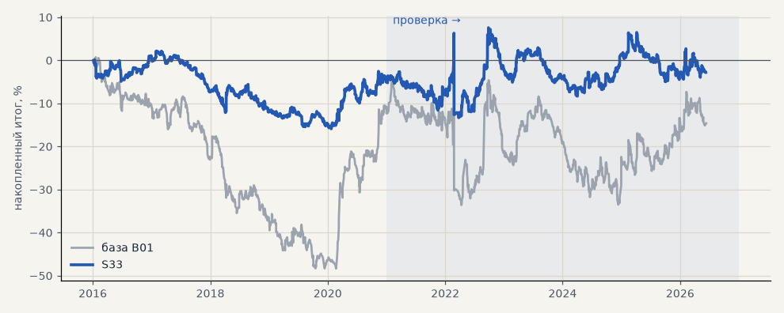

# S33. Выход по времени через 20 ч

**Семейство:** стратегия без ML (импульс) · **база:** B01 · **гипотеза:** H49 · **вердикт:** хуже базы на металлах (−29% против +41%); на акциях меньше свопов

**Что проверяли.** Вход как у базы, но сделка закрывается не позже чем через 20 часов (стоп и трейлинг базы). Из 13 выходов списка параметров ТЗ — по времени 10 / 20 / 50 ч, Chandelier, фиксированные стоп 1.5 / 2 / 3 ATR × тейк 2 / 3 / 4 ATR — лучший по 2016–2020 на всех рынках.

**Зачем.** ТЗ перечисляет популярные выходы; база держит позицию до 10 дней.

**Итог простыми словами.** Металлы на проверке −29% против +41% у базы. На всех рынках лучше (−10% против −19%) только потому, что акции через CFD меньше платят свопов; на акциях на бирже это уже решено S25.

**Издержки:** профиль `base` (спред и свопы брокера)

Подробности: [results/trend_filter_tz.md](../../results/trend_filter_tz.md)

Проверка — сделки, открытые с 1 января 2021 года; выбор — до 2021. В скобках — база на тех же инструментах.

| срез | период | сделок | итог % | выигрышей | ожидание на сделку | PF | без 2 лучших | просадка | t | лет в плюсе |
|---|---|---|---|---|---|---|---|---|---|---|
| все инструменты | проверка | 3535 (1924) | -9.9 (-18.9) | 44% (41%) | -0.023% (-0.078%) | 0.97 (0.95) | -14.5 (-27.9) | -22.1 (-32.5) | -0.56 (-0.70) | 2/6 (1/6) |
| все инструменты | выбор | 2115 (1196) | -12.0 (-41.1) | 43% (39%) | -0.045% (-0.275%) | 0.90 (0.79) | -14.5 (-45.8) | -16.8 (-59.1) | -1.68 (-3.02) | 1/5 (1/5) |
| портфель 4 | проверка | 1659 (896) | +2.1 (-2.3) | 45% (42%) | +0.005% (-0.010%) | 1.01 (0.99) | -6.2 (-17.7) | -19.6 (-28.9) | 0.08 (-0.07) | 3/6 (3/6) |
| портфель 4 | выбор | 1185 (665) | -4.9 (-12.3) | 44% (41%) | -0.016% (-0.074%) | 0.97 (0.94) | -9.9 (-21.8) | -18.1 (-49.1) | -0.41 (-0.55) | 2/5 (1/5) |
| металлы (серебро + золото) | проверка | 983 (506) | -29.2 (+41.3) | 42% (44%) | -0.059% (+0.163%) | 0.88 (1.17) | -40.3 (+23.2) | -56.3 (-28.5) | -1.26 (1.18) | 3/6 (5/6) |
| металлы (серебро + золото) | выбор | 806 (461) | -25.2 (-11.5) | 39% (38%) | -0.063% (-0.050%) | 0.83 (0.94) | -31.0 (-30.4) | -42.0 (-55.8) | -1.78 (-0.41) | 2/5 (1/5) |
| серебро | проверка | 477 (243) | -20.0 (+58.1) | 43% (46%) | -0.042% (+0.239%) | 0.94 (1.18) | -42.1 (+21.9) | -67.2 (-51.2) | -0.47 (0.94) | 1/6 (5/6) |
| серебро | выбор | 364 (218) | -20.9 (+25.4) | 39% (37%) | -0.057% (+0.117%) | 0.88 (1.11) | -32.6 (-12.4) | -42.9 (-66.8) | -0.88 (0.52) | 2/5 (2/5) |
| золото | проверка | 506 (263) | -38.4 (+24.5) | 42% (42%) | -0.076% (+0.093%) | 0.78 (1.15) | -43.6 (-2.2) | -53.5 (-39.2) | -2.05 (0.73) | 3/6 (2/6) |
| золото | выбор | 442 (243) | -29.5 (-48.4) | 39% (40%) | -0.067% (-0.199%) | 0.77 (0.73) | -38.8 (-63.4) | -46.0 (-69.1) | -1.88 (-1.80) | 1/5 (2/5) |
| LKOH | проверка | 392 (214) | -7.3 (-59.3) | 47% (40%) | -0.019% (-0.277%) | 0.96 (0.80) | -21.6 (-80.9) | -28.7 (-89.9) | -0.26 (-1.23) | 2/6 (1/6) |
| LKOH | выбор | 245 (132) | +37.4 (-2.6) | 51% (45%) | +0.153% (-0.020%) | 1.42 (0.99) | +25.7 (-28.8) | -13.0 (-48.4) | 1.90 (-0.06) | 3/5 (2/5) |
| GAZP | проверка | 386 (219) | -28.1 (-23.3) | 45% (42%) | -0.073% (-0.106%) | 0.90 (0.94) | -47.2 (-83.4) | -75.7 (-112.1) | -0.33 (-0.22) | 3/6 (3/6) |
| GAZP | выбор | 272 (154) | -14.2 (-14.2) | 43% (40%) | -0.052% (-0.092%) | 0.89 (0.93) | -28.8 (-41.0) | -23.3 (-52.8) | -0.65 (-0.34) | 2/5 (3/5) |
| SBER | проверка | 404 (220) | +63.8 (+15.2) | 46% (37%) | +0.158% (+0.069%) | 1.39 (1.06) | +36.8 (-12.0) | -35.9 (-45.1) | 1.87 (0.30) | 3/6 (2/6) |
| SBER | выбор | 304 (161) | -21.8 (-57.8) | 46% (45%) | -0.072% (-0.359%) | 0.88 (0.79) | -39.2 (-82.3) | -30.6 (-89.8) | -0.76 (-1.21) | 1/5 (2/5) |
| MOEX | проверка | 413 (227) | -37.8 (-93.7) | 40% (37%) | -0.091% (-0.413%) | 0.83 (0.71) | -56.6 (-117.4) | -42.2 (-93.7) | -1.25 (-1.93) | 1/6 (1/6) |
| MOEX | выбор | 263 (153) | -6.2 (-75.4) | 50% (39%) | -0.023% (-0.493%) | 0.95 (0.70) | -11.9 (-93.1) | -14.0 (-102.6) | -0.33 (-1.79) | 1/5 (1/5) |
| MTSS | проверка | 351 (196) | -33.7 (-48.1) | 40% (39%) | -0.096% (-0.245%) | 0.83 (0.83) | -51.6 (-86.9) | -48.4 (-54.5) | -1.17 (-0.93) | 2/6 (2/6) |
| MTSS | выбор | 225 (135) | -40.5 (-155.9) | 41% (32%) | -0.180% (-1.155%) | 0.69 (0.39) | -51.1 (-171.3) | -40.9 (-155.9) | -2.06 (-4.42) | 1/5 (0/5) |
| ETH | проверка | 606 (342) | +21.9 (-24.2) | 46% (44%) | +0.036% (-0.071%) | 1.03 (0.98) | -10.7 (-82.2) | -78.6 (-115.3) | 0.26 (-0.17) | 4/6 (4/6) |

Журнал сделок: `trades.csv.gz` (инструмент, прогон, сторона, вход, выход, цены, результат после издержек, причина выхода).
