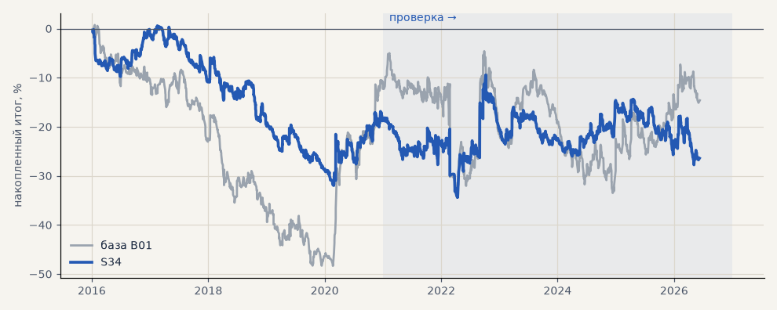

# S34. Chandelier: трейлинг 3 ATR с первой минуты

**Семейство:** стратегия без ML (импульс) · **база:** B01 · **гипотеза:** H49 · **вердикт:** хуже базы

**Что проверяли.** Chandelier exit: стоп 3 ATR и трейлинг 3 ATR от лучшей цены с первой минуты сделки (аналог «максимум за 22 бара − 3 ATR»).

**Зачем.** Классический выход следования тренду из ТЗ.

**Итог простыми словами.** Хуже базы во всех срезах: металлы −27% против +41%. Узкий трейлинг обрезает крупные движения — как и S11.

**Издержки:** профиль `base` (спред и свопы брокера)

Подробности: [results/trend_filter_tz.md](../../results/trend_filter_tz.md)

Проверка — сделки, открытые с 1 января 2021 года; выбор — до 2021. В скобках — база на тех же инструментах.

| срез | период | сделок | итог % | выигрышей | ожидание на сделку | PF | без 2 лучших | просадка | t | лет в плюсе |
|---|---|---|---|---|---|---|---|---|---|---|
| все инструменты | проверка | 3280 (1924) | -20.6 (-18.9) | 35% (41%) | -0.050% (-0.078%) | 0.93 (0.95) | -30.0 (-27.9) | -28.2 (-32.5) | -1.13 (-0.70) | 2/6 (1/6) |
| все инструменты | выбор | 1864 (1196) | -33.9 (-41.1) | 32% (39%) | -0.146% (-0.275%) | 0.79 (0.79) | -37.4 (-45.8) | -40.5 (-59.1) | -3.44 (-3.02) | 1/5 (1/5) |
| портфель 4 | проверка | 1484 (896) | -8.0 (-2.3) | 36% (42%) | -0.021% (-0.010%) | 0.97 (0.99) | -22.0 (-17.7) | -18.3 (-28.9) | -0.32 (-0.07) | 2/6 (3/6) |
| портфель 4 | выбор | 1030 (665) | -18.4 (-12.3) | 33% (41%) | -0.072% (-0.074%) | 0.90 (0.94) | -25.5 (-21.8) | -32.6 (-49.1) | -1.09 (-0.55) | 1/5 (1/5) |
| металлы (серебро + золото) | проверка | 906 (506) | -26.7 (+41.3) | 33% (44%) | -0.059% (+0.163%) | 0.90 (1.17) | -38.9 (+23.2) | -44.0 (-28.5) | -1.06 (1.18) | 1/6 (5/6) |
| металлы (серебро + золото) | выбор | 758 (461) | -24.4 (-11.5) | 31% (38%) | -0.064% (-0.050%) | 0.84 (0.94) | -35.2 (-30.4) | -41.5 (-55.8) | -1.47 (-0.41) | 2/5 (1/5) |
| серебро | проверка | 433 (243) | -16.2 (+58.1) | 34% (46%) | -0.037% (+0.239%) | 0.95 (1.18) | -40.6 (+21.9) | -40.8 (-51.2) | -0.36 (0.94) | 2/6 (5/6) |
| серебро | выбор | 344 (218) | -6.1 (+25.4) | 33% (37%) | -0.018% (+0.117%) | 0.96 (1.11) | -27.7 (-12.4) | -43.8 (-66.8) | -0.21 (0.52) | 2/5 (2/5) |
| золото | проверка | 473 (263) | -37.2 (+24.5) | 32% (42%) | -0.079% (+0.093%) | 0.82 (1.15) | -52.2 (-2.2) | -53.9 (-39.2) | -1.58 (0.73) | 2/6 (2/6) |
| золото | выбор | 414 (243) | -42.7 (-48.4) | 30% (40%) | -0.103% (-0.199%) | 0.69 (0.73) | -49.6 (-63.4) | -51.5 (-69.1) | -2.77 (-1.80) | 1/5 (2/5) |
| LKOH | проверка | 343 (214) | -30.8 (-59.3) | 36% (40%) | -0.090% (-0.277%) | 0.87 (0.80) | -54.1 (-80.9) | -42.0 (-89.9) | -0.80 (-1.23) | 1/6 (1/6) |
| LKOH | выбор | 201 (132) | +13.5 (-2.6) | 38% (45%) | +0.067% (-0.020%) | 1.09 (0.99) | -10.7 (-28.8) | -42.3 (-48.4) | 0.40 (-0.06) | 2/5 (2/5) |
| GAZP | проверка | 344 (219) | +15.3 (-23.3) | 37% (42%) | +0.045% (-0.106%) | 1.05 (0.94) | -38.5 (-83.4) | -53.5 (-112.1) | 0.22 (-0.22) | 3/6 (3/6) |
| GAZP | выбор | 233 (154) | -32.1 (-14.2) | 33% (40%) | -0.138% (-0.092%) | 0.83 (0.93) | -57.2 (-41.0) | -39.3 (-52.8) | -1.00 (-0.34) | 2/5 (3/5) |
| SBER | проверка | 364 (220) | -0.2 (+15.2) | 35% (37%) | -0.001% (+0.069%) | 1.00 (1.06) | -22.1 (-12.0) | -30.4 (-45.1) | -0.01 (0.30) | 3/6 (2/6) |
| SBER | выбор | 252 (161) | -49.1 (-57.8) | 31% (45%) | -0.195% (-0.359%) | 0.80 (0.79) | -75.7 (-82.3) | -64.2 (-89.8) | -1.26 (-1.21) | 0/5 (2/5) |
| MOEX | проверка | 389 (227) | -124.9 (-93.7) | 32% (37%) | -0.321% (-0.413%) | 0.57 (0.71) | -138.0 (-117.4) | -124.9 (-93.7) | -4.04 (-1.93) | 1/6 (1/6) |
| MOEX | выбор | 225 (153) | -44.3 (-75.4) | 35% (39%) | -0.197% (-0.493%) | 0.75 (0.70) | -58.5 (-93.1) | -63.1 (-102.6) | -1.64 (-1.79) | 1/5 (1/5) |
| MTSS | проверка | 317 (196) | -50.3 (-48.1) | 30% (39%) | -0.159% (-0.245%) | 0.78 (0.83) | -90.2 (-86.9) | -66.2 (-54.5) | -1.22 (-0.93) | 2/6 (2/6) |
| MTSS | выбор | 195 (135) | -110.5 (-155.9) | 28% (32%) | -0.567% (-1.155%) | 0.46 (0.39) | -125.2 (-171.3) | -110.5 (-155.9) | -4.27 (-4.42) | 1/5 (0/5) |
| ETH | проверка | 617 (342) | +79.4 (-24.2) | 38% (44%) | +0.129% (-0.071%) | 1.11 (0.98) | +18.6 (-82.2) | -57.2 (-115.3) | 0.86 (-0.17) | 5/6 (4/6) |

Журнал сделок: `trades.csv.gz` (инструмент, прогон, сторона, вход, выход, цены, результат после издержек, причина выхода).
