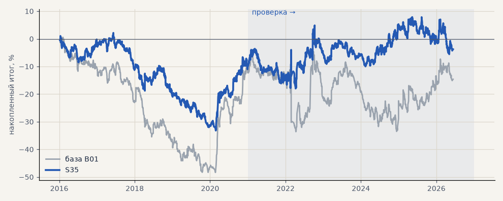

# S35. Фиксированные стоп 3 ATR и тейк 4 ATR

**Семейство:** стратегия без ML (импульс) · **база:** B01 · **гипотеза:** H49 · **вердикт:** хуже базы на металлах

**Что проверяли.** Без трейлинга: стоп 3 ATR и тейк 4 ATR, выход не позже 240 ч. Лучшая на выборе из 9 пар стоп × тейк.

**Зачем.** Фиксированный тейк из ТЗ.

**Итог простыми словами.** Металлы +5% против +41%; узкие стопы (1.5–2 ATR) хуже ещё сильнее. Прибыль импульса — от редких крупных ходов, тейк их обрезает.

**Издержки:** профиль `base` (спред и свопы брокера)

Подробности: [results/trend_filter_tz.md](../../results/trend_filter_tz.md)

Проверка — сделки, открытые с 1 января 2021 года; выбор — до 2021. В скобках — база на тех же инструментах.

| срез | период | сделок | итог % | выигрышей | ожидание на сделку | PF | без 2 лучших | просадка | t | лет в плюсе |
|---|---|---|---|---|---|---|---|---|---|---|
| все инструменты | проверка | 3213 (1924) | -21.0 (-18.9) | 47% (41%) | -0.052% (-0.078%) | 0.95 (0.95) | -25.2 (-27.9) | -28.4 (-32.5) | -1.08 (-0.70) | 2/6 (1/6) |
| все инструменты | выбор | 1872 (1196) | -33.6 (-41.1) | 47% (39%) | -0.144% (-0.275%) | 0.85 (0.79) | -36.2 (-45.8) | -44.4 (-59.1) | -3.11 (-3.02) | 1/5 (1/5) |
| портфель 4 | проверка | 1481 (896) | +6.4 (-2.3) | 50% (42%) | +0.017% (-0.010%) | 1.02 (0.99) | -2.0 (-17.7) | -14.8 (-28.9) | 0.25 (-0.07) | 2/6 (3/6) |
| портфель 4 | выбор | 1038 (665) | -10.2 (-12.3) | 49% (41%) | -0.039% (-0.074%) | 0.96 (0.94) | -15.4 (-21.8) | -35.3 (-49.1) | -0.58 (-0.55) | 1/5 (1/5) |
| металлы (серебро + золото) | проверка | 892 (506) | +4.6 (+41.3) | 48% (44%) | +0.010% (+0.163%) | 1.01 (1.17) | -6.8 (+23.2) | -23.5 (-28.5) | 0.16 (1.18) | 4/6 (5/6) |
| металлы (серебро + золото) | выбор | 763 (461) | -31.0 (-11.5) | 46% (38%) | -0.081% (-0.050%) | 0.86 (0.94) | -37.2 (-30.4) | -38.3 (-55.8) | -1.74 (-0.41) | 1/5 (1/5) |
| серебро | проверка | 421 (243) | +59.1 (+58.1) | 51% (46%) | +0.140% (+0.239%) | 1.14 (1.18) | +36.4 (+21.9) | -34.5 (-51.2) | 1.15 (0.94) | 5/6 (5/6) |
| серебро | выбор | 354 (218) | -20.6 (+25.4) | 48% (37%) | -0.058% (+0.117%) | 0.92 (1.11) | -33.0 (-12.4) | -49.7 (-66.8) | -0.67 (0.52) | 1/5 (2/5) |
| золото | проверка | 471 (263) | -49.9 (+24.5) | 46% (42%) | -0.106% (+0.093%) | 0.81 (1.15) | -56.0 (-2.2) | -55.9 (-39.2) | -2.05 (0.73) | 0/6 (2/6) |
| золото | выбор | 409 (243) | -41.5 (-48.4) | 45% (40%) | -0.101% (-0.199%) | 0.78 (0.73) | -46.7 (-63.4) | -47.2 (-69.1) | -2.23 (-1.80) | 0/5 (2/5) |
| LKOH | проверка | 344 (214) | -57.6 (-59.3) | 46% (40%) | -0.167% (-0.277%) | 0.84 (0.80) | -71.4 (-80.9) | -71.0 (-89.9) | -1.39 (-1.23) | 1/6 (1/6) |
| LKOH | выбор | 204 (132) | +43.5 (-2.6) | 53% (45%) | +0.213% (-0.020%) | 1.22 (0.99) | +22.6 (-28.8) | -37.6 (-48.4) | 1.25 (-0.06) | 2/5 (2/5) |
| GAZP | проверка | 351 (219) | -30.1 (-23.3) | 50% (42%) | -0.086% (-0.106%) | 0.93 (0.94) | -47.4 (-83.4) | -92.9 (-112.1) | -0.48 (-0.22) | 3/6 (3/6) |
| GAZP | выбор | 223 (154) | -27.6 (-14.2) | 49% (40%) | -0.124% (-0.092%) | 0.88 (0.93) | -37.1 (-41.0) | -41.6 (-52.8) | -0.85 (-0.34) | 1/5 (3/5) |
| SBER | проверка | 365 (220) | +54.2 (+15.2) | 51% (37%) | +0.148% (+0.069%) | 1.19 (1.06) | +26.4 (-12.0) | -32.2 (-45.1) | 1.26 (0.30) | 2/6 (2/6) |
| SBER | выбор | 257 (161) | -36.0 (-57.8) | 48% (45%) | -0.140% (-0.359%) | 0.89 (0.79) | -49.9 (-82.3) | -64.8 (-89.8) | -0.88 (-1.21) | 1/5 (2/5) |
| MOEX | проверка | 366 (227) | -65.1 (-93.7) | 46% (37%) | -0.178% (-0.413%) | 0.83 (0.71) | -77.6 (-117.4) | -65.3 (-93.7) | -1.55 (-1.93) | 1/6 (1/6) |
| MOEX | выбор | 233 (153) | -53.4 (-75.4) | 47% (39%) | -0.229% (-0.493%) | 0.81 (0.70) | -62.4 (-93.1) | -62.4 (-102.6) | -1.52 (-1.79) | 1/5 (1/5) |
| MTSS | проверка | 299 (196) | -84.2 (-48.1) | 42% (39%) | -0.282% (-0.245%) | 0.74 (0.83) | -103.2 (-86.9) | -87.3 (-54.5) | -2.22 (-0.93) | 1/6 (2/6) |
| MTSS | выбор | 192 (135) | -133.4 (-155.9) | 38% (32%) | -0.695% (-1.155%) | 0.51 (0.39) | -143.1 (-171.3) | -133.4 (-155.9) | -4.25 (-4.42) | 0/5 (0/5) |
| ETH | проверка | 596 (342) | +5.8 (-24.2) | 46% (44%) | +0.010% (-0.071%) | 1.01 (0.98) | -13.1 (-82.2) | -89.7 (-115.3) | 0.06 (-0.17) | 3/6 (4/6) |

Журнал сделок: `trades.csv.gz` (инструмент, прогон, сторона, вход, выход, цены, результат после издержек, причина выхода).
