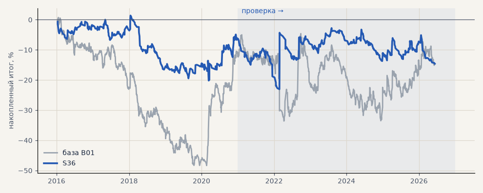

# S36. Новая стратегия №1 перебора (металлы)

**Семейство:** новые стратегии из блоков ТЗ (перебор) · **база:** B01 · **гипотеза:** H50 · **вердикт:** хуже базы: металлы −31% против +41% (на выборе +36% — подгонка)

**Что проверяли.** Самостоятельная стратегия из блоков ТЗ 15.10, найденная перебором (scripts/strategy_search.py): вход: пробой 20 дней + 0.25 ATR · фильтр: ADX 1ч > 25 + ADX 1ч > 25 · выход: Supertrend 4ч · стоп 3 · ATR10. Сделки — штатный минутный симулятор.

**Зачем.** Одна из лучших по устойчивой оценке (медиана PF пробы и соседей) среза «металлы» на выборе 2016–2020.

**Итог простыми словами.** Минутный симулятор: металлы на выборе +35.9% (PF 1.62), на проверке −31.1% (PF 0.71) против +41.3% у B01; без 2 лучших −45%. Лучшее на выборе не переносится на проверку.

**Издержки:** профиль `base` (спред и свопы брокера)

Подробности: [results/strategy_search.md](../../results/strategy_search.md)

Проверка — сделки, открытые с 1 января 2021 года; выбор — до 2021. В скобках — база на тех же инструментах.

| срез | период | сделок | итог % | выигрышей | ожидание на сделку | PF | без 2 лучших | просадка | t | лет в плюсе |
|---|---|---|---|---|---|---|---|---|---|---|
| все инструменты | проверка | 746 (1924) | -8.4 (-18.9) | 29% (41%) | -0.091% (-0.078%) | 0.94 (0.95) | -18.8 (-27.9) | -22.0 (-32.5) | -0.47 (-0.70) | 3/6 (1/6) |
| все инструменты | выбор | 535 (1196) | -16.9 (-41.1) | 32% (39%) | -0.252% (-0.275%) | 0.80 (0.79) | -21.9 (-45.8) | -25.8 (-59.1) | -1.83 (-3.02) | 1/5 (1/5) |
| портфель 4 | проверка | 360 (896) | -8.5 (-2.3) | 30% (42%) | -0.095% (-0.010%) | 0.93 (0.99) | -24.3 (-17.7) | -17.0 (-28.9) | -0.44 (-0.07) | 3/6 (3/6) |
| портфель 4 | выбор | 304 (665) | -6.1 (-12.3) | 34% (41%) | -0.080% (-0.074%) | 0.94 (0.94) | -16.2 (-21.8) | -21.6 (-49.1) | -0.38 (-0.55) | 2/5 (1/5) |
| металлы (серебро + золото) | проверка | 196 (506) | -31.1 (+41.3) | 26% (44%) | -0.317% (+0.163%) | 0.71 (1.17) | -44.6 (+23.2) | -41.8 (-28.5) | -1.60 (1.18) | 2/6 (5/6) |
| металлы (серебро + золото) | выбор | 175 (461) | +35.9 (-11.5) | 35% (38%) | +0.410% (-0.050%) | 1.62 (0.94) | +15.6 (-30.4) | -9.8 (-55.8) | 1.77 (-0.41) | 4/5 (1/5) |
| серебро | проверка | 91 (243) | -64.9 (+58.1) | 29% (46%) | -0.713% (+0.239%) | 0.53 (1.18) | -83.4 (+21.9) | -70.0 (-51.2) | -2.16 (0.94) | 1/6 (5/6) |
| серебро | выбор | 82 (218) | +65.7 (+25.4) | 37% (37%) | +0.801% (+0.117%) | 1.92 (1.11) | +25.1 (-12.4) | -11.5 (-66.8) | 1.74 (0.52) | 4/5 (2/5) |
| золото | проверка | 105 (263) | +2.7 (+24.5) | 23% (42%) | +0.026% (+0.093%) | 1.04 (1.15) | -19.2 (-2.2) | -18.2 (-39.2) | 0.11 (0.73) | 2/6 (2/6) |
| золото | выбор | 93 (243) | +6.1 (-48.4) | 33% (40%) | +0.066% (-0.199%) | 1.14 (0.73) | -5.8 (-63.4) | -12.6 (-69.1) | 0.42 (-1.80) | 3/5 (2/5) |
| LKOH | проверка | 91 (214) | +2.8 (-59.3) | 35% (40%) | +0.031% (-0.277%) | 1.03 (0.80) | -24.9 (-80.9) | -24.6 (-89.9) | 0.09 (-1.23) | 2/6 (1/6) |
| LKOH | выбор | 66 (132) | -21.1 (-2.6) | 35% (45%) | -0.320% (-0.020%) | 0.76 (0.99) | -41.7 (-28.8) | -37.0 (-48.4) | -0.86 (-0.06) | 2/5 (2/5) |
| GAZP | проверка | 81 (219) | +28.8 (-23.3) | 33% (42%) | +0.356% (-0.106%) | 1.28 (0.94) | -14.0 (-83.4) | -23.5 (-112.1) | 0.65 (-0.22) | 3/6 (3/6) |
| GAZP | выбор | 74 (154) | -30.0 (-14.2) | 31% (40%) | -0.405% (-0.092%) | 0.72 (0.93) | -54.7 (-41.0) | -33.2 (-52.8) | -1.02 (-0.34) | 1/5 (3/5) |
| SBER | проверка | 97 (220) | -0.9 (+15.2) | 24% (37%) | -0.009% (+0.069%) | 0.99 (1.06) | -49.7 (-12.0) | -33.4 (-45.1) | -0.02 (0.30) | 2/6 (2/6) |
| SBER | выбор | 82 (161) | -38.8 (-57.8) | 32% (45%) | -0.473% (-0.359%) | 0.72 (0.79) | -58.4 (-82.3) | -62.3 (-89.8) | -1.15 (-1.21) | 1/5 (2/5) |
| MOEX | проверка | 88 (227) | -15.5 (-93.7) | 30% (37%) | -0.176% (-0.413%) | 0.87 (0.71) | -51.7 (-117.4) | -43.2 (-93.7) | -0.41 (-1.93) | 3/6 (1/6) |
| MOEX | выбор | 70 (153) | -48.6 (-75.4) | 31% (39%) | -0.694% (-0.493%) | 0.56 (0.70) | -69.0 (-93.1) | -66.8 (-102.6) | -1.87 (-1.79) | 1/5 (1/5) |
| MTSS | проверка | 72 (196) | -10.7 (-48.1) | 32% (39%) | -0.148% (-0.245%) | 0.90 (0.83) | -33.6 (-86.9) | -27.7 (-54.5) | -0.31 (-0.93) | 2/6 (2/6) |
| MTSS | выбор | 68 (135) | -68.2 (-155.9) | 22% (32%) | -1.003% (-1.155%) | 0.36 (0.39) | -81.0 (-171.3) | -77.2 (-155.9) | -3.20 (-4.42) | 1/5 (0/5) |
| ETH | проверка | 121 (342) | -10.0 (-24.2) | 26% (44%) | -0.083% (-0.071%) | 0.97 (0.98) | -87.4 (-82.2) | -82.7 (-115.3) | -0.09 (-0.17) | 3/6 (4/6) |

Журнал сделок: `trades.csv.gz` (инструмент, прогон, сторона, вход, выход, цены, результат после издержек, причина выхода).
