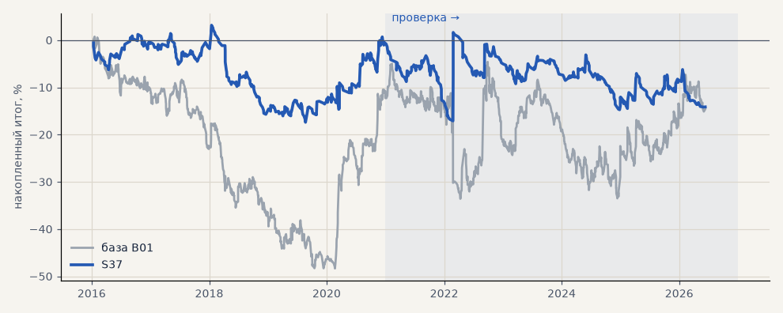

# S37. Новая стратегия №2 перебора (металлы)

**Семейство:** новые стратегии из блоков ТЗ (перебор) · **база:** B01 · **гипотеза:** H50 · **вердикт:** хуже базы: металлы −30% против +41% (на выборе +41% — подгонка)

**Что проверяли.** Самостоятельная стратегия из блоков ТЗ 15.10, найденная перебором (scripts/strategy_search.py): вход: пробой 20 дней + 0.25 ATR · фильтр: ADX 1ч > 20 + ADX 1ч > 25 · выход: Supertrend 4ч · стоп 3 · ATR20. Сделки — штатный минутный симулятор.

**Зачем.** Одна из лучших по устойчивой оценке (медиана PF пробы и соседей) среза «металлы» на выборе 2016–2020.

**Итог простыми словами.** Минутный симулятор: металлы на выборе +41.4% (PF 1.79), на проверке −29.6% (PF 0.71) против +41.3% у B01.

**Издержки:** профиль `base` (спред и свопы брокера)

Подробности: [results/strategy_search.md](../../results/strategy_search.md)

Проверка — сделки, открытые с 1 января 2021 года; выбор — до 2021. В скобках — база на тех же инструментах.

| срез | период | сделок | итог % | выигрышей | ожидание на сделку | PF | без 2 лучших | просадка | t | лет в плюсе |
|---|---|---|---|---|---|---|---|---|---|---|
| все инструменты | проверка | 753 (1924) | -5.1 (-18.9) | 28% (41%) | -0.054% (-0.078%) | 0.96 (0.95) | -15.5 (-27.9) | -16.3 (-32.5) | -0.29 (-0.70) | 3/6 (1/6) |
| все инструменты | выбор | 532 (1196) | -13.3 (-41.1) | 32% (39%) | -0.199% (-0.275%) | 0.84 (0.79) | -18.3 (-45.8) | -21.9 (-59.1) | -1.46 (-3.02) | 1/5 (1/5) |
| портфель 4 | проверка | 364 (896) | -13.7 (-2.3) | 29% (42%) | -0.151% (-0.010%) | 0.88 (0.99) | -29.5 (-17.7) | -16.7 (-28.9) | -0.71 (-0.07) | 2/6 (3/6) |
| портфель 4 | выбор | 302 (665) | -0.4 (-12.3) | 34% (41%) | -0.005% (-0.074%) | 1.00 (0.94) | -10.5 (-21.8) | -20.6 (-49.1) | -0.03 (-0.55) | 2/5 (1/5) |
| металлы (серебро + золото) | проверка | 196 (506) | -29.6 (+41.3) | 26% (44%) | -0.302% (+0.163%) | 0.71 (1.17) | -43.1 (+23.2) | -41.6 (-28.5) | -1.60 (1.18) | 2/6 (5/6) |
| металлы (серебро + золото) | выбор | 170 (461) | +41.4 (-11.5) | 35% (38%) | +0.488% (-0.050%) | 1.79 (0.94) | +21.2 (-30.4) | -8.8 (-55.8) | 2.06 (-0.41) | 4/5 (1/5) |
| серебро | проверка | 93 (243) | -70.9 (+58.1) | 26% (46%) | -0.762% (+0.239%) | 0.48 (1.18) | -89.3 (+21.9) | -76.0 (-51.2) | -2.54 (0.94) | 1/6 (5/6) |
| серебро | выбор | 79 (218) | +73.4 (+25.4) | 37% (37%) | +0.929% (+0.117%) | 2.14 (1.11) | +32.9 (-12.4) | -10.1 (-66.8) | 1.96 (0.52) | 4/5 (2/5) |
| золото | проверка | 103 (263) | +11.6 (+24.5) | 25% (42%) | +0.113% (+0.093%) | 1.17 (1.15) | -10.3 (-2.2) | -15.3 (-39.2) | 0.49 (0.73) | 3/6 (2/6) |
| золото | выбор | 91 (243) | +9.5 (-48.4) | 34% (40%) | +0.104% (-0.199%) | 1.23 (0.73) | -2.4 (-63.4) | -10.5 (-69.1) | 0.67 (-1.80) | 3/5 (2/5) |
| LKOH | проверка | 91 (214) | +4.3 (-59.3) | 35% (40%) | +0.047% (-0.277%) | 1.04 (0.80) | -23.5 (-80.9) | -23.6 (-89.9) | 0.14 (-1.23) | 2/6 (1/6) |
| LKOH | выбор | 66 (132) | -12.8 (-2.6) | 38% (45%) | -0.194% (-0.020%) | 0.84 (0.99) | -33.4 (-28.8) | -31.0 (-48.4) | -0.53 (-0.06) | 2/5 (2/5) |
| GAZP | проверка | 83 (219) | +19.0 (-23.3) | 31% (42%) | +0.229% (-0.106%) | 1.17 (0.94) | -23.8 (-83.4) | -22.7 (-112.1) | 0.43 (-0.22) | 3/6 (3/6) |
| GAZP | выбор | 75 (154) | -27.8 (-14.2) | 29% (40%) | -0.370% (-0.092%) | 0.74 (0.93) | -52.6 (-41.0) | -34.0 (-52.8) | -0.97 (-0.34) | 1/5 (3/5) |
| SBER | проверка | 97 (220) | -7.3 (+15.2) | 23% (37%) | -0.076% (+0.069%) | 0.94 (1.06) | -56.2 (-12.0) | -39.5 (-45.1) | -0.16 (0.30) | 2/6 (2/6) |
| SBER | выбор | 82 (161) | -34.5 (-57.8) | 33% (45%) | -0.420% (-0.359%) | 0.75 (0.79) | -54.0 (-82.3) | -58.5 (-89.8) | -1.03 (-1.21) | 2/5 (2/5) |
| MOEX | проверка | 92 (227) | -36.9 (-93.7) | 26% (37%) | -0.401% (-0.413%) | 0.72 (0.71) | -73.1 (-117.4) | -55.9 (-93.7) | -0.96 (-1.93) | 3/6 (1/6) |
| MOEX | выбор | 71 (153) | -46.3 (-75.4) | 31% (39%) | -0.653% (-0.493%) | 0.57 (0.70) | -66.7 (-93.1) | -62.7 (-102.6) | -1.86 (-1.79) | 1/5 (1/5) |
| MTSS | проверка | 72 (196) | -13.0 (-48.1) | 31% (39%) | -0.180% (-0.245%) | 0.88 (0.83) | -36.0 (-86.9) | -32.2 (-54.5) | -0.39 (-0.93) | 2/6 (2/6) |
| MTSS | выбор | 68 (135) | -67.5 (-155.9) | 24% (32%) | -0.993% (-1.155%) | 0.37 (0.39) | -80.3 (-171.3) | -73.3 (-155.9) | -3.27 (-4.42) | 0/5 (0/5) |
| ETH | проверка | 122 (342) | +52.4 (-24.2) | 27% (44%) | +0.430% (-0.071%) | 1.16 (0.98) | -25.0 (-82.2) | -55.1 (-115.3) | 0.50 (-0.17) | 4/6 (4/6) |

Журнал сделок: `trades.csv.gz` (инструмент, прогон, сторона, вход, выход, цены, результат после издержек, причина выхода).
