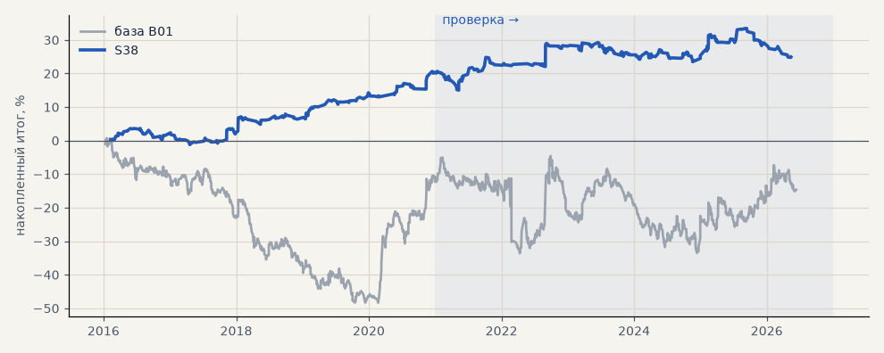

# S38. Новая стратегия №3 перебора (портфель 4)

**Семейство:** новые стратегии из блоков ТЗ (перебор) · **база:** B01 · **гипотеза:** H50 · **вердикт:** хуже базы на металлах (−5%); портфель 4 +5% против −2%, но t 0.4 — шум

**Что проверяли.** Самостоятельная стратегия из блоков ТЗ 15.10, найденная перебором (scripts/strategy_search.py): вход: keltner:20:10:2 @24h · фильтр: ATR14/ATR100 > 1 + только лонг · выход: трейлинг 3 · ATR10 · размер по риску. Сделки — штатный минутный симулятор.

**Зачем.** Одна из лучших по устойчивой оценке (медиана PF пробы и соседей) среза «портфель 4» на выборе 2016–2020.

**Итог простыми словами.** Минутный симулятор: портфель 4 на выборе +20.4% (PF 1.68), на проверке +4.6% (PF 1.08, t 0.4) против −2.3% у B01; металлы −5.2% против +41.3%.

**Издержки:** профиль `base` (спред и свопы брокера)

Подробности: [results/strategy_search.md](../../results/strategy_search.md)

Проверка — сделки, открытые с 1 января 2021 года; выбор — до 2021. В скобках — база на тех же инструментах.

| срез | период | сделок | итог % | выигрышей | ожидание на сделку | PF | без 2 лучших | просадка | t | лет в плюсе |
|---|---|---|---|---|---|---|---|---|---|---|
| все инструменты | проверка | 644 (1924) | -5.6 (-18.9) | 34% (41%) | -0.069% (-0.078%) | 0.92 (0.95) | -10.6 (-27.9) | -14.1 (-32.5) | -0.69 (-0.70) | 3/6 (1/6) |
| все инструменты | выбор | 394 (1196) | +7.1 (-41.1) | 45% (39%) | +0.145% (-0.275%) | 1.24 (0.79) | +4.5 (-45.8) | -3.9 (-59.1) | 1.57 (-3.02) | 4/5 (1/5) |
| портфель 4 | проверка | 295 (896) | +4.6 (-2.3) | 35% (42%) | +0.062% (-0.010%) | 1.08 (0.99) | -5.0 (-17.7) | -8.6 (-28.9) | 0.40 (-0.07) | 3/6 (3/6) |
| портфель 4 | выбор | 220 (665) | +20.4 (-12.3) | 49% (41%) | +0.370% (-0.074%) | 1.68 (0.94) | +15.2 (-21.8) | -4.9 (-49.1) | 2.65 (-0.55) | 4/5 (1/5) |
| металлы (серебро + золото) | проверка | 165 (506) | -5.2 (+41.3) | 36% (44%) | -0.063% (+0.163%) | 0.85 (1.17) | -9.0 (+23.2) | -10.2 (-28.5) | -0.81 (1.18) | 2/6 (5/6) |
| металлы (серебро + золото) | выбор | 139 (461) | +3.9 (-11.5) | 42% (38%) | +0.056% (-0.050%) | 1.14 (0.94) | +0.4 (-30.4) | -11.4 (-55.8) | 0.60 (-0.41) | 3/5 (1/5) |
| серебро | проверка | 92 (243) | -7.8 (+58.1) | 35% (46%) | -0.084% (+0.239%) | 0.83 (1.18) | -15.4 (+21.9) | -15.4 (-51.2) | -0.69 (0.94) | 2/6 (5/6) |
| серебро | выбор | 77 (218) | -4.9 (+25.4) | 42% (37%) | -0.064% (+0.117%) | 0.87 (1.11) | -11.5 (-12.4) | -19.2 (-66.8) | -0.48 (0.52) | 3/5 (2/5) |
| золото | проверка | 73 (263) | -2.7 (+24.5) | 37% (42%) | -0.037% (+0.093%) | 0.88 (1.15) | -7.4 (-2.2) | -6.1 (-39.2) | -0.42 (0.73) | 3/6 (2/6) |
| золото | выбор | 62 (243) | +12.7 (-48.4) | 44% (40%) | +0.205% (-0.199%) | 1.75 (0.73) | +6.7 (-63.4) | -6.3 (-69.1) | 1.65 (-1.80) | 5/5 (2/5) |
| LKOH | проверка | 61 (214) | -12.4 (-59.3) | 34% (40%) | -0.203% (-0.277%) | 0.73 (0.80) | -18.9 (-80.9) | -17.7 (-89.9) | -1.03 (-1.23) | 1/6 (1/6) |
| LKOH | выбор | 49 (132) | +32.7 (-2.6) | 57% (45%) | +0.667% (-0.020%) | 2.18 (0.99) | +13.7 (-28.8) | -5.9 (-48.4) | 1.75 (-0.06) | 5/5 (2/5) |
| GAZP | проверка | 71 (219) | +24.1 (-23.3) | 37% (42%) | +0.340% (-0.106%) | 1.40 (0.94) | -10.7 (-83.4) | -13.3 (-112.1) | 0.73 (-0.22) | 2/6 (3/6) |
| GAZP | выбор | 52 (154) | +8.9 (-14.2) | 44% (40%) | +0.172% (-0.092%) | 1.27 (0.93) | -1.1 (-41.0) | -8.5 (-52.8) | 0.68 (-0.34) | 2/5 (3/5) |
| SBER | проверка | 71 (220) | +14.3 (+15.2) | 35% (37%) | +0.201% (+0.069%) | 1.19 (1.06) | -8.3 (-12.0) | -14.6 (-45.1) | 0.53 (0.30) | 3/6 (2/6) |
| SBER | выбор | 42 (161) | +44.8 (-57.8) | 57% (45%) | +1.067% (-0.359%) | 2.98 (0.79) | +29.7 (-82.3) | -8.1 (-89.8) | 2.62 (-1.21) | 5/5 (2/5) |
| MOEX | проверка | 87 (227) | -42.0 (-93.7) | 30% (37%) | -0.483% (-0.413%) | 0.51 (0.71) | -54.2 (-117.4) | -51.7 (-93.7) | -2.53 (-1.93) | 1/6 (1/6) |
| MOEX | выбор | 57 (153) | -19.5 (-75.4) | 42% (39%) | -0.342% (-0.493%) | 0.62 (0.70) | -25.7 (-93.1) | -27.1 (-102.6) | -1.54 (-1.79) | 1/5 (1/5) |
| MTSS | проверка | 77 (196) | -22.7 (-48.1) | 32% (39%) | -0.295% (-0.245%) | 0.64 (0.83) | -33.4 (-86.9) | -22.7 (-54.5) | -1.52 (-0.93) | 2/6 (2/6) |
| MTSS | выбор | 55 (135) | -17.5 (-155.9) | 36% (32%) | -0.319% (-1.155%) | 0.61 (0.39) | -25.4 (-171.3) | -21.7 (-155.9) | -1.53 (-4.42) | 2/5 (0/5) |
| ETH | проверка | 112 (342) | +4.6 (-24.2) | 34% (44%) | +0.041% (-0.071%) | 1.03 (0.98) | -22.4 (-82.2) | -46.1 (-115.3) | 0.12 (-0.17) | 4/6 (4/6) |

Журнал сделок: `trades.csv.gz` (инструмент, прогон, сторона, вход, выход, цены, результат после издержек, причина выхода).
