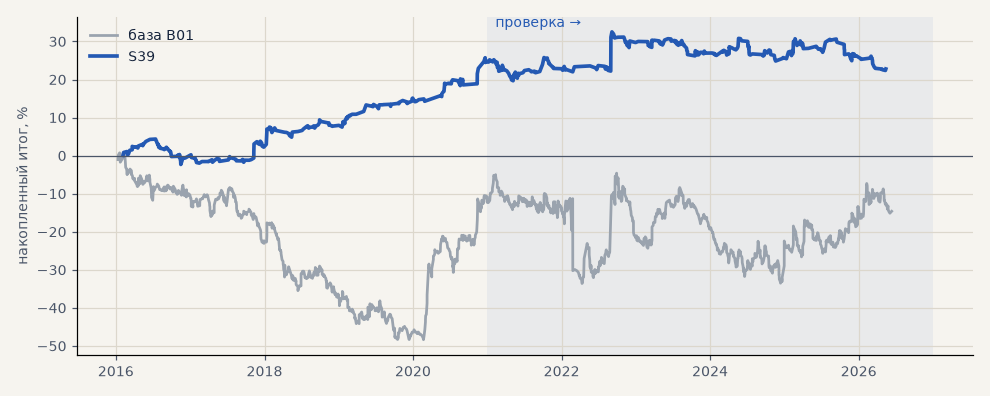

# S39. Новая стратегия №4 перебора (портфель 4)

**Семейство:** новые стратегии из блоков ТЗ (перебор) · **база:** B01 · **гипотеза:** H50 · **вердикт:** хуже базы: металлы −18%, портфель 4 −2% как база

**Что проверяли.** Самостоятельная стратегия из блоков ТЗ 15.10, найденная перебором (scripts/strategy_search.py): вход: keltner:20:10:2 @24h · фильтр: ATR14/ATR100 > 1 + только лонг · выход: трейлинг 3 · ATR20. Сделки — штатный минутный симулятор.

**Зачем.** Одна из лучших по устойчивой оценке (медиана PF пробы и соседей) среза «портфель 4» на выборе 2016–2020.

**Итог простыми словами.** Минутный симулятор: портфель 4 на выборе +24.8% (PF 1.66), на проверке −2.0% (PF 0.97) — как база; металлы −18.2%.

**Издержки:** профиль `base` (спред и свопы брокера)

Подробности: [results/strategy_search.md](../../results/strategy_search.md)

Проверка — сделки, открытые с 1 января 2021 года; выбор — до 2021. В скобках — база на тех же инструментах.

| срез | период | сделок | итог % | выигрышей | ожидание на сделку | PF | без 2 лучших | просадка | t | лет в плюсе |
|---|---|---|---|---|---|---|---|---|---|---|
| все инструменты | проверка | 723 (1924) | -7.9 (-18.9) | 34% (41%) | -0.088% (-0.078%) | 0.91 (0.95) | -17.3 (-27.9) | -17.2 (-32.5) | -0.71 (-0.70) | 3/6 (1/6) |
| все инструменты | выбор | 438 (1196) | +2.3 (-41.1) | 42% (39%) | +0.043% (-0.275%) | 1.06 (0.79) | -0.7 (-45.8) | -7.2 (-59.1) | 0.41 (-3.02) | 3/5 (1/5) |
| портфель 4 | проверка | 334 (896) | -2.0 (-2.3) | 35% (42%) | -0.024% (-0.010%) | 0.97 (0.99) | -13.1 (-17.7) | -10.1 (-28.9) | -0.15 (-0.07) | 1/6 (3/6) |
| портфель 4 | выбор | 233 (665) | +24.8 (-12.3) | 48% (41%) | +0.426% (-0.074%) | 1.66 (0.94) | +18.8 (-21.8) | -6.7 (-49.1) | 2.68 (-0.55) | 5/5 (1/5) |
| металлы (серебро + золото) | проверка | 198 (506) | -18.2 (+41.3) | 32% (44%) | -0.184% (+0.163%) | 0.76 (1.17) | -26.2 (+23.2) | -22.0 (-28.5) | -1.44 (1.18) | 1/6 (5/6) |
| металлы (серебро + золото) | выбор | 160 (461) | -2.8 (-11.5) | 37% (38%) | -0.035% (-0.050%) | 0.94 (0.94) | -9.4 (-30.4) | -16.0 (-55.8) | -0.29 (-0.41) | 2/5 (1/5) |
| серебро | проверка | 115 (243) | -22.7 (+58.1) | 31% (46%) | -0.197% (+0.239%) | 0.79 (1.18) | -38.5 (+21.9) | -36.3 (-51.2) | -0.98 (0.94) | 2/6 (5/6) |
| серебро | выбор | 81 (218) | +4.3 (+25.4) | 42% (37%) | +0.053% (+0.117%) | 1.08 (1.11) | -8.8 (-12.4) | -18.9 (-66.8) | 0.26 (0.52) | 3/5 (2/5) |
| золото | проверка | 83 (263) | -13.8 (+24.5) | 34% (42%) | -0.166% (+0.093%) | 0.69 (1.15) | -19.7 (-2.2) | -15.1 (-39.2) | -1.36 (0.73) | 1/6 (2/6) |
| золото | выбор | 79 (243) | -9.9 (-48.4) | 32% (40%) | -0.125% (-0.199%) | 0.73 (0.73) | -15.8 (-63.4) | -15.8 (-69.1) | -1.06 (-1.80) | 1/5 (2/5) |
| LKOH | проверка | 66 (214) | -18.2 (-59.3) | 36% (40%) | -0.276% (-0.277%) | 0.67 (0.80) | -28.9 (-80.9) | -23.3 (-89.9) | -1.24 (-1.23) | 2/6 (1/6) |
| LKOH | выбор | 54 (132) | +27.7 (-2.6) | 50% (45%) | +0.512% (-0.020%) | 1.75 (0.99) | +7.4 (-28.8) | -8.4 (-48.4) | 1.34 (-0.06) | 4/5 (2/5) |
| GAZP | проверка | 81 (219) | +10.8 (-23.3) | 36% (42%) | +0.133% (-0.106%) | 1.13 (0.94) | -32.4 (-83.4) | -20.9 (-112.1) | 0.26 (-0.22) | 2/6 (3/6) |
| GAZP | выбор | 55 (154) | +13.4 (-14.2) | 45% (40%) | +0.243% (-0.092%) | 1.39 (0.93) | +0.9 (-41.0) | -9.5 (-52.8) | 0.93 (-0.34) | 4/5 (3/5) |
| SBER | проверка | 72 (220) | +22.0 (+15.2) | 39% (37%) | +0.305% (+0.069%) | 1.44 (1.06) | +8.2 (-12.0) | -12.2 (-45.1) | 1.15 (0.30) | 3/6 (2/6) |
| SBER | выбор | 43 (161) | +53.9 (-57.8) | 60% (45%) | +1.253% (-0.359%) | 3.02 (0.79) | +34.5 (-82.3) | -8.5 (-89.8) | 2.59 (-1.21) | 5/5 (2/5) |
| MOEX | проверка | 97 (227) | -42.9 (-93.7) | 30% (37%) | -0.442% (-0.413%) | 0.53 (0.71) | -58.4 (-117.4) | -58.3 (-93.7) | -2.20 (-1.93) | 2/6 (1/6) |
| MOEX | выбор | 64 (153) | -36.9 (-75.4) | 36% (39%) | -0.576% (-0.493%) | 0.51 (0.70) | -44.7 (-93.1) | -41.9 (-102.6) | -2.39 (-1.79) | 1/5 (1/5) |
| MTSS | проверка | 83 (196) | -30.3 (-48.1) | 36% (39%) | -0.365% (-0.245%) | 0.57 (0.83) | -41.9 (-86.9) | -30.3 (-54.5) | -1.79 (-0.93) | 2/6 (2/6) |
| MTSS | выбор | 62 (135) | -33.8 (-155.9) | 37% (32%) | -0.546% (-1.155%) | 0.51 (0.39) | -43.8 (-171.3) | -37.6 (-155.9) | -2.10 (-4.42) | 1/5 (0/5) |
| ETH | проверка | 126 (342) | +31.8 (-24.2) | 35% (44%) | +0.252% (-0.071%) | 1.15 (0.98) | -24.6 (-82.2) | -46.1 (-115.3) | 0.48 (-0.17) | 5/6 (4/6) |

Журнал сделок: `trades.csv.gz` (инструмент, прогон, сторона, вход, выход, цены, результат после издержек, причина выхода).
