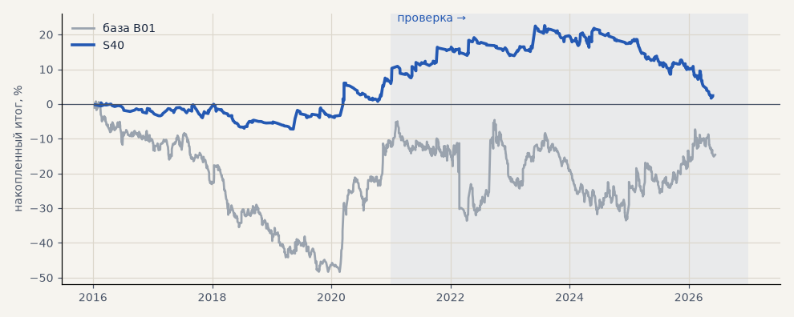

# S40. Новая стратегия №5 перебора (все)

**Семейство:** новые стратегии из блоков ТЗ (перебор) · **база:** B01 · **гипотеза:** H50 · **вердикт:** хуже базы: металлы +6% против +41%

**Что проверяли.** Самостоятельная стратегия из блоков ТЗ 15.10, найденная перебором (scripts/strategy_search.py): вход: inside bar → пробой · фильтр: EMA200 1ч + EMA200 дни · выход: Дончиан 10 ч · стоп 3 · ATR20 · размер по риску. Сделки — штатный минутный симулятор.

**Зачем.** Одна из лучших по устойчивой оценке (медиана PF пробы и соседей) среза «все» на выборе 2016–2020.

**Итог простыми словами.** Минутный симулятор: все рынки на выборе +10.7% (PF 1.28), на проверке −6.8% (PF 0.92) против −18.9% у B01; металлы +6.1% против +41.3%.

**Издержки:** профиль `base` (спред и свопы брокера)

Подробности: [results/strategy_search.md](../../results/strategy_search.md)

Проверка — сделки, открытые с 1 января 2021 года; выбор — до 2021. В скобках — база на тех же инструментах.

| срез | период | сделок | итог % | выигрышей | ожидание на сделку | PF | без 2 лучших | просадка | t | лет в плюсе |
|---|---|---|---|---|---|---|---|---|---|---|
| все инструменты | проверка | 647 (1924) | -6.8 (-18.9) | 33% (41%) | -0.084% (-0.078%) | 0.92 (0.95) | -12.0 (-27.9) | -13.9 (-32.5) | -0.70 (-0.70) | 2/6 (1/6) |
| все инструменты | выбор | 408 (1196) | +10.7 (-41.1) | 35% (39%) | +0.210% (-0.275%) | 1.28 (0.79) | +6.3 (-45.8) | -6.1 (-59.1) | 1.51 (-3.02) | 3/5 (1/5) |
| портфель 4 | проверка | 316 (896) | -7.9 (-2.3) | 31% (42%) | -0.100% (-0.010%) | 0.90 (0.99) | -18.1 (-17.7) | -20.9 (-28.9) | -0.59 (-0.07) | 2/6 (3/6) |
| портфель 4 | выбор | 216 (665) | +10.3 (-12.3) | 31% (41%) | +0.191% (-0.074%) | 1.24 (0.94) | +1.9 (-21.8) | -7.6 (-49.1) | 0.92 (-0.55) | 3/5 (1/5) |
| металлы (серебро + золото) | проверка | 149 (506) | +6.1 (+41.3) | 39% (44%) | +0.082% (+0.163%) | 1.18 (1.17) | +2.0 (+23.2) | -7.0 (-28.5) | 0.80 (1.18) | 3/6 (5/6) |
| металлы (серебро + золото) | выбор | 145 (461) | +5.8 (-11.5) | 32% (38%) | +0.080% (-0.050%) | 1.15 (0.94) | -8.4 (-30.4) | -9.0 (-55.8) | 0.43 (-0.41) | 1/5 (1/5) |
| серебро | проверка | 71 (243) | +2.7 (+58.1) | 32% (46%) | +0.038% (+0.239%) | 1.07 (1.18) | -5.6 (+21.9) | -12.7 (-51.2) | 0.21 (0.94) | 2/6 (5/6) |
| серебро | выбор | 74 (218) | -4.1 (+25.4) | 26% (37%) | -0.056% (+0.117%) | 0.92 (1.11) | -27.5 (-12.4) | -17.2 (-66.8) | -0.18 (0.52) | 2/5 (2/5) |
| золото | проверка | 78 (263) | +9.6 (+24.5) | 45% (42%) | +0.123% (+0.093%) | 1.36 (1.15) | +3.9 (-2.2) | -5.1 (-39.2) | 1.12 (0.73) | 5/6 (2/6) |
| золото | выбор | 71 (243) | +15.7 (-48.4) | 39% (40%) | +0.221% (-0.199%) | 1.61 (0.73) | -0.4 (-63.4) | -8.4 (-69.1) | 1.09 (-1.80) | 3/5 (2/5) |
| LKOH | проверка | 74 (214) | +38.3 (-59.3) | 32% (40%) | +0.518% (-0.277%) | 1.52 (0.80) | -0.5 (-80.9) | -25.7 (-89.9) | 1.02 (-1.23) | 4/6 (1/6) |
| LKOH | выбор | 40 (132) | +23.5 (-2.6) | 38% (45%) | +0.587% (-0.020%) | 1.73 (0.99) | -0.7 (-28.8) | -12.0 (-48.4) | 1.05 (-0.06) | 2/5 (2/5) |
| GAZP | проверка | 93 (219) | -46.9 (-23.3) | 30% (42%) | -0.504% (-0.106%) | 0.56 (0.94) | -60.9 (-83.4) | -54.3 (-112.1) | -2.28 (-0.22) | 1/6 (3/6) |
| GAZP | выбор | 45 (154) | +9.0 (-14.2) | 33% (40%) | +0.200% (-0.092%) | 1.22 (0.93) | -12.7 (-41.0) | -20.6 (-52.8) | 0.44 (-0.34) | 2/5 (3/5) |
| SBER | проверка | 78 (220) | -25.8 (+15.2) | 29% (37%) | -0.330% (+0.069%) | 0.74 (1.06) | -54.9 (-12.0) | -44.0 (-45.1) | -0.86 (0.30) | 2/6 (2/6) |
| SBER | выбор | 57 (161) | +12.9 (-57.8) | 33% (45%) | +0.226% (-0.359%) | 1.25 (0.79) | -12.7 (-82.3) | -16.1 (-89.8) | 0.54 (-1.21) | 4/5 (2/5) |
| MOEX | проверка | 70 (227) | -2.9 (-93.7) | 37% (37%) | -0.041% (-0.413%) | 0.96 (0.71) | -22.5 (-117.4) | -20.5 (-93.7) | -0.14 (-1.93) | 1/6 (1/6) |
| MOEX | выбор | 57 (153) | +23.8 (-75.4) | 37% (39%) | +0.417% (-0.493%) | 1.46 (0.70) | -1.4 (-93.1) | -13.1 (-102.6) | 0.95 (-1.79) | 2/5 (1/5) |
| MTSS | проверка | 71 (196) | -41.6 (-48.1) | 25% (39%) | -0.586% (-0.245%) | 0.47 (0.83) | -62.4 (-86.9) | -41.6 (-54.5) | -2.10 (-0.93) | 1/6 (2/6) |
| MTSS | выбор | 64 (135) | +5.1 (-155.9) | 38% (32%) | +0.079% (-1.155%) | 1.10 (0.39) | -13.0 (-171.3) | -19.8 (-155.9) | 0.26 (-4.42) | 4/5 (0/5) |
| ETH | проверка | 112 (342) | +12.0 (-24.2) | 33% (44%) | +0.108% (-0.071%) | 1.07 (0.98) | -22.5 (-82.2) | -39.5 (-115.3) | 0.25 (-0.17) | 3/6 (4/6) |

Журнал сделок: `trades.csv.gz` (инструмент, прогон, сторона, вход, выход, цены, результат после издержек, причина выхода).
