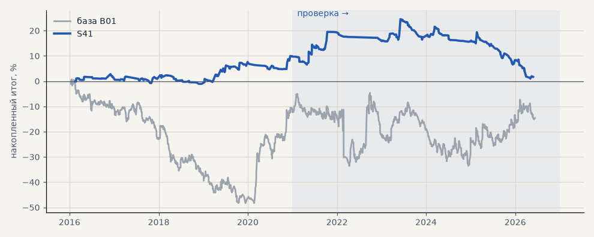

# S41. Новая стратегия №6 перебора (все)

**Семейство:** новые стратегии из блоков ТЗ (перебор) · **база:** B01 · **гипотеза:** H50 · **вердикт:** хуже базы на металлах (+4%); все рынки +1% против −19% лишь за счёт меньших свопов CFD

**Что проверяли.** Самостоятельная стратегия из блоков ТЗ 15.10, найденная перебором (scripts/strategy_search.py): вход: inside bar → пробой · фильтр: только лонг + EMA200 дни · выход: Supertrend 4ч · стоп 3 · ATR14 · размер по риску. Сделки — штатный минутный симулятор.

**Зачем.** Одна из лучших по устойчивой оценке (медиана PF пробы и соседей) среза «все» на выборе 2016–2020.

**Итог простыми словами.** Минутный симулятор: все рынки на выборе +8.6% (PF 1.35), на проверке +1.4% (PF 1.02, t 0.1) против −18.9% у B01 — только лонг и меньше сделок, поэтому меньше свопов CFD по акциям; металлы +4.1% против +41.3%.

**Издержки:** профиль `base` (спред и свопы брокера)

Подробности: [results/strategy_search.md](../../results/strategy_search.md)

Проверка — сделки, открытые с 1 января 2021 года; выбор — до 2021. В скобках — база на тех же инструментах.

| срез | период | сделок | итог % | выигрышей | ожидание на сделку | PF | без 2 лучших | просадка | t | лет в плюсе |
|---|---|---|---|---|---|---|---|---|---|---|
| все инструменты | проверка | 581 (1924) | +1.4 (-18.9) | 18% (41%) | +0.019% (-0.078%) | 1.02 (0.95) | -8.7 (-27.9) | -7.7 (-32.5) | 0.12 (-0.70) | 4/6 (1/6) |
| все инструменты | выбор | 366 (1196) | +8.6 (-41.1) | 25% (39%) | +0.189% (-0.275%) | 1.35 (0.79) | +5.2 (-45.8) | -3.2 (-59.1) | 1.46 (-3.02) | 3/5 (1/5) |
| портфель 4 | проверка | 270 (896) | -8.0 (-2.3) | 17% (42%) | -0.119% (-0.010%) | 0.86 (0.99) | -19.2 (-17.7) | -23.6 (-28.9) | -0.61 (-0.07) | 2/6 (3/6) |
| портфель 4 | выбор | 186 (665) | +9.7 (-12.3) | 27% (41%) | +0.210% (-0.074%) | 1.35 (0.94) | +4.1 (-21.8) | -3.9 (-49.1) | 1.10 (-0.55) | 3/5 (1/5) |
| металлы (серебро + золото) | проверка | 148 (506) | +4.1 (+41.3) | 18% (44%) | +0.055% (+0.163%) | 1.16 (1.17) | -2.7 (+23.2) | -11.4 (-28.5) | 0.48 (1.18) | 2/6 (5/6) |
| металлы (серебро + золото) | выбор | 127 (461) | +1.3 (-11.5) | 16% (38%) | +0.020% (-0.050%) | 1.05 (0.94) | -9.4 (-30.4) | -13.5 (-55.8) | 0.12 (-0.41) | 2/5 (1/5) |
| серебро | проверка | 67 (243) | +1.8 (+58.1) | 19% (46%) | +0.027% (+0.239%) | 1.06 (1.18) | -11.7 (+21.9) | -17.9 (-51.2) | 0.13 (0.94) | 3/6 (5/6) |
| серебро | выбор | 53 (218) | -0.2 (+25.4) | 23% (37%) | -0.004% (+0.117%) | 0.99 (1.11) | -11.8 (-12.4) | -14.9 (-66.8) | -0.02 (0.52) | 2/4 (2/5) |
| золото | проверка | 81 (263) | +6.3 (+24.5) | 17% (42%) | +0.077% (+0.093%) | 1.31 (1.15) | -2.4 (-2.2) | -9.4 (-39.2) | 0.64 (0.73) | 2/6 (2/6) |
| золото | выбор | 74 (243) | +2.8 (-48.4) | 11% (40%) | +0.037% (-0.199%) | 1.10 (0.73) | -18.6 (-63.4) | -21.6 (-69.1) | 0.16 (-1.80) | 1/5 (2/5) |
| LKOH | проверка | 69 (214) | +19.8 (-59.3) | 17% (40%) | +0.286% (-0.277%) | 1.41 (0.80) | -22.9 (-80.9) | -25.3 (-89.9) | 0.57 (-1.23) | 3/6 (1/6) |
| LKOH | выбор | 38 (132) | -3.5 (-2.6) | 24% (45%) | -0.093% (-0.020%) | 0.89 (0.99) | -22.0 (-28.8) | -14.3 (-48.4) | -0.21 (-0.06) | 3/5 (2/5) |
| GAZP | проверка | 48 (219) | -32.7 (-23.3) | 23% (42%) | -0.681% (-0.106%) | 0.42 (0.94) | -49.9 (-83.4) | -41.8 (-112.1) | -1.93 (-0.22) | 1/5 (3/6) |
| GAZP | выбор | 43 (154) | +2.9 (-14.2) | 23% (40%) | +0.067% (-0.092%) | 1.09 (0.93) | -17.7 (-41.0) | -20.3 (-52.8) | 0.16 (-0.34) | 1/5 (3/5) |
| SBER | проверка | 86 (220) | -21.1 (+15.2) | 13% (37%) | -0.245% (+0.069%) | 0.77 (1.06) | -56.1 (-12.0) | -47.8 (-45.1) | -0.63 (0.30) | 1/5 (2/6) |
| SBER | выбор | 52 (161) | +39.8 (-57.8) | 38% (45%) | +0.766% (-0.359%) | 2.60 (0.79) | +17.4 (-82.3) | -6.2 (-89.8) | 1.76 (-1.21) | 4/5 (2/5) |
| MOEX | проверка | 64 (227) | -5.8 (-93.7) | 17% (37%) | -0.091% (-0.413%) | 0.91 (0.71) | -33.5 (-117.4) | -23.4 (-93.7) | -0.23 (-1.93) | 2/6 (1/6) |
| MOEX | выбор | 40 (153) | +19.8 (-75.4) | 30% (39%) | +0.495% (-0.493%) | 1.89 (0.70) | -1.7 (-93.1) | -11.4 (-102.6) | 1.01 (-1.79) | 3/5 (1/5) |
| MTSS | проверка | 71 (196) | -13.2 (-48.1) | 11% (39%) | -0.185% (-0.245%) | 0.77 (0.83) | -36.8 (-86.9) | -23.9 (-54.5) | -0.59 (-0.93) | 1/6 (2/6) |
| MTSS | выбор | 66 (135) | +7.5 (-155.9) | 30% (32%) | +0.113% (-1.155%) | 1.21 (0.39) | -9.5 (-171.3) | -15.9 (-155.9) | 0.43 (-4.42) | 3/5 (0/5) |
| ETH | проверка | 95 (342) | +56.0 (-24.2) | 28% (44%) | +0.589% (-0.071%) | 1.58 (0.98) | -24.8 (-82.2) | -26.9 (-115.3) | 0.80 (-0.17) | 3/5 (4/6) |

Журнал сделок: `trades.csv.gz` (инструмент, прогон, сторона, вход, выход, цены, результат после издержек, причина выхода).
