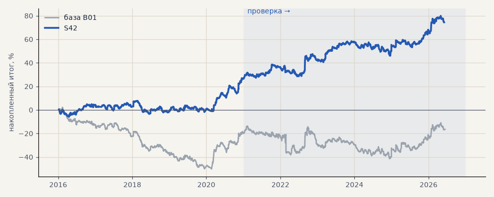

# S42. Набор для запуска — металлы через CFD, акции на бирже в лонг

**Семейство:** стратегия без ML (импульс) · **база:** B01 · **гипотеза:** H52 · **вердикт:** подтвердилась: PF 1.26 на проверке и 1.19 на выборе, без 2 лучших в плюсе; держится на акциях в лонг — металлы прибыльны только на проверке

**Что проверяли.** Ровно тот набор, что идёт в запуск: серебро и золото через CFD Альфа-Форекс в обе стороны (сделки и издержки как в B01) и GAZP, SBER, LKOH на Мосбирже только в лонг (сделки S25: шорты гасятся до симуляции, комиссия 0.1% за круг, проскальзывание 0.05% на сторону, перенос лонга бесплатный). Пять инструментов поровну; правило импульса без изменений.

**Зачем.** Металлы и акции в лонг проверялись по отдельности, а единого эксперимента на запускаемый набор не было: у S25 основной срез — портфель 4 без золота, а MOEX, MTSS и ETH в запуск не идут (гипотеза H52, задача T15).

**Итог простыми словами.** Набор прибылен в обоих периодах, но держится на акциях: акции в лонг в плюсе каждый год и на выборе, и на проверке, металлы — только на проверке (на выборе в минусе, на свежих данных лета 2026 тоже, вероятно, в минусе). Разумный порядок запуска — сначала акции, металлы после проверки на споте брокера.

**Издержки:** профиль `exchange` (спред и свопы брокера)

Подробности: [results/launch_set.md](../../results/launch_set.md)

Проверка — сделки, открытые с 1 января 2021 года; выбор — до 2021. В скобках — база на тех же инструментах.

| срез | период | сделок | итог % | выигрышей | ожидание на сделку | PF | без 2 лучших | просадка | t | лет в плюсе |
|---|---|---|---|---|---|---|---|---|---|---|
| все инструменты | проверка | 884 (1159) | +47.0 (+3.0) | 44% (42%) | +0.266% (+0.013%) | 1.26 (1.01) | +34.7 (-9.3) | -12.2 (-27.7) | 2.20 (0.11) | 5/6 (2/6) |
| все инструменты | выбор | 736 (908) | +27.5 (-19.5) | 44% (41%) | +0.187% (-0.107%) | 1.19 (0.91) | +19.9 (-27.1) | -11.2 (-52.4) | 1.64 (-1.05) | 3/5 (1/5) |
| портфель 4 | проверка | 621 (896) | +52.6 (-2.3) | 44% (42%) | +0.339% (-0.010%) | 1.29 (0.99) | +37.2 (-17.7) | -16.1 (-28.9) | 2.07 (-0.07) | 5/6 (3/6) |
| портфель 4 | выбор | 493 (665) | +46.4 (-12.3) | 46% (41%) | +0.377% (-0.074%) | 1.35 (0.94) | +37.0 (-21.8) | -11.5 (-49.1) | 2.35 (-0.55) | 3/5 (1/5) |
| металлы (серебро + золото) | проверка | 506 (506) | +41.3 (+41.3) | 44% (44%) | +0.163% (+0.163%) | 1.17 (1.17) | +23.2 (+23.2) | -28.5 (-28.5) | 1.18 (1.18) | 5/6 (5/6) |
| металлы (серебро + золото) | выбор | 461 (461) | -11.5 (-11.5) | 38% (38%) | -0.050% (-0.050%) | 0.94 (0.94) | -30.4 (-30.4) | -55.8 (-55.8) | -0.41 (-0.41) | 1/5 (1/5) |
| серебро | проверка | 243 (243) | +58.1 (+58.1) | 46% (46%) | +0.239% (+0.239%) | 1.18 (1.18) | +21.9 (+21.9) | -51.2 (-51.2) | 0.94 (0.94) | 5/6 (5/6) |
| серебро | выбор | 218 (218) | +25.4 (+25.4) | 37% (37%) | +0.117% (+0.117%) | 1.11 (1.11) | -12.4 (-12.4) | -66.8 (-66.8) | 0.52 (0.52) | 2/5 (2/5) |
| золото | проверка | 263 (263) | +24.5 (+24.5) | 42% (42%) | +0.093% (+0.093%) | 1.15 (1.15) | -2.2 (-2.2) | -39.2 (-39.2) | 0.73 (0.73) | 2/6 (2/6) |
| золото | выбор | 243 (243) | -48.4 (-48.4) | 40% (40%) | -0.199% (-0.199%) | 0.73 (0.73) | -63.4 (-63.4) | -69.1 (-69.1) | -1.80 (-1.80) | 2/5 (2/5) |
| LKOH | проверка | 123 (214) | +32.3 (-59.3) | 45% (40%) | +0.262% (-0.277%) | 1.23 (0.80) | +10.1 (-80.9) | -24.1 (-89.9) | 0.87 (-1.23) | 4/6 (1/6) |
| LKOH | выбор | 79 (132) | +65.4 (-2.6) | 59% (45%) | +0.828% (-0.020%) | 1.82 (0.99) | +38.0 (-28.8) | -14.0 (-48.4) | 1.97 (-0.06) | 3/5 (2/5) |
| GAZP | проверка | 127 (219) | +60.3 (-23.3) | 43% (42%) | +0.475% (-0.106%) | 1.38 (0.94) | -0.3 (-83.4) | -34.6 (-112.1) | 1.00 (-0.22) | 5/6 (3/6) |
| GAZP | выбор | 96 (154) | +44.1 (-14.2) | 48% (40%) | +0.459% (-0.092%) | 1.45 (0.93) | +16.4 (-41.0) | -12.4 (-52.8) | 1.27 (-0.34) | 4/5 (3/5) |
| SBER | проверка | 128 (220) | +59.8 (+15.2) | 44% (37%) | +0.467% (+0.069%) | 1.50 (1.06) | +31.1 (-12.0) | -27.9 (-45.1) | 1.52 (0.30) | 5/6 (2/6) |
| SBER | выбор | 100 (161) | +50.8 (-57.8) | 53% (45%) | +0.508% (-0.359%) | 1.39 (0.79) | +26.8 (-82.3) | -28.5 (-89.8) | 1.29 (-1.21) | 4/5 (2/5) |

Журнал сделок: `trades.csv.gz` (инструмент, прогон, сторона, вход, выход, цены, результат после издержек, причина выхода).
