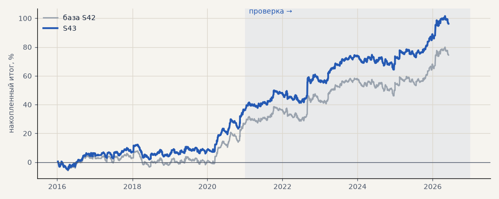

# S43. Набор для запуска, серебро с шагом 0.0001

**Семейство:** стратегия без ML (импульс) · **база:** S42 · **гипотеза:** H52 · **вердикт:** лучше S42 на 12 п.п. на проверке — если серебро котируется с шагом 0.0001 (уточнить, T01)

**Что проверяли.** То же, что S42, но если серебро у Альфа-Форекс котируется с 4 знаками (1 пункт = 0.0001): свопы серебра в пунктах в 10 раз меньше. Комиссия и проскальзывание те же.

**Зачем.** Шаг цены серебра у брокера ещё не подтверждён (уточнение T01), а от него зависят свопы — главная издержка металлов при удержании до 10 дней.

**Итог простыми словами.** При шаге 0.0001 набор зарабатывает заметно больше — вся разница приходится на серебро. Ответ на T01 меняет оценку металлов, но не вывод про акции.

**Издержки:** профиль `exchange` (спред и свопы брокера)

Подробности: [results/launch_set.md](../../results/launch_set.md)

Проверка — сделки, открытые с 1 января 2021 года; выбор — до 2021. В скобках — база на тех же инструментах.

| срез | период | сделок | итог % | выигрышей | ожидание на сделку | PF | без 2 лучших | просадка | t | лет в плюсе |
|---|---|---|---|---|---|---|---|---|---|---|
| все инструменты | проверка | 884 (884) | +59.0 (+47.0) | 44% (44%) | +0.334% (+0.266%) | 1.34 (1.26) | +46.5 (+34.7) | -10.3 (-12.2) | 2.74 (2.20) | 5/6 (5/6) |
| все инструменты | выбор | 736 (736) | +37.2 (+27.5) | 45% (44%) | +0.253% (+0.187%) | 1.27 (1.19) | +29.6 (+19.9) | -10.4 (-11.2) | 2.21 (1.64) | 4/5 (3/5) |
| портфель 4 | проверка | 621 (621) | +67.6 (+52.6) | 45% (44%) | +0.435% (+0.339%) | 1.38 (1.29) | +52.0 (+37.2) | -13.0 (-16.1) | 2.65 (2.07) | 5/6 (5/6) |
| портфель 4 | выбор | 493 (493) | +58.7 (+46.4) | 48% (46%) | +0.476% (+0.377%) | 1.47 (1.35) | +49.1 (+37.0) | -10.5 (-11.5) | 2.95 (2.35) | 5/5 (3/5) |
| металлы (серебро + золото) | проверка | 506 (506) | +71.3 (+41.3) | 44% (44%) | +0.282% (+0.163%) | 1.31 (1.17) | +52.7 (+23.2) | -17.8 (-28.5) | 2.01 (1.18) | 5/6 (5/6) |
| металлы (серебро + золото) | выбор | 461 (461) | +12.9 (-11.5) | 40% (38%) | +0.056% (-0.050%) | 1.07 (0.94) | -6.2 (-30.4) | -38.1 (-55.8) | 0.45 (-0.41) | 2/5 (1/5) |
| серебро | проверка | 243 (243) | +118.1 (+58.1) | 47% (46%) | +0.486% (+0.239%) | 1.41 (1.18) | +81.0 (+21.9) | -30.9 (-51.2) | 1.89 (0.94) | 5/6 (5/6) |
| серебро | выбор | 218 (218) | +74.3 (+25.4) | 41% (37%) | +0.341% (+0.117%) | 1.38 (1.11) | +36.0 (-12.4) | -44.5 (-66.8) | 1.49 (0.52) | 3/5 (2/5) |
| золото | проверка | 263 (263) | +24.5 (+24.5) | 42% (42%) | +0.093% (+0.093%) | 1.15 (1.15) | -2.2 (-2.2) | -39.2 (-39.2) | 0.73 (0.73) | 2/6 (2/6) |
| золото | выбор | 243 (243) | -48.4 (-48.4) | 40% (40%) | -0.199% (-0.199%) | 0.73 (0.73) | -63.4 (-63.4) | -69.1 (-69.1) | -1.80 (-1.80) | 2/5 (2/5) |
| LKOH | проверка | 123 (123) | +32.3 (+32.3) | 45% (45%) | +0.262% (+0.262%) | 1.23 (1.23) | +10.1 (+10.1) | -24.1 (-24.1) | 0.87 (0.87) | 4/6 (4/6) |
| LKOH | выбор | 79 (79) | +65.4 (+65.4) | 59% (59%) | +0.828% (+0.828%) | 1.82 (1.82) | +38.0 (+38.0) | -14.0 (-14.0) | 1.97 (1.97) | 3/5 (3/5) |
| GAZP | проверка | 127 (127) | +60.3 (+60.3) | 43% (43%) | +0.475% (+0.475%) | 1.38 (1.38) | -0.3 (-0.3) | -34.6 (-34.6) | 1.00 (1.00) | 5/6 (5/6) |
| GAZP | выбор | 96 (96) | +44.1 (+44.1) | 48% (48%) | +0.459% (+0.459%) | 1.45 (1.45) | +16.4 (+16.4) | -12.4 (-12.4) | 1.27 (1.27) | 4/5 (4/5) |
| SBER | проверка | 128 (128) | +59.8 (+59.8) | 44% (44%) | +0.467% (+0.467%) | 1.50 (1.50) | +31.1 (+31.1) | -27.9 (-27.9) | 1.52 (1.52) | 5/6 (5/6) |
| SBER | выбор | 100 (100) | +50.8 (+50.8) | 53% (53%) | +0.508% (+0.508%) | 1.39 (1.39) | +26.8 (+26.8) | -28.5 (-28.5) | 1.29 (1.29) | 4/5 (4/5) |

Журнал сделок: `trades.csv.gz` (инструмент, прогон, сторона, вход, выход, цены, результат после издержек, причина выхода).
