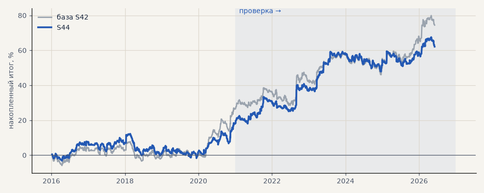

# S44. Набор для запуска, размер позиции по волатильности

**Семейство:** стратегия без ML (импульс) · **база:** S42 · **гипотеза:** H07 · **вердикт:** не помогло: на проверке как S42 (PF 1.26, t 2.15 против 2.20), на выборе хуже (PF 1.14 против 1.19, просадка −14 против −11)

**Что проверяли.** Те же сделки, что S42, но размер позиции обратно пропорционален волатильности на входе: медиана ATR% инструмента на выборе 2016–2020, делённая на ATR% сделки, в пределах 0.5–2 (scripts/vol_sizing.py). Одинаковый риск на сделку; на выборе средний размер около 1.

**Зачем.** Стоп стоит в 6 ATR, поэтому при одинаковом размере в нервные периоды стратегия рискует больше. У модели CatBoost такой размер дал слабый плюс (M10) — гипотеза H07.

**Итог простыми словами.** Не помогло: на проверке PF тот же, t чуть ниже, просадка чуть меньше; на выборе хуже по PF и по просадке. Оставляем одинаковый размер.

**Издержки:** профиль `exchange` (спред и свопы брокера)

Подробности: [results/launch_set.md](../../results/launch_set.md)

Проверка — сделки, открытые с 1 января 2021 года; выбор — до 2021. В скобках — база на тех же инструментах.

| срез | период | сделок | итог % | выигрышей | ожидание на сделку | PF | без 2 лучших | просадка | t | лет в плюсе |
|---|---|---|---|---|---|---|---|---|---|---|
| все инструменты | проверка | 884 (884) | +42.3 (+47.0) | 44% (44%) | +0.239% (+0.266%) | 1.26 (1.26) | +30.4 (+34.7) | -11.4 (-12.2) | 2.15 (2.20) | 5/6 (5/6) |
| все инструменты | выбор | 736 (736) | +19.8 (+27.5) | 44% (44%) | +0.134% (+0.187%) | 1.14 (1.19) | +13.9 (+19.9) | -14.0 (-11.2) | 1.32 (1.64) | 2/5 (3/5) |
| портфель 4 | проверка | 621 (621) | +50.0 (+52.6) | 44% (44%) | +0.322% (+0.339%) | 1.29 (1.29) | +35.1 (+37.2) | -16.3 (-16.1) | 2.09 (2.07) | 5/6 (5/6) |
| портфель 4 | выбор | 493 (493) | +32.6 (+46.4) | 46% (46%) | +0.264% (+0.377%) | 1.25 (1.35) | +25.3 (+37.0) | -12.2 (-11.5) | 1.85 (2.35) | 3/5 (3/5) |
| металлы (серебро + золото) | проверка | 506 (506) | +21.2 (+41.3) | 44% (44%) | +0.084% (+0.163%) | 1.12 (1.17) | +11.6 (+23.2) | -21.8 (-28.5) | 0.93 (1.18) | 3/6 (5/6) |
| металлы (серебро + золото) | выбор | 461 (461) | -21.4 (-11.5) | 38% (38%) | -0.093% (-0.050%) | 0.89 (0.94) | -34.7 (-30.4) | -60.4 (-55.8) | -0.91 (-0.41) | 2/5 (1/5) |
| серебро | проверка | 243 (243) | +30.9 (+58.1) | 46% (46%) | +0.127% (+0.239%) | 1.14 (1.18) | +11.6 (+21.9) | -40.4 (-51.2) | 0.79 (0.94) | 5/6 (5/6) |
| серебро | выбор | 218 (218) | -11.4 (+25.4) | 37% (37%) | -0.052% (+0.117%) | 0.95 (1.11) | -37.9 (-12.4) | -76.7 (-66.8) | -0.28 (0.52) | 2/5 (2/5) |
| золото | проверка | 263 (263) | +11.6 (+24.5) | 42% (42%) | +0.044% (+0.093%) | 1.08 (1.15) | -4.0 (-2.2) | -31.7 (-39.2) | 0.49 (0.73) | 2/6 (2/6) |
| золото | выбор | 243 (243) | -31.5 (-48.4) | 40% (40%) | -0.129% (-0.199%) | 0.81 (0.73) | -46.6 (-63.4) | -57.0 (-69.1) | -1.26 (-1.80) | 1/5 (2/5) |
| LKOH | проверка | 123 (123) | +27.7 (+32.3) | 45% (45%) | +0.225% (+0.262%) | 1.16 (1.23) | +0.4 (+10.1) | -34.9 (-24.1) | 0.63 (0.87) | 3/6 (4/6) |
| LKOH | выбор | 79 (79) | +64.2 (+65.4) | 59% (59%) | +0.813% (+0.828%) | 1.79 (1.82) | +36.7 (+38.0) | -14.3 (-14.0) | 1.96 (1.97) | 4/5 (3/5) |
| GAZP | проверка | 127 (127) | +55.1 (+60.3) | 43% (43%) | +0.434% (+0.475%) | 1.34 (1.38) | -1.1 (-0.3) | -36.9 (-34.6) | 0.95 (1.00) | 4/6 (5/6) |
| GAZP | выбор | 96 (96) | +23.1 (+44.1) | 48% (48%) | +0.241% (+0.459%) | 1.23 (1.45) | +5.3 (+16.4) | -16.2 (-12.4) | 0.78 (1.27) | 4/5 (4/5) |
| SBER | проверка | 128 (128) | +86.4 (+59.8) | 44% (44%) | +0.675% (+0.467%) | 1.59 (1.50) | +53.3 (+31.1) | -22.5 (-27.9) | 1.79 (1.52) | 5/6 (5/6) |
| SBER | выбор | 100 (100) | +54.4 (+50.8) | 53% (53%) | +0.544% (+0.508%) | 1.44 (1.39) | +33.5 (+26.8) | -27.7 (-28.5) | 1.45 (1.29) | 4/5 (4/5) |

Журнал сделок: `trades.csv.gz` (инструмент, прогон, сторона, вход, выход, цены, результат после издержек, причина выхода).
