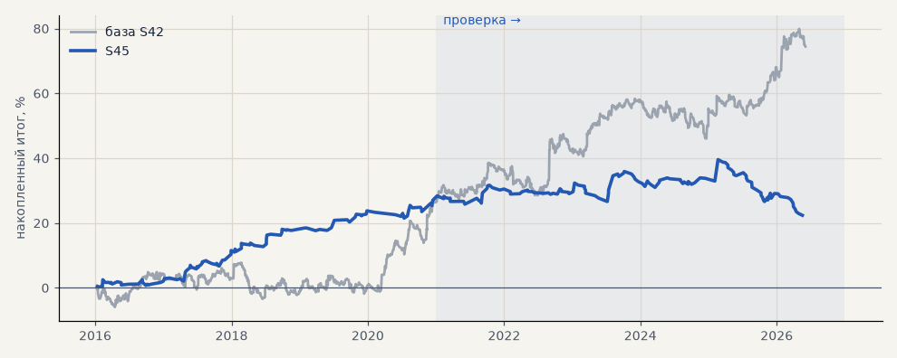

# S45. Итератор, стратегия 1: NR7 → пробой (набор для запуска)

**Семейство:** новые стратегии из блоков ТЗ (перебор) · **база:** S42 · **гипотеза:** H54 · **вердикт:** провал на проверке: PF 2.29 на выборе → 0.88, без 2 лучших −17 — пример подгонки (первый финалист H54)

**Что проверяли.** Финалист №1 перебора H54 на наборе для запуска: вход — пробой дня сжатия (вчера самый узкий диапазон за 7 дней, сегодня закрытие часа выше вчерашнего максимума), только лонг при ADX(14) на 1 ч > 25; выход — закрытие ниже минимума 20 дней, защитный стоп 6 ATR(10), не дольше 240 ч; размер по риску. Издержки как у S42.

**Зачем.** Созвон 18.10 (T36): Тимур хочет видеть, как перебор находит стратегии и как они торгуют, — сделки на графике, наложение на тренд-фильтр (H61) и согласие с импульсом (H62). Сделки посчитаны тем же часовым движком, которым считал перебор H54, — ровно то, что «видел» итератор.

**Итог простыми словами.** Лучший на выборе (PF 2.29, лучшая устойчивая оценка) и в минусе на проверке. Сделки закрывает в основном предел 240 ч (54%) и стоп (41%): выход по каналу почти не работает. Наглядный пример подгонки.

**Издержки:** профиль `exchange` (спред и свопы брокера)

Подробности: [results/iterator_walkthrough.md](../../results/iterator_walkthrough.md)

Проверка — сделки, открытые с 1 января 2021 года; выбор — до 2021. В скобках — база на тех же инструментах.

| срез | период | сделок | итог % | выигрышей | ожидание на сделку | PF | без 2 лучших | просадка | t | лет в плюсе |
|---|---|---|---|---|---|---|---|---|---|---|
| все инструменты | проверка | 123 (884) | -6.0 (+47.0) | 30% (44%) | -0.244% (+0.266%) | 0.88 (1.26) | -17.0 (+34.7) | -17.2 (-12.2) | -0.48 (2.20) | 3/6 (5/6) |
| все инструменты | выбор | 114 (736) | +28.4 (+27.5) | 56% (44%) | +1.245% (+0.187%) | 2.29 (1.19) | +22.9 (+19.9) | -2.3 (-11.2) | 3.31 (1.64) | 5/5 (3/5) |
| портфель 4 | проверка | 109 (621) | -5.3 (+52.6) | 30% (44%) | -0.193% (+0.339%) | 0.91 (1.29) | -19.0 (+37.2) | -21.1 (-16.1) | -0.34 (2.07) | 3/6 (5/6) |
| портфель 4 | выбор | 86 (493) | +35.3 (+46.4) | 59% (46%) | +1.641% (+0.377%) | 2.57 (1.35) | +28.5 (+37.0) | -3.0 (-11.5) | 3.43 (2.35) | 5/5 (3/5) |
| металлы (серебро + золото) | проверка | 29 (506) | -7.3 (+41.3) | 31% (44%) | -0.504% (+0.163%) | 0.59 (1.17) | -13.2 (+23.2) | -10.9 (-28.5) | -1.14 (1.18) | 2/5 (5/6) |
| металлы (серебро + золото) | выбор | 45 (461) | +4.4 (-11.5) | 42% (38%) | +0.194% (-0.050%) | 1.21 (0.94) | -5.1 (-30.4) | -5.2 (-55.8) | 0.45 (-0.41) | 3/5 (1/5) |
| серебро | проверка | 15 (243) | -5.7 (+58.1) | 33% (46%) | -0.378% (+0.239%) | 0.75 (1.18) | -17.6 (+21.9) | -12.9 (-51.2) | -0.47 (0.94) | 2/5 (5/6) |
| серебро | выбор | 17 (218) | +7.9 (+25.4) | 35% (37%) | +0.463% (+0.117%) | 1.35 (1.11) | -11.1 (-12.4) | -7.1 (-66.8) | 0.46 (0.52) | 2/5 (2/5) |
| золото | проверка | 14 (263) | -8.9 (+24.5) | 29% (42%) | -0.638% (+0.093%) | 0.32 (1.15) | -12.4 (-2.2) | -10.2 (-39.2) | -1.92 (0.73) | 0/5 (2/6) |
| золото | выбор | 28 (243) | +0.9 (-48.4) | 46% (40%) | +0.031% (-0.199%) | 1.04 (0.73) | -8.3 (-63.4) | -6.5 (-69.1) | 0.09 (-1.80) | 2/5 (2/5) |
| LKOH | проверка | 30 (123) | -12.9 (+32.3) | 27% (45%) | -0.431% (+0.262%) | 0.81 (1.23) | -48.1 (+10.1) | -33.0 (-24.1) | -0.41 (0.87) | 3/6 (4/6) |
| LKOH | выбор | 18 (79) | +35.3 (+65.4) | 72% (59%) | +1.962% (+0.828%) | 3.03 (1.82) | +18.6 (+38.0) | -3.8 (-14.0) | 2.02 (1.97) | 5/5 (3/5) |
| GAZP | проверка | 32 (127) | +20.1 (+60.3) | 31% (43%) | +0.628% (+0.475%) | 1.30 (1.38) | -28.8 (-0.3) | -26.0 (-34.6) | 0.46 (1.00) | 3/6 (5/6) |
| GAZP | выбор | 25 (96) | +32.8 (+44.1) | 56% (48%) | +1.311% (+0.459%) | 2.03 (1.45) | +7.0 (+16.4) | -10.7 (-12.4) | 1.36 (1.27) | 4/5 (4/5) |
| SBER | проверка | 32 (128) | -22.5 (+59.8) | 31% (44%) | -0.704% (+0.467%) | 0.74 (1.50) | -45.2 (+31.1) | -41.3 (-27.9) | -0.76 (1.52) | 2/6 (5/6) |
| SBER | выбор | 26 (100) | +65.1 (+50.8) | 69% (53%) | +2.504% (+0.508%) | 4.55 (1.39) | +42.8 (+26.8) | -5.2 (-28.5) | 2.83 (1.29) | 5/5 (4/5) |

Журнал сделок: `trades.csv.gz` (инструмент, прогон, сторона, вход, выход, цены, результат после издержек, причина выхода).
