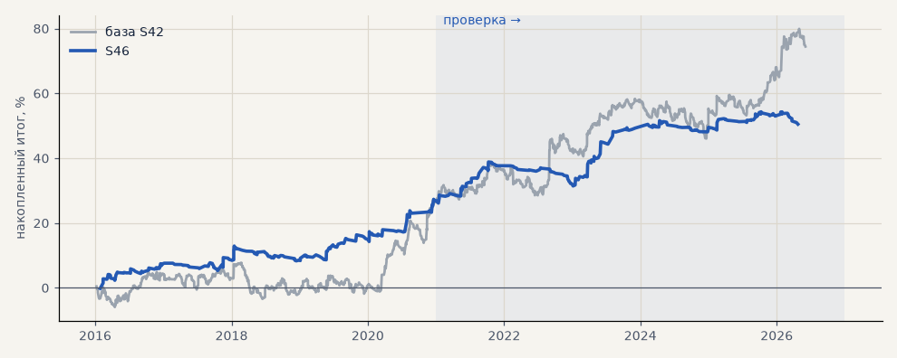

# S46. Итератор, стратегия 2: пробой 55 дней (набор для запуска)

**Семейство:** новые стратегии из блоков ТЗ (перебор) · **база:** S42 · **гипотеза:** H54 · **вердикт:** держится в обоих периодах: PF 1.83 / 1.70, без 2 лучших в плюсе; с S42 t месяцев 2.43 против 1.93 — кандидат в бумажный режим (выбран после взгляда на проверку)

**Что проверяли.** Финалист №3 перебора H54: вход — первый за день час, закрывшийся выше максимума 55 дней (лонг) или ниже минимума (шорт, у акций не берётся); фильтры — цена на 4 ч по ту же сторону от EMA200 и ATR14/ATR100 > 1; выход — разворот Supertrend (10, 3) на 4 ч, защитный стоп 3 ATR(20); размер по риску. Издержки как у S42.

**Зачем.** Созвон 18.10 (T36): Тимур хочет видеть, как перебор находит стратегии и как они торгуют, — сделки на графике, наложение на тренд-фильтр (H61) и согласие с импульсом (H62). Сделки посчитаны тем же часовым движком, которым считал перебор H54, — ровно то, что «видел» итератор.

**Итог простыми словами.** Единственный из четырёх, что держится на проверке (PF 1.70, без 2 лучших в плюсе) и улучшает S42 в портфеле в обоих периодах. Выбран из пяти финалистов уже после взгляда на проверку — кандидат для бумажного режима.

**Издержки:** профиль `exchange` (спред и свопы брокера)

Подробности: [results/iterator_walkthrough.md](../../results/iterator_walkthrough.md)

Проверка — сделки, открытые с 1 января 2021 года; выбор — до 2021. В скобках — база на тех же инструментах.

| срез | период | сделок | итог % | выигрышей | ожидание на сделку | PF | без 2 лучших | просадка | t | лет в плюсе |
|---|---|---|---|---|---|---|---|---|---|---|
| все инструменты | проверка | 214 (884) | +23.4 (+47.0) | 33% (44%) | +0.547% (+0.266%) | 1.70 (1.26) | +15.8 (+34.7) | -7.4 (-12.2) | 2.34 (2.20) | 4/6 (5/6) |
| все инструменты | выбор | 199 (736) | +27.1 (+27.5) | 37% (44%) | +0.680% (+0.187%) | 1.83 (1.19) | +20.7 (+19.9) | -4.6 (-11.2) | 2.64 (1.64) | 5/5 (3/5) |
| портфель 4 | проверка | 148 (621) | +28.8 (+52.6) | 36% (44%) | +0.779% (+0.339%) | 1.86 (1.29) | +19.2 (+37.2) | -8.1 (-16.1) | 2.38 (2.07) | 4/6 (5/6) |
| портфель 4 | выбор | 144 (493) | +29.4 (+46.4) | 38% (46%) | +0.817% (+0.377%) | 1.85 (1.35) | +21.4 (+37.0) | -5.0 (-11.5) | 2.40 (2.35) | 5/5 (3/5) |
| металлы (серебро + золото) | проверка | 124 (506) | -8.9 (+41.3) | 26% (44%) | -0.144% (+0.163%) | 0.78 (1.17) | -15.4 (+23.2) | -18.0 (-28.5) | -1.00 (1.18) | 3/6 (5/6) |
| металлы (серебро + золото) | выбор | 101 (461) | +25.4 (-11.5) | 35% (38%) | +0.503% (-0.050%) | 1.83 (0.94) | +12.1 (-30.4) | -9.7 (-55.8) | 1.73 (-0.41) | 3/5 (1/5) |
| серебро | проверка | 58 (243) | -19.6 (+58.1) | 26% (46%) | -0.338% (+0.239%) | 0.61 (1.18) | -32.5 (+21.9) | -25.9 (-51.2) | -1.43 (0.94) | 2/6 (5/6) |
| серебро | выбор | 46 (218) | +33.0 (+25.4) | 33% (37%) | +0.717% (+0.117%) | 1.88 (1.11) | +6.5 (-12.4) | -13.2 (-66.8) | 1.30 (0.52) | 3/5 (2/5) |
| золото | проверка | 66 (263) | +1.8 (+24.5) | 26% (42%) | +0.027% (+0.093%) | 1.06 (1.15) | -7.3 (-2.2) | -13.7 (-39.2) | 0.16 (0.73) | 2/6 (2/6) |
| золото | выбор | 55 (243) | +17.8 (-48.4) | 36% (40%) | +0.323% (-0.199%) | 1.75 (0.73) | -0.4 (-63.4) | -7.3 (-69.1) | 1.18 (-1.80) | 3/5 (2/5) |
| LKOH | проверка | 34 (123) | +46.4 (+32.3) | 38% (45%) | +1.364% (+0.262%) | 2.75 (1.23) | +15.5 (+10.1) | -10.3 (-24.1) | 1.75 (0.87) | 3/6 (4/6) |
| LKOH | выбор | 33 (79) | +18.8 (+65.4) | 33% (59%) | +0.570% (+0.828%) | 1.53 (1.82) | -9.5 (+38.0) | -9.5 (-14.0) | 0.77 (1.97) | 3/5 (3/5) |
| GAZP | проверка | 16 (127) | +21.4 (+60.3) | 50% (43%) | +1.335% (+0.475%) | 2.38 (1.38) | +5.8 (-0.3) | -9.8 (-34.6) | 1.36 (1.00) | 3/6 (5/6) |
| GAZP | выбор | 29 (96) | +25.4 (+44.1) | 38% (48%) | +0.875% (+0.459%) | 1.88 (1.45) | +2.3 (+16.4) | -9.8 (-12.4) | 1.12 (1.27) | 3/5 (4/5) |
| SBER | проверка | 40 (128) | +67.2 (+59.8) | 45% (44%) | +1.680% (+0.467%) | 2.58 (1.50) | +34.3 (+31.1) | -12.0 (-27.9) | 1.98 (1.52) | 3/6 (5/6) |
| SBER | выбор | 36 (100) | +40.5 (+50.8) | 47% (53%) | +1.124% (+0.508%) | 2.09 (1.39) | +13.5 (+26.8) | -11.9 (-28.5) | 1.53 (1.29) | 3/5 (4/5) |

Журнал сделок: `trades.csv.gz` (инструмент, прогон, сторона, вход, выход, цены, результат после издержек, причина выхода).
