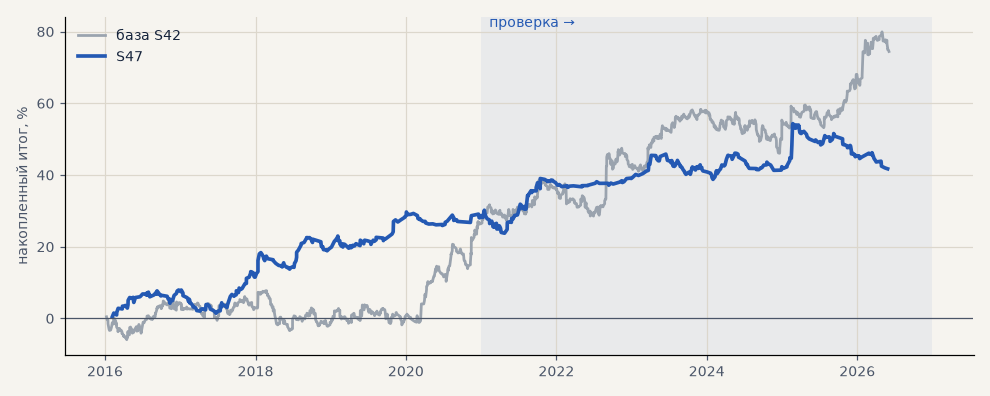

# S47. Итератор, стратегия 3: канал Кельтнера дневной (набор для запуска)

**Семейство:** новые стратегии из блоков ТЗ (перебор) · **база:** S42 · **гипотеза:** H54 · **вердикт:** слабее на проверке: PF 1.53 → 1.18, без 2 лучших +3.8, t 0.98

**Что проверяли.** Финалист №4 перебора H54: вход — дневное закрытие вышло за канал Кельтнера EMA20 ± 2 ATR10 (вверх — лонг, вниз — шорт); фильтр — дневная цена по ту же сторону от EMA200 дней; выход — обратный сигнал канала, защитный стоп 6 ATR(14); размер по риску. Издержки как у S42.

**Зачем.** Созвон 18.10 (T36): Тимур хочет видеть, как перебор находит стратегии и как они торгуют, — сделки на графике, наложение на тренд-фильтр (H61) и согласие с импульсом (H62). Сделки посчитаны тем же часовым движком, которым считал перебор H54, — ровно то, что «видел» итератор.

**Итог простыми словами.** На проверке слабее вдвое (PF 1.18). Обратный сигнал почти не наступает: сделки закрывает предел 240 ч (64%) или стоп. С тренд-фильтром на проверке лучше (PF 1.45), но на выборе t падает.

**Издержки:** профиль `exchange` (спред и свопы брокера)

Подробности: [results/iterator_walkthrough.md](../../results/iterator_walkthrough.md)

Проверка — сделки, открытые с 1 января 2021 года; выбор — до 2021. В скобках — база на тех же инструментах.

| срез | период | сделок | итог % | выигрышей | ожидание на сделку | PF | без 2 лучших | просадка | t | лет в плюсе |
|---|---|---|---|---|---|---|---|---|---|---|
| все инструменты | проверка | 294 (884) | +13.0 (+47.0) | 43% (44%) | +0.221% (+0.266%) | 1.18 (1.26) | +3.8 (+34.7) | -12.6 (-12.2) | 0.98 (2.20) | 5/6 (5/6) |
| все инструменты | выбор | 266 (736) | +28.7 (+27.5) | 50% (44%) | +0.540% (+0.187%) | 1.53 (1.19) | +22.7 (+19.9) | -6.5 (-11.2) | 2.64 (1.64) | 4/5 (3/5) |
| портфель 4 | проверка | 220 (621) | +16.2 (+52.6) | 45% (44%) | +0.294% (+0.339%) | 1.21 (1.29) | +4.7 (+37.2) | -17.0 (-16.1) | 1.00 (2.07) | 5/6 (5/6) |
| портфель 4 | выбор | 202 (493) | +37.0 (+46.4) | 53% (46%) | +0.733% (+0.377%) | 1.67 (1.35) | +29.6 (+37.0) | -6.7 (-11.5) | 2.84 (2.35) | 5/5 (3/5) |
| металлы (серебро + золото) | проверка | 152 (506) | -12.4 (+41.3) | 39% (44%) | -0.163% (+0.163%) | 0.82 (1.17) | -19.5 (+23.2) | -18.4 (-28.5) | -1.00 (1.18) | 3/6 (5/6) |
| металлы (серебро + золото) | выбор | 143 (461) | -11.7 (-11.5) | 39% (38%) | -0.164% (-0.050%) | 0.85 (0.94) | -18.9 (-30.4) | -20.2 (-55.8) | -0.80 (-0.41) | 1/5 (1/5) |
| серебро | проверка | 78 (243) | -25.2 (+58.1) | 40% (46%) | -0.323% (+0.239%) | 0.72 (1.18) | -39.3 (+21.9) | -31.6 (-51.2) | -1.22 (0.94) | 2/6 (5/6) |
| серебро | выбор | 79 (218) | -18.9 (+25.4) | 41% (37%) | -0.239% (+0.117%) | 0.82 (1.11) | -33.2 (-12.4) | -34.3 (-66.8) | -0.75 (0.52) | 3/5 (2/5) |
| золото | проверка | 74 (263) | +0.4 (+24.5) | 39% (42%) | +0.005% (+0.093%) | 1.01 (1.15) | -9.2 (-2.2) | -9.7 (-39.2) | 0.03 (0.73) | 2/6 (2/6) |
| золото | выбор | 64 (243) | -4.6 (-48.4) | 38% (40%) | -0.071% (-0.199%) | 0.91 (0.73) | -14.7 (-63.4) | -15.2 (-69.1) | -0.31 (-1.80) | 2/5 (2/5) |
| LKOH | проверка | 48 (123) | +23.7 (+32.3) | 50% (45%) | +0.494% (+0.262%) | 1.36 (1.23) | +0.9 (+10.1) | -30.6 (-24.1) | 0.85 (0.87) | 3/6 (4/6) |
| LKOH | выбор | 46 (79) | +46.8 (+65.4) | 61% (59%) | +1.017% (+0.828%) | 2.20 (1.82) | +24.4 (+38.0) | -9.1 (-14.0) | 1.90 (1.97) | 4/5 (3/5) |
| GAZP | проверка | 38 (127) | +24.7 (+60.3) | 45% (43%) | +0.649% (+0.475%) | 1.46 (1.38) | -16.2 (-0.3) | -17.3 (-34.6) | 0.68 (1.00) | 2/5 (5/6) |
| GAZP | выбор | 36 (96) | +37.1 (+44.1) | 58% (48%) | +1.031% (+0.459%) | 1.96 (1.45) | +13.5 (+16.4) | -10.9 (-12.4) | 1.48 (1.27) | 4/5 (4/5) |
| SBER | проверка | 56 (128) | +41.5 (+59.8) | 46% (44%) | +0.742% (+0.467%) | 1.40 (1.50) | +9.8 (+31.1) | -27.0 (-27.9) | 1.00 (1.52) | 4/5 (5/6) |
| SBER | выбор | 41 (100) | +83.1 (+50.8) | 66% (53%) | +2.028% (+0.508%) | 3.16 (1.39) | +62.1 (+26.8) | -12.0 (-28.5) | 3.05 (1.29) | 5/5 (4/5) |

Журнал сделок: `trades.csv.gz` (инструмент, прогон, сторона, вход, выход, цены, результат после издержек, причина выхода).
