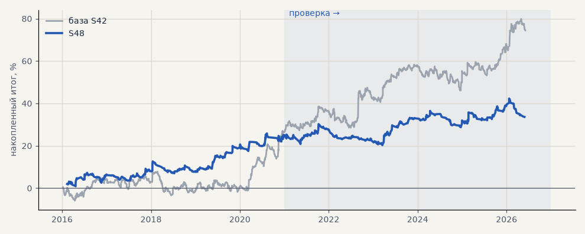

# S48. Итератор, стратегия 4: пробой 20 дней + 0.25 ATR (набор для запуска)

**Семейство:** новые стратегии из блоков ТЗ (перебор) · **база:** S42 · **гипотеза:** H54 · **вердикт:** слабее на проверке: PF 1.42 → 1.11, без 2 лучших +2.8, t 0.71

**Что проверяли.** Финалист №5 перебора H54: вход — пробой максимума (минимума) 20 дней с запасом 0.25 ATR; фильтр — дневная цена по ту же сторону от EMA200 дней; выход — закрытие за минимумом (максимумом) 20 дней, защитный стоп 3 ATR(10); размер одинаковый. Издержки как у S42.

**Зачем.** Созвон 18.10 (T36): Тимур хочет видеть, как перебор находит стратегии и как они торгуют, — сделки на графике, наложение на тренд-фильтр (H61) и согласие с импульсом (H62). Сделки посчитаны тем же часовым движком, которым считал перебор H54, — ровно то, что «видел» итератор.

**Итог простыми словами.** На проверке почти ноль (PF 1.11). Стоп 3 ATR часовых узкий: 62% сделок закрывает стоп, на серебре в росте 2024 года в плюсе 5 сделок из 27.

**Издержки:** профиль `exchange` (спред и свопы брокера)

Подробности: [results/iterator_walkthrough.md](../../results/iterator_walkthrough.md)

Проверка — сделки, открытые с 1 января 2021 года; выбор — до 2021. В скобках — база на тех же инструментах.

| срез | период | сделок | итог % | выигрышей | ожидание на сделку | PF | без 2 лучших | просадка | t | лет в плюсе |
|---|---|---|---|---|---|---|---|---|---|---|
| все инструменты | проверка | 361 (884) | +8.4 (+47.0) | 31% (44%) | +0.117% (+0.266%) | 1.11 (1.26) | +2.8 (+34.7) | -10.0 (-12.2) | 0.71 (2.20) | 3/6 (5/6) |
| все инструменты | выбор | 319 (736) | +25.2 (+27.5) | 37% (44%) | +0.395% (+0.187%) | 1.42 (1.19) | +17.3 (+19.9) | -5.7 (-11.2) | 2.02 (1.64) | 4/5 (3/5) |
| портфель 4 | проверка | 266 (621) | +7.7 (+52.6) | 32% (44%) | +0.116% (+0.339%) | 1.10 (1.29) | +0.7 (+37.2) | -10.8 (-16.1) | 0.56 (2.07) | 3/6 (5/6) |
| портфель 4 | выбор | 242 (493) | +31.2 (+46.4) | 38% (46%) | +0.516% (+0.377%) | 1.50 (1.35) | +21.3 (+37.0) | -6.4 (-11.5) | 2.09 (2.35) | 5/5 (3/5) |
| металлы (серебро + золото) | проверка | 196 (506) | -19.6 (+41.3) | 29% (44%) | -0.200% (+0.163%) | 0.83 (1.17) | -29.6 (+23.2) | -34.9 (-28.5) | -1.02 (1.18) | 1/6 (5/6) |
| металлы (серебро + золото) | выбор | 155 (461) | +17.3 (-11.5) | 32% (38%) | +0.223% (-0.050%) | 1.28 (0.94) | -2.5 (-30.4) | -14.5 (-55.8) | 0.86 (-0.41) | 3/5 (1/5) |
| серебро | проверка | 101 (243) | -50.5 (+58.1) | 29% (46%) | -0.500% (+0.239%) | 0.68 (1.18) | -70.4 (+21.9) | -68.7 (-51.2) | -1.55 (0.94) | 1/6 (5/6) |
| серебро | выбор | 78 (218) | +33.5 (+25.4) | 31% (37%) | +0.429% (+0.117%) | 1.44 (1.11) | -6.2 (-12.4) | -20.6 (-66.8) | 0.91 (0.52) | 4/5 (2/5) |
| золото | проверка | 95 (263) | +11.2 (+24.5) | 29% (42%) | +0.118% (+0.093%) | 1.16 (1.15) | -1.5 (-2.2) | -13.8 (-39.2) | 0.56 (0.73) | 3/6 (2/6) |
| золото | выбор | 77 (243) | +1.1 (-48.4) | 34% (40%) | +0.015% (-0.199%) | 1.02 (0.73) | -17.0 (-63.4) | -13.6 (-69.1) | 0.07 (-1.80) | 2/5 (2/5) |
| LKOH | проверка | 63 (123) | +23.8 (+32.3) | 33% (45%) | +0.377% (+0.262%) | 1.35 (1.23) | +2.3 (+10.1) | -23.4 (-24.1) | 0.89 (0.87) | 3/6 (4/6) |
| LKOH | выбор | 60 (79) | -4.5 (+65.4) | 33% (59%) | -0.075% (+0.828%) | 0.94 (1.82) | -26.8 (+38.0) | -15.4 (-14.0) | -0.19 (1.97) | 2/5 (3/5) |
| GAZP | проверка | 38 (127) | +20.3 (+60.3) | 32% (43%) | +0.536% (+0.475%) | 1.49 (1.38) | -6.6 (-0.3) | -10.9 (-34.6) | 0.81 (1.00) | 2/6 (5/6) |
| GAZP | выбор | 46 (96) | +35.2 (+44.1) | 43% (48%) | +0.764% (+0.459%) | 1.76 (1.45) | +7.1 (+16.4) | -13.3 (-12.4) | 1.26 (1.27) | 3/5 (4/5) |
| SBER | проверка | 64 (128) | +37.2 (+59.8) | 36% (44%) | +0.582% (+0.467%) | 1.66 (1.50) | +17.2 (+31.1) | -11.4 (-27.9) | 1.44 (1.52) | 3/5 (5/6) |
| SBER | выбор | 58 (100) | +60.8 (+50.8) | 47% (53%) | +1.048% (+0.508%) | 2.08 (1.39) | +35.5 (+26.8) | -9.9 (-28.5) | 2.05 (1.29) | 4/5 (4/5) |

Журнал сделок: `trades.csv.gz` (инструмент, прогон, сторона, вход, выход, цены, результат после издержек, причина выхода).
