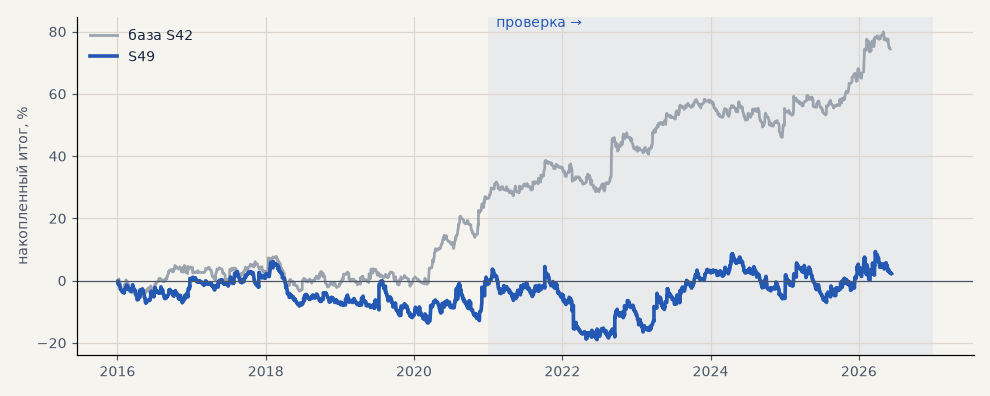

# S49. Сделки по трёхслойному фильтру (набор для запуска)

**Семейство:** тренд-фильтр как самостоятельная стратегия · **база:** S42 · **гипотеза:** H59 · **вердикт:** ноль: PF 1.01 на выборе и 1.00 на проверке, без 2 лучших в минусе — металлы теряют на частых переворотах, акции в лонг в плюсе (вынесено в H60)

**Что проверяли.** Сделки по самому трёхслойному тренд-фильтру (режим по дневной EMA200, H55) на наборе для запуска: лонг, пока фильтр смотрит вверх, шорт — пока вниз (у акций только лонг); вход и выход по открытию часа после смены состояния, нейтраль закрывает позицию. Без стопа и подбора; издержки как у S42.

**Зачем.** Созвон 18.10: Тимур предложил открывать сделки по самому фильтру — «может быть, совсем простенько» (гипотеза H59).

**Итог простыми словами.** Ноль в обоих периодах: на металлах фильтр часто переворачивается, и каждая сделка платит издержки; акции в лонг по фильтру в плюсе, но частично это рост рынка — вынесено в H60 (S50).

**Издержки:** профиль `exchange` (спред и свопы брокера)

Подробности: [results/trend_follow.md](../../results/trend_follow.md)

Проверка — сделки, открытые с 1 января 2021 года; выбор — до 2021. В скобках — база на тех же инструментах.

| срез | период | сделок | итог % | выигрышей | ожидание на сделку | PF | без 2 лучших | просадка | t | лет в плюсе |
|---|---|---|---|---|---|---|---|---|---|---|
| все инструменты | проверка | 2197 (884) | -0.7 (+47.0) | 31% (44%) | -0.002% (+0.266%) | 1.00 (1.26) | -11.3 (+34.7) | -23.5 (-12.2) | -0.03 (2.20) | 2/6 (5/6) |
| все инструменты | выбор | 1716 (736) | +2.9 (+27.5) | 30% (44%) | +0.009% (+0.187%) | 1.01 (1.19) | -8.5 (+19.9) | -19.8 (-11.2) | 0.15 (1.64) | 3/5 (3/5) |
| портфель 4 | проверка | 1477 (621) | +14.6 (+52.6) | 32% (44%) | +0.040% (+0.339%) | 1.05 (1.29) | +1.3 (+37.2) | -24.6 (-16.1) | 0.53 (2.07) | 2/6 (5/6) |
| портфель 4 | выбор | 1073 (493) | +18.2 (+46.4) | 31% (46%) | +0.068% (+0.377%) | 1.09 (1.35) | +3.9 (+37.0) | -13.7 (-11.5) | 0.77 (2.35) | 4/5 (3/5) |
| металлы (серебро + золото) | проверка | 1440 (506) | -65.0 (+41.3) | 31% (44%) | -0.090% (+0.163%) | 0.86 (1.17) | -81.7 (+23.2) | -108.0 (-28.5) | -1.71 (1.18) | 2/6 (5/6) |
| металлы (серебро + золото) | выбор | 1322 (461) | -98.8 (-11.5) | 28% (38%) | -0.149% (-0.050%) | 0.73 (0.94) | -116.6 (-30.4) | -108.4 (-55.8) | -3.25 (-0.41) | 0/5 (1/5) |
| серебро | проверка | 720 (243) | -68.3 (+58.1) | 32% (46%) | -0.095% (+0.239%) | 0.88 (1.18) | -101.7 (+21.9) | -143.4 (-51.2) | -1.02 (0.94) | 2/6 (5/6) |
| серебро | выбор | 679 (218) | -139.5 (+25.4) | 27% (37%) | -0.205% (+0.117%) | 0.71 (1.11) | -175.1 (-12.4) | -148.8 (-66.8) | -2.56 (0.52) | 0/5 (2/5) |
| золото | проверка | 720 (263) | -61.7 (+24.5) | 29% (42%) | -0.086% (+0.093%) | 0.81 (1.15) | -83.5 (-2.2) | -78.9 (-39.2) | -1.70 (0.73) | 1/6 (2/6) |
| золото | выбор | 643 (243) | -58.1 (-48.4) | 28% (40%) | -0.090% (-0.199%) | 0.76 (0.73) | -71.7 (-63.4) | -75.7 (-69.1) | -2.16 (-1.80) | 1/5 (2/5) |
| LKOH | проверка | 253 (123) | +9.7 (+32.3) | 29% (45%) | +0.038% (+0.262%) | 1.04 (1.23) | -14.2 (+10.1) | -42.8 (-24.1) | 0.21 (0.87) | 3/6 (4/6) |
| LKOH | выбор | 130 (79) | +66.4 (+65.4) | 41% (59%) | +0.511% (+0.828%) | 1.66 (1.82) | +33.8 (+38.0) | -14.6 (-14.0) | 1.72 (1.97) | 5/5 (3/5) |
| GAZP | проверка | 255 (127) | +47.2 (+60.3) | 31% (43%) | +0.185% (+0.475%) | 1.23 (1.38) | -3.7 (-0.3) | -25.6 (-34.6) | 0.83 (1.00) | 4/6 (5/6) |
| GAZP | выбор | 144 (96) | +44.7 (+44.1) | 35% (48%) | +0.310% (+0.459%) | 1.38 (1.45) | -6.2 (+16.4) | -20.9 (-12.4) | 0.92 (1.27) | 4/5 (4/5) |
| SBER | проверка | 249 (128) | +69.9 (+59.8) | 34% (44%) | +0.281% (+0.467%) | 1.40 (1.50) | +29.6 (+31.1) | -37.6 (-27.9) | 1.41 (1.52) | 4/6 (5/6) |
| SBER | выбор | 120 (100) | +101.2 (+50.8) | 41% (53%) | +0.843% (+0.508%) | 1.90 (1.39) | +74.3 (+26.8) | -23.1 (-28.5) | 2.29 (1.29) | 4/5 (4/5) |

Журнал сделок: `trades.csv.gz` (инструмент, прогон, сторона, вход, выход, цены, результат после издержек, причина выхода).
