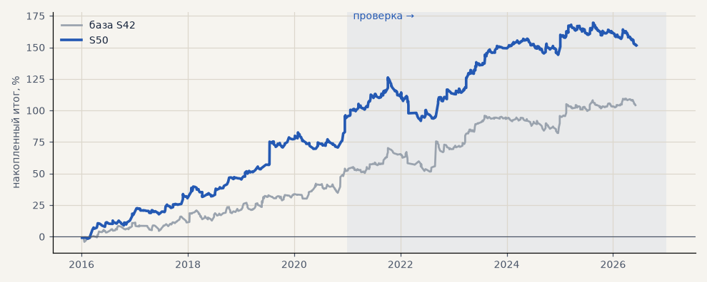

# S50. Акции в лонг по трёхслойному фильтру до противоположного сигнала

**Семейство:** тренд-фильтр как самостоятельная стратегия · **база:** S42 · **гипотеза:** H60 · **вердикт:** лучше «купить и держать» на единицу риска в обоих периодах, но с акциями S42 связан сильно (корр. 0.79) и портфель с ними на проверке не лучше — H60 не подтвердилась целиком; вариант найден после расчёта H59

**Что проверяли.** GAZP, SBER, LKOH на бирже в лонг, пока трёхслойный фильтр не покажет вниз: нейтраль позицию не закрывает. Вход и выход по открытию часа после сигнала, без стопа и подбора; цены с поправкой на дивиденды, издержки биржи.

**Зачем.** В разборе H59 этот вариант дал плюс на всех трёх бумагах в обоих периодах; надо было понять, не просто ли это рост рынка, и годится ли он второй стратегией к импульсу (гипотеза H60).

**Итог простыми словами.** Против «купить и держать» — лучше на единицу риска в обоих периодах: просадка вдвое меньше, t месяцев выше; на выборе итог ниже держания. Но месяцы правила и акций S42 сильно связаны (обе держат те же бумаги в лонг), и портфель с ними на проверке не лучше. Сравнение с держанием — в docs/results/trend_hold.md.

**Издержки:** профиль `exchange` (спред и свопы брокера)

Подробности: [results/trend_hold.md](../../results/trend_hold.md)

Проверка — сделки, открытые с 1 января 2021 года; выбор — до 2021. В скобках — база на тех же инструментах.

| срез | период | сделок | итог % | выигрышей | ожидание на сделку | PF | без 2 лучших | просадка | t | лет в плюсе |
|---|---|---|---|---|---|---|---|---|---|---|
| все инструменты | проверка | 620 (378) | +51.9 (+50.8) | 36% (44%) | +0.251% (+0.403%) | 1.25 (1.37) | +33.8 (+30.6) | -34.4 (-18.7) | 1.66 (1.89) | 5/6 (6/6) |
| все инструменты | выбор | 288 (275) | +99.8 (+53.4) | 43% (53%) | +1.039% (+0.583%) | 2.01 (1.52) | +73.4 (+44.1) | -13.0 (-8.1) | 3.28 (2.59) | 5/5 (5/5) |
| LKOH | проверка | 211 (123) | +19.8 (+32.3) | 32% (45%) | +0.094% (+0.262%) | 1.09 (1.23) | -6.1 (+10.1) | -46.3 (-24.1) | 0.40 (0.87) | 3/6 (4/6) |
| LKOH | выбор | 94 (79) | +82.3 (+65.4) | 44% (59%) | +0.876% (+0.828%) | 1.87 (1.82) | +49.2 (+38.0) | -15.3 (-14.0) | 1.97 (1.97) | 5/5 (3/5) |
| GAZP | проверка | 208 (127) | +55.1 (+60.3) | 35% (43%) | +0.265% (+0.475%) | 1.27 (1.38) | +6.7 (-0.3) | -32.1 (-34.6) | 0.94 (1.00) | 4/6 (5/6) |
| GAZP | выбор | 105 (96) | +84.2 (+44.1) | 40% (48%) | +0.802% (+0.459%) | 1.78 (1.45) | +5.1 (+16.4) | -27.9 (-12.4) | 1.28 (1.27) | 5/5 (4/5) |
| SBER | проверка | 201 (128) | +80.7 (+59.8) | 41% (44%) | +0.402% (+0.467%) | 1.44 (1.50) | +36.7 (+31.1) | -44.4 (-27.9) | 1.49 (1.52) | 5/6 (5/6) |
| SBER | выбор | 89 (100) | +132.7 (+50.8) | 46% (53%) | +1.491% (+0.508%) | 2.43 (1.39) | +99.4 (+26.8) | -16.7 (-28.5) | 2.80 (1.29) | 5/5 (4/5) |

Журнал сделок: `trades.csv.gz` (инструмент, прогон, сторона, вход, выход, цены, результат после издержек, причина выхода).
