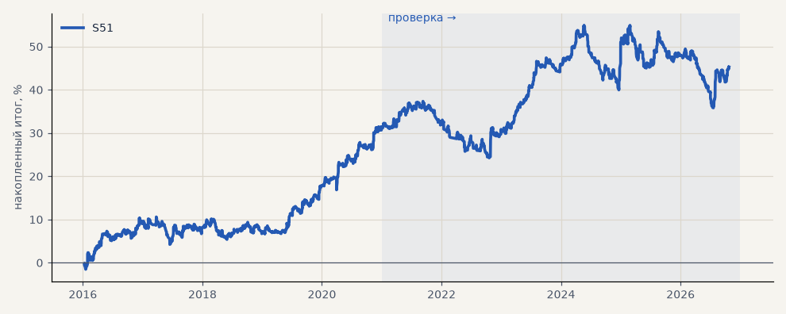

# S51. S42 на 16 новых акциях Мосбиржи

**Семейство:** стратегия без ML (импульс) · **база:** — · **гипотеза:** H66 · **вердикт:** не подтвердилась по одному пункту: PF на проверке 1.08 < 1.1 (на SBER, GAZP, LKOH — 1.37); остальное выполнено, лучше случайных входов (p 0.001)

**Что проверяли.** Импульс S42 без изменений — правило, выход, гейт C, только лонг, издержки биржи, цены с поправкой на дивиденды — на 16 акциях индекса Мосбиржи, которые не участвовали в выборе: TATN, NVTK, GMKN, ROSN, VTBR, PLZL, SNGSP, IRAO, CHMF, NLMK, MAGN, RTKM, TRNFP, AFLT, ALRS, AFKS. Бумаги отобраны до расчёта: история с 2015 года, оборот 2016–2020 от 100 млн ₽ в день, одна бумага на эмитента.

**Зачем.** Созвон 23.10: много стратегий на многих инструментах; S42 выбран на SBER, GAZP, LKOH — новые бумаги проверяют, не подгонка ли это под них (гипотеза H66, T41).

**Итог простыми словами.** Преимущество переносится, но слабым: PF 1.28 на выборе и 1.08 на проверке, в плюсе 12 бумаг из 16, средняя сделка заметно лучше случайных входов в лонг той же длины (p 0.001). Порог H66 (PF > 1.1 на проверке) не пройден. На бумагах выбора PF 1.37 — часть результата S42 дал удачный выбор бумаг.

**Издержки:** профиль `exchange` (спред и свопы брокера)

Подробности: [results/new_stocks.md](../../results/new_stocks.md)

Проверка — сделки, открытые с 1 января 2021 года; выбор — до 2021. В скобках — база на тех же инструментах.

| срез | период | сделок | итог % | выигрышей | ожидание на сделку | PF | без 2 лучших | просадка | t | лет в плюсе |
|---|---|---|---|---|---|---|---|---|---|---|
| все инструменты | проверка | 2103 | +13.7 | 42% | +0.104% | 1.08 | +10.6 | -19.1 | 1.22 | 3/6 |
| все инструменты | выбор | 1375 | +31.6 | 47% | +0.368% | 1.28 | +29.0 | -6.4 | 3.43 | 3/5 |
| TATN | проверка | 132 | +56.3 | 42% | +0.426% | 1.30 | +24.8 | -32.4 | 1.10 | 4/6 |
| TATN | выбор | 81 | +18.0 | 49% | +0.222% | 1.16 | -12.4 | -36.8 | 0.49 | 3/5 |
| NVTK | проверка | 132 | +47.0 | 46% | +0.356% | 1.26 | +16.0 | -33.0 | 0.98 | 5/6 |
| NVTK | выбор | 83 | -22.5 | 42% | -0.271% | 0.83 | -41.5 | -41.8 | -0.68 | 2/5 |
| GMKN | проверка | 148 | -38.5 | 39% | -0.260% | 0.81 | -60.3 | -69.0 | -0.98 | 1/6 |
| GMKN | выбор | 103 | +61.3 | 50% | +0.595% | 1.56 | +41.7 | -13.6 | 1.75 | 4/5 |
| ROSN | проверка | 138 | +15.3 | 46% | +0.111% | 1.09 | -3.0 | -32.8 | 0.38 | 3/6 |
| ROSN | выбор | 92 | +46.5 | 47% | +0.506% | 1.42 | +13.7 | -26.0 | 1.18 | 3/5 |
| VTBR | проверка | 141 | +23.9 | 38% | +0.169% | 1.12 | -8.4 | -34.0 | 0.47 | 4/6 |
| VTBR | выбор | 83 | -28.2 | 35% | -0.339% | 0.78 | -43.4 | -41.6 | -0.92 | 1/5 |
| PLZL | проверка | 141 | +48.5 | 44% | +0.344% | 1.26 | +23.4 | -26.5 | 1.02 | 3/6 |
| PLZL | выбор | 88 | +56.4 | 53% | +0.641% | 1.48 | +27.9 | -30.6 | 1.41 | 3/5 |
| SNGSP | проверка | 138 | -9.9 | 41% | -0.071% | 0.94 | -36.1 | -37.9 | -0.26 | 2/6 |
| SNGSP | выбор | 85 | -8.3 | 44% | -0.097% | 0.92 | -32.1 | -33.2 | -0.28 | 2/5 |
| IRAO | проверка | 111 | +40.2 | 47% | +0.363% | 1.38 | +13.8 | -31.4 | 1.14 | 3/6 |
| IRAO | выбор | 80 | +50.9 | 49% | +0.637% | 1.46 | +21.0 | -33.6 | 1.26 | 2/5 |
| CHMF | проверка | 135 | +21.9 | 44% | +0.162% | 1.11 | -21.1 | -49.3 | 0.41 | 3/6 |
| CHMF | выбор | 90 | +47.0 | 50% | +0.523% | 1.48 | +28.8 | -28.1 | 1.40 | 3/5 |
| NLMK | проверка | 136 | +28.2 | 41% | +0.207% | 1.15 | -7.2 | -51.0 | 0.57 | 3/6 |
| NLMK | выбор | 90 | +77.2 | 56% | +0.857% | 1.86 | +54.1 | -15.5 | 2.20 | 4/5 |
| MAGN | проверка | 136 | +11.3 | 43% | +0.083% | 1.06 | -20.4 | -40.9 | 0.24 | 4/6 |
| MAGN | выбор | 87 | +113.1 | 57% | +1.299% | 2.22 | +80.1 | -13.5 | 2.74 | 4/5 |
| RTKM | проверка | 111 | +7.5 | 41% | +0.067% | 1.05 | -20.1 | -36.4 | 0.18 | 3/6 |
| RTKM | выбор | 80 | -46.5 | 39% | -0.581% | 0.56 | -55.3 | -58.5 | -2.21 | 2/5 |
| TRNFP | проверка | 133 | +23.0 | 45% | +0.173% | 1.15 | +0.9 | -20.1 | 0.60 | 4/6 |
| TRNFP | выбор | 76 | +35.5 | 45% | +0.467% | 1.38 | +14.0 | -16.3 | 1.06 | 4/5 |
| AFLT | проверка | 123 | +0.3 | 38% | +0.002% | 1.00 | -28.9 | -33.4 | 0.01 | 2/6 |
| AFLT | выбор | 85 | +53.7 | 48% | +0.632% | 1.39 | +21.7 | -28.3 | 1.12 | 5/5 |
| ALRS | проверка | 124 | -24.6 | 44% | -0.198% | 0.88 | -51.5 | -64.0 | -0.54 | 3/6 |
| ALRS | выбор | 93 | +10.6 | 40% | +0.114% | 1.09 | -7.1 | -19.3 | 0.31 | 3/5 |
| AFKS | проверка | 124 | -30.9 | 38% | -0.249% | 0.84 | -51.0 | -44.6 | -0.75 | 2/6 |
| AFKS | выбор | 79 | +40.7 | 49% | +0.515% | 1.31 | +0.5 | -40.3 | 0.85 | 3/5 |

Журнал сделок: `trades.csv.gz` (инструмент, прогон, сторона, вход, выход, цены, результат после издержек, причина выхода).
