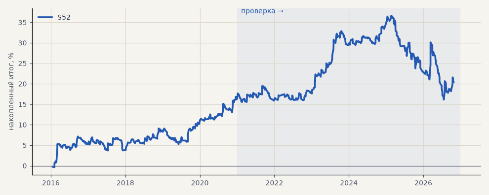

# S52. S45 (NR7 → пробой) на 16 новых акциях

**Семейство:** новые стратегии из блоков ТЗ (перебор) · **база:** — · **гипотеза:** H66 · **вердикт:** не переносится: PF на проверке 1.03, без 2 лучших −6.3, от случайных входов не отличается (p 0.10)

**Что проверяли.** Стратегия итератора S45 (NR7 → пробой, ADX 1ч > 25, выход Дончиан 20 дней, стоп 6 ATR, размер по риску) без изменений на тех же 16 новых акциях, движком перебора; только лонг, издержки биржи.

**Зачем.** Гипотеза H66: финалисты итератора выбраны на наборе для запуска — проверка на бумагах, которых перебор не видел.

**Итог простыми словами.** Не переносится: PF 1.42 на выборе, 1.03 на проверке, без 2 лучших в минусе, от случайных входов не отличается. Как и на журнале (S45), это подгонка.

**Издержки:** профиль `exchange` (спред и свопы брокера)

Подробности: [results/new_stocks.md](../../results/new_stocks.md)

Проверка — сделки, открытые с 1 января 2021 года; выбор — до 2021. В скобках — база на тех же инструментах.

| срез | период | сделок | итог % | выигрышей | ожидание на сделку | PF | без 2 лучших | просадка | t | лет в плюсе |
|---|---|---|---|---|---|---|---|---|---|---|
| все инструменты | проверка | 532 | +2.8 | 34% | +0.084% | 1.03 | -6.3 | -20.5 | 0.23 | 3/6 |
| все инструменты | выбор | 377 | +17.7 | 46% | +0.750% | 1.42 | +13.1 | -3.9 | 2.39 | 4/5 |
| TATN | проверка | 28 | +26.8 | 25% | +0.957% | 1.29 | -60.9 | -37.0 | 0.37 | 4/6 |
| TATN | выбор | 25 | +21.4 | 48% | +0.857% | 1.47 | -12.6 | -18.0 | 0.66 | 3/5 |
| NVTK | проверка | 33 | -23.3 | 33% | -0.705% | 0.75 | -56.4 | -31.1 | -0.68 | 1/6 |
| NVTK | выбор | 24 | +28.9 | 42% | +1.202% | 1.76 | -9.4 | -18.5 | 0.90 | 2/5 |
| GMKN | проверка | 39 | -62.4 | 21% | -1.600% | 0.45 | -89.1 | -62.5 | -2.14 | 2/6 |
| GMKN | выбор | 26 | +14.5 | 50% | +0.556% | 1.36 | -12.5 | -16.9 | 0.57 | 3/5 |
| ROSN | проверка | 40 | +29.5 | 32% | +0.738% | 1.28 | -66.2 | -45.5 | 0.32 | 3/6 |
| ROSN | выбор | 18 | +11.6 | 50% | +0.646% | 1.37 | -3.9 | -17.7 | 0.59 | 3/5 |
| VTBR | проверка | 32 | +15.7 | 31% | +0.490% | 1.19 | -32.9 | -52.3 | 0.33 | 4/6 |
| VTBR | выбор | 20 | +24.8 | 55% | +1.238% | 1.97 | -0.9 | -9.4 | 1.05 | 4/5 |
| PLZL | проверка | 42 | +74.5 | 55% | +1.774% | 1.91 | +25.4 | -26.9 | 1.49 | 3/6 |
| PLZL | выбор | 33 | +12.3 | 48% | +0.373% | 1.20 | -14.7 | -30.5 | 0.42 | 3/5 |
| SNGSP | проверка | 31 | -7.4 | 29% | -0.238% | 0.89 | -39.5 | -19.9 | -0.24 | 2/6 |
| SNGSP | выбор | 27 | +17.4 | 41% | +0.645% | 1.53 | -9.5 | -10.3 | 0.71 | 3/5 |
| IRAO | проверка | 25 | -23.8 | 32% | -0.954% | 0.72 | -51.7 | -53.8 | -0.73 | 2/6 |
| IRAO | выбор | 29 | +38.6 | 52% | +1.330% | 1.75 | +9.0 | -15.7 | 1.18 | 3/5 |
| CHMF | проверка | 39 | +21.3 | 41% | +0.546% | 1.30 | -12.8 | -32.6 | 0.59 | 4/6 |
| CHMF | выбор | 22 | -21.6 | 41% | -0.984% | 0.54 | -33.2 | -25.8 | -1.27 | 2/5 |
| NLMK | проверка | 36 | -56.6 | 25% | -1.571% | 0.52 | -86.4 | -58.5 | -1.74 | 2/6 |
| NLMK | выбор | 19 | +26.7 | 63% | +1.405% | 2.32 | +8.1 | -7.9 | 1.44 | 5/5 |
| MAGN | проверка | 39 | +121.4 | 44% | +3.112% | 2.27 | +46.2 | -66.9 | 1.65 | 4/6 |
| MAGN | выбор | 19 | +35.6 | 68% | +1.871% | 2.51 | +6.0 | -6.1 | 1.29 | 4/5 |
| RTKM | проверка | 33 | -25.8 | 30% | -0.781% | 0.61 | -48.1 | -25.8 | -1.10 | 2/6 |
| RTKM | выбор | 13 | +1.4 | 54% | +0.108% | 1.08 | -10.2 | -8.3 | 0.11 | 3/5 |
| TRNFP | проверка | 25 | +12.0 | 36% | +0.482% | 1.18 | -33.1 | -31.3 | 0.29 | 2/6 |
| TRNFP | выбор | 16 | -31.0 | 12% | -1.937% | 0.27 | -42.5 | -35.6 | -2.33 | 1/5 |
| AFLT | проверка | 36 | -26.8 | 31% | -0.743% | 0.76 | -72.6 | -70.8 | -0.62 | 2/6 |
| AFLT | выбор | 30 | +91.7 | 43% | +3.056% | 2.40 | +19.2 | -25.0 | 1.46 | 4/5 |
| ALRS | проверка | 29 | -37.7 | 28% | -1.298% | 0.47 | -52.1 | -51.7 | -1.79 | 3/6 |
| ALRS | выбор | 31 | +9.5 | 42% | +0.308% | 1.16 | -11.3 | -27.1 | 0.34 | 4/5 |
| AFKS | проверка | 25 | +6.9 | 44% | +0.275% | 1.11 | -30.9 | -26.1 | 0.19 | 3/6 |
| AFKS | выбор | 25 | +0.9 | 36% | +0.035% | 1.01 | -42.3 | -32.2 | 0.02 | 2/5 |

Журнал сделок: `trades.csv.gz` (инструмент, прогон, сторона, вход, выход, цены, результат после издержек, причина выхода).
