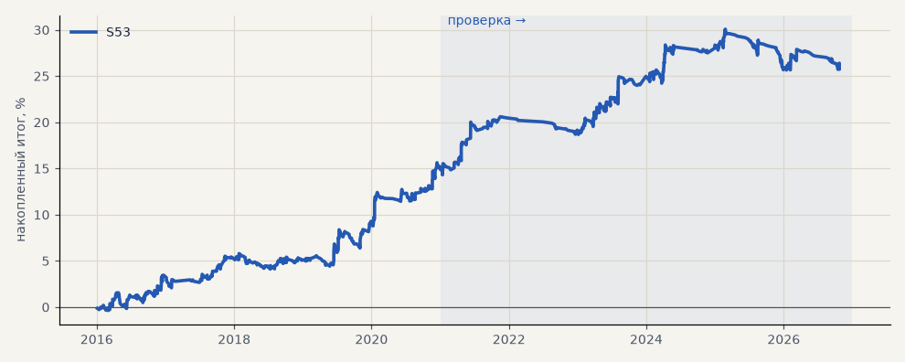

# S53. S46 (пробой 55 дней) на 16 новых акциях

**Семейство:** новые стратегии из блоков ТЗ (перебор) · **база:** — · **гипотеза:** H66 · **вердикт:** подтвердилась: PF 1.44 на выборе и 1.30 на проверке, без 2 лучших в плюсе, в плюсе 12 бумаг из 16, лучше случайных входов (p 0.020)

**Что проверяли.** Стратегия итератора S46 (пробой 55 дней, EMA200 4ч и ATR14/ATR100 > 1, выход Supertrend 4ч, стоп 3 ATR, размер по риску) без изменений на 16 новых акциях, движком перебора; только лонг, издержки биржи.

**Зачем.** Гипотеза H66: S46 — единственный финалист, что держался на проверке (кандидат в бумажный режим) — держится ли он на бумагах, которых перебор не видел.

**Итог простыми словами.** Подтвердилась по критерию H66: PF 1.44 на выборе и 1.30 на проверке, без 2 лучших в плюсе, в плюсе 12 бумаг из 16, лучше случайных входов (p 0.02). Вдвое слабее, чем на SBER, GAZP, LKOH (PF 2.60).

**Издержки:** профиль `exchange` (спред и свопы брокера)

Подробности: [results/new_stocks.md](../../results/new_stocks.md)

Проверка — сделки, открытые с 1 января 2021 года; выбор — до 2021. В скобках — база на тех же инструментах.

| срез | период | сделок | итог % | выигрышей | ожидание на сделку | PF | без 2 лучших | просадка | t | лет в плюсе |
|---|---|---|---|---|---|---|---|---|---|---|
| все инструменты | проверка | 468 | +11.4 | 32% | +0.391% | 1.30 | +8.7 | -4.4 | 1.98 | 4/6 |
| все инструменты | выбор | 489 | +14.9 | 40% | +0.489% | 1.44 | +12.0 | -2.0 | 2.82 | 4/5 |
| TATN | проверка | 30 | +73.5 | 40% | +2.451% | 3.21 | +36.4 | -9.1 | 2.02 | 3/6 |
| TATN | выбор | 33 | +25.2 | 45% | +0.764% | 1.78 | +6.8 | -8.0 | 1.31 | 4/5 |
| NVTK | проверка | 33 | +14.4 | 42% | +0.438% | 1.37 | -1.9 | -9.1 | 0.72 | 2/5 |
| NVTK | выбор | 27 | +10.8 | 41% | +0.401% | 1.41 | -2.5 | -9.6 | 0.70 | 4/5 |
| GMKN | проверка | 25 | +0.8 | 32% | +0.034% | 1.03 | -12.9 | -13.7 | 0.06 | 3/5 |
| GMKN | выбор | 35 | +40.6 | 54% | +1.161% | 2.52 | +16.4 | -11.3 | 1.87 | 5/5 |
| ROSN | проверка | 34 | +1.1 | 32% | +0.032% | 1.02 | -14.7 | -11.2 | 0.06 | 3/6 |
| ROSN | выбор | 28 | +20.1 | 39% | +0.717% | 1.63 | +0.2 | -9.6 | 0.95 | 4/5 |
| VTBR | проверка | 27 | +17.0 | 30% | +0.630% | 1.57 | -15.9 | -8.1 | 0.63 | 2/5 |
| VTBR | выбор | 19 | -8.5 | 26% | -0.447% | 0.65 | -21.3 | -17.3 | -0.69 | 2/5 |
| PLZL | проверка | 32 | +55.6 | 44% | +1.739% | 2.70 | +28.2 | -10.3 | 1.94 | 5/6 |
| PLZL | выбор | 33 | +32.6 | 36% | +0.989% | 1.98 | +6.9 | -8.5 | 1.28 | 4/5 |
| SNGSP | проверка | 34 | -2.6 | 26% | -0.077% | 0.94 | -23.0 | -18.9 | -0.13 | 1/5 |
| SNGSP | выбор | 30 | -16.8 | 30% | -0.559% | 0.45 | -22.7 | -17.4 | -1.91 | 0/5 |
| IRAO | проверка | 31 | -28.2 | 13% | -0.909% | 0.47 | -46.3 | -43.0 | -1.59 | 2/6 |
| IRAO | выбор | 33 | +40.3 | 39% | +1.221% | 1.98 | +10.4 | -21.4 | 1.33 | 3/5 |
| CHMF | проверка | 23 | +29.6 | 43% | +1.287% | 2.21 | -0.6 | -14.2 | 1.20 | 3/6 |
| CHMF | выбор | 39 | +9.6 | 41% | +0.247% | 1.26 | -6.6 | -9.8 | 0.55 | 3/5 |
| NLMK | проверка | 31 | +2.5 | 39% | +0.080% | 1.06 | -9.8 | -14.3 | 0.14 | 3/6 |
| NLMK | выбор | 42 | +21.0 | 45% | +0.501% | 1.49 | +5.8 | -13.4 | 1.04 | 3/5 |
| MAGN | проверка | 30 | +7.1 | 30% | +0.235% | 1.18 | -11.8 | -22.5 | 0.34 | 2/6 |
| MAGN | выбор | 30 | +26.7 | 40% | +0.891% | 1.60 | -13.6 | -10.7 | 0.79 | 2/5 |
| RTKM | проверка | 21 | +7.2 | 33% | +0.342% | 1.34 | -9.2 | -11.9 | 0.49 | 2/5 |
| RTKM | выбор | 26 | -5.0 | 31% | -0.192% | 0.80 | -16.1 | -11.4 | -0.44 | 1/5 |
| TRNFP | проверка | 31 | -5.9 | 16% | -0.191% | 0.89 | -31.4 | -36.9 | -0.24 | 3/5 |
| TRNFP | выбор | 25 | -14.4 | 32% | -0.574% | 0.59 | -25.8 | -16.1 | -1.13 | 1/5 |
| AFLT | проверка | 29 | +11.2 | 38% | +0.388% | 1.30 | -11.0 | -12.4 | 0.51 | 4/6 |
| AFLT | выбор | 28 | +25.9 | 46% | +0.927% | 1.87 | +5.0 | -12.8 | 1.23 | 5/5 |
| ALRS | проверка | 29 | -8.8 | 24% | -0.302% | 0.80 | -34.0 | -31.0 | -0.36 | 1/5 |
| ALRS | выбор | 31 | +4.7 | 42% | +0.153% | 1.15 | -8.1 | -16.0 | 0.31 | 3/5 |
| AFKS | проверка | 28 | +8.2 | 32% | +0.294% | 1.19 | -22.7 | -13.0 | 0.31 | 1/6 |
| AFKS | выбор | 30 | +25.7 | 40% | +0.858% | 1.54 | -6.4 | -11.4 | 0.78 | 3/4 |

Журнал сделок: `trades.csv.gz` (инструмент, прогон, сторона, вход, выход, цены, результат после издержек, причина выхода).
