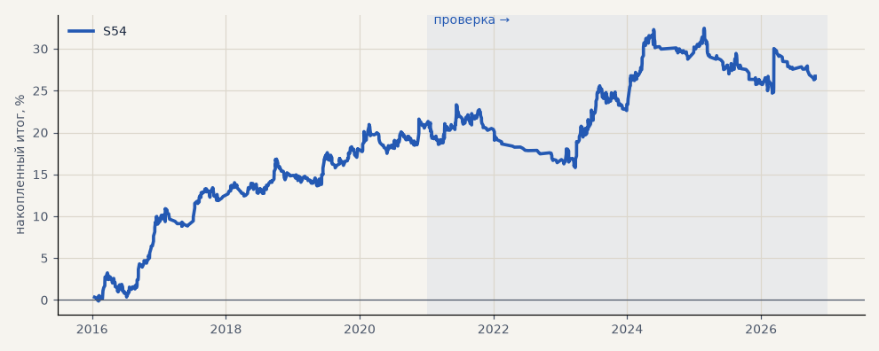

# S54. S47 (канал Кельтнера) на 16 новых акциях

**Семейство:** новые стратегии из блоков ТЗ (перебор) · **база:** — · **гипотеза:** H66 · **вердикт:** не переносится: PF на проверке 1.07, без 2 лучших в минусе, от случайных входов не отличается (p 0.26)

**Что проверяли.** Стратегия итератора S47 (канал Кельтнера на дневках, фильтр EMA200 дней, выход по обратному сигналу, стоп 6 ATR) без изменений на 16 новых акциях, движком перебора; только лонг, издержки биржи.

**Зачем.** Гипотеза H66: проверка финалистов итератора на бумагах, которых перебор не видел.

**Итог простыми словами.** Не переносится: PF 1.42 на выборе, 1.07 на проверке, без 2 лучших в минусе, от случайных входов не отличается (p 0.26).

**Издержки:** профиль `exchange` (спред и свопы брокера)

Подробности: [results/new_stocks.md](../../results/new_stocks.md)

Проверка — сделки, открытые с 1 января 2021 года; выбор — до 2021. В скобках — база на тех же инструментах.

| срез | период | сделок | итог % | выигрышей | ожидание на сделку | PF | без 2 лучших | просадка | t | лет в плюсе |
|---|---|---|---|---|---|---|---|---|---|---|
| все инструменты | проверка | 612 | +5.4 | 45% | +0.141% | 1.07 | -0.8 | -7.8 | 0.61 | 3/6 |
| все инструменты | выбор | 591 | +21.3 | 51% | +0.577% | 1.42 | +19.0 | -3.5 | 3.27 | 5/5 |
| TATN | проверка | 48 | -0.5 | 44% | -0.010% | 1.00 | -25.6 | -33.2 | -0.01 | 2/6 |
| TATN | выбор | 38 | +18.3 | 53% | +0.481% | 1.39 | -0.8 | -11.4 | 0.77 | 3/5 |
| NVTK | проверка | 42 | -14.1 | 43% | -0.337% | 0.84 | -32.7 | -31.8 | -0.49 | 1/5 |
| NVTK | выбор | 32 | +34.2 | 59% | +1.069% | 1.77 | +8.9 | -20.1 | 1.28 | 3/5 |
| GMKN | проверка | 29 | -33.8 | 41% | -1.166% | 0.43 | -45.8 | -33.8 | -1.91 | 1/6 |
| GMKN | выбор | 45 | +55.1 | 56% | +1.224% | 2.18 | +37.1 | -8.3 | 2.13 | 4/5 |
| ROSN | проверка | 43 | +53.7 | 44% | +1.250% | 1.61 | -33.3 | -32.1 | 0.67 | 2/6 |
| ROSN | выбор | 47 | +18.8 | 47% | +0.400% | 1.25 | -5.3 | -20.9 | 0.60 | 3/5 |
| VTBR | проверка | 29 | +22.0 | 48% | +0.759% | 1.50 | -9.8 | -11.0 | 0.74 | 5/5 |
| VTBR | выбор | 23 | -6.9 | 39% | -0.300% | 0.83 | -30.0 | -26.4 | -0.33 | 3/5 |
| PLZL | проверка | 44 | -1.3 | 45% | -0.029% | 0.99 | -26.3 | -34.5 | -0.04 | 2/5 |
| PLZL | выбор | 32 | +51.2 | 53% | +1.601% | 2.32 | +21.1 | -11.4 | 1.64 | 4/5 |
| SNGSP | проверка | 49 | -2.2 | 47% | -0.045% | 0.97 | -20.4 | -27.0 | -0.08 | 3/6 |
| SNGSP | выбор | 38 | -0.2 | 39% | -0.004% | 1.00 | -16.2 | -16.1 | -0.01 | 3/5 |
| IRAO | проверка | 47 | -67.5 | 32% | -1.436% | 0.41 | -80.7 | -69.7 | -2.72 | 0/6 |
| IRAO | выбор | 42 | +15.6 | 52% | +0.372% | 1.20 | -6.9 | -26.5 | 0.49 | 2/5 |
| CHMF | проверка | 33 | +15.2 | 39% | +0.461% | 1.25 | -12.6 | -25.6 | 0.50 | 3/6 |
| CHMF | выбор | 46 | +6.7 | 57% | +0.146% | 1.11 | -9.3 | -13.7 | 0.30 | 2/5 |
| NLMK | проверка | 33 | +2.2 | 42% | +0.065% | 1.03 | -20.2 | -28.0 | 0.08 | 1/6 |
| NLMK | выбор | 42 | +18.3 | 52% | +0.435% | 1.33 | +3.3 | -21.9 | 0.76 | 4/5 |
| MAGN | проверка | 36 | +18.7 | 42% | +0.518% | 1.23 | -25.0 | -31.9 | 0.44 | 3/5 |
| MAGN | выбор | 37 | +29.6 | 54% | +0.801% | 1.50 | -1.5 | -15.5 | 0.87 | 4/5 |
| RTKM | проверка | 41 | +17.2 | 54% | +0.418% | 1.35 | -2.6 | -14.6 | 0.76 | 3/5 |
| RTKM | выбор | 39 | -2.7 | 41% | -0.068% | 0.94 | -13.3 | -14.6 | -0.17 | 1/5 |
| TRNFP | проверка | 50 | +23.1 | 42% | +0.462% | 1.24 | -18.8 | -29.6 | 0.53 | 3/6 |
| TRNFP | выбор | 31 | -23.8 | 42% | -0.769% | 0.59 | -39.6 | -33.6 | -1.20 | 2/5 |
| AFLT | проверка | 36 | +31.0 | 58% | +0.861% | 1.54 | +0.4 | -24.7 | 0.95 | 3/4 |
| AFLT | выбор | 28 | +43.2 | 54% | +1.543% | 2.05 | +15.6 | -13.5 | 1.43 | 3/5 |
| ALRS | проверка | 27 | +1.7 | 44% | +0.063% | 1.04 | -19.9 | -12.6 | 0.07 | 1/4 |
| ALRS | выбор | 45 | +15.2 | 49% | +0.338% | 1.22 | -4.4 | -15.3 | 0.55 | 2/5 |
| AFKS | проверка | 25 | +21.1 | 56% | +0.843% | 1.53 | +1.5 | -16.6 | 0.89 | 2/5 |
| AFKS | выбор | 26 | +68.5 | 73% | +2.636% | 4.40 | +43.7 | -5.5 | 2.87 | 4/4 |

Журнал сделок: `trades.csv.gz` (инструмент, прогон, сторона, вход, выход, цены, результат после издержек, причина выхода).
