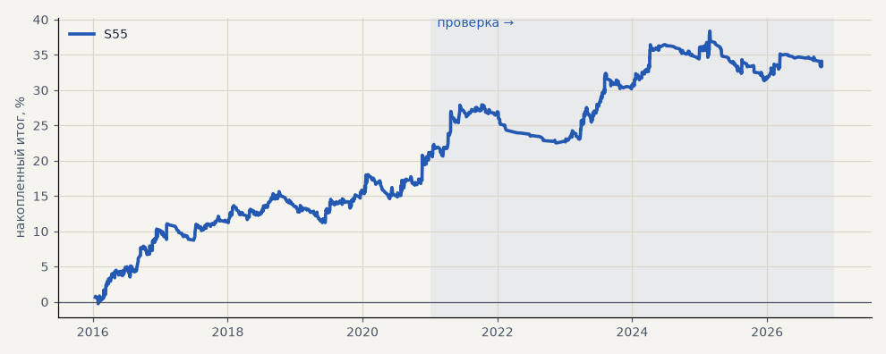

# S55. S48 (пробой 20 дней + 0.25 ATR) на 16 новых акциях

**Семейство:** новые стратегии из блоков ТЗ (перебор) · **база:** — · **гипотеза:** H66 · **вердикт:** подтвердилась: PF 1.34 на выборе и 1.21 на проверке, без 2 лучших в плюсе, в плюсе 9 бумаг из 16, лучше случайных входов (p 0.003)

**Что проверяли.** Стратегия итератора S48 (пробой 20 дней + 0.25 ATR, фильтр EMA200 дней, выход Дончиан 20 дней, стоп 3 ATR, размер 1) без изменений на 16 новых акциях, движком перебора; только лонг, издержки биржи.

**Зачем.** Гипотеза H66: проверка финалистов итератора на бумагах, которых перебор не видел.

**Итог простыми словами.** Подтвердилась по критерию H66: PF 1.34 на выборе и 1.21 на проверке, без 2 лучших в плюсе, в плюсе 9 бумаг из 16, лучше случайных входов (p 0.003).

**Издержки:** профиль `exchange` (спред и свопы брокера)

Подробности: [results/new_stocks.md](../../results/new_stocks.md)

Проверка — сделки, открытые с 1 января 2021 года; выбор — до 2021. В скобках — база на тех же инструментах.

| срез | период | сделок | итог % | выигрышей | ожидание на сделку | PF | без 2 лучших | просадка | t | лет в плюсе |
|---|---|---|---|---|---|---|---|---|---|---|
| все инструменты | проверка | 709 | +12.6 | 31% | +0.284% | 1.21 | +10.1 | -7.0 | 1.86 | 4/6 |
| все инструменты | выбор | 765 | +21.5 | 40% | +0.449% | 1.34 | +18.8 | -4.4 | 3.01 | 5/5 |
| TATN | проверка | 63 | -0.9 | 24% | -0.015% | 0.99 | -26.3 | -29.5 | -0.03 | 3/6 |
| TATN | выбор | 54 | +15.1 | 41% | +0.279% | 1.22 | -5.9 | -16.3 | 0.59 | 3/5 |
| NVTK | проверка | 50 | +27.0 | 34% | +0.539% | 1.39 | +4.0 | -12.6 | 0.91 | 4/5 |
| NVTK | выбор | 48 | +11.8 | 35% | +0.245% | 1.18 | -8.2 | -23.2 | 0.46 | 3/5 |
| GMKN | проверка | 45 | -15.6 | 27% | -0.347% | 0.72 | -28.8 | -31.8 | -0.90 | 3/6 |
| GMKN | выбор | 63 | +49.1 | 49% | +0.779% | 1.70 | +30.1 | -18.7 | 1.68 | 5/5 |
| ROSN | проверка | 47 | +41.6 | 34% | +0.885% | 1.78 | +6.0 | -11.4 | 1.27 | 5/6 |
| ROSN | выбор | 50 | +38.9 | 44% | +0.777% | 1.69 | +12.4 | -12.3 | 1.32 | 3/5 |
| VTBR | проверка | 37 | -2.2 | 32% | -0.058% | 0.97 | -28.2 | -42.3 | -0.07 | 3/6 |
| VTBR | выбор | 27 | -34.4 | 22% | -1.274% | 0.28 | -43.1 | -38.0 | -2.88 | 1/5 |
| PLZL | проверка | 49 | +54.1 | 39% | +1.105% | 1.89 | +29.5 | -15.7 | 1.66 | 5/6 |
| PLZL | выбор | 52 | +43.4 | 40% | +0.834% | 1.55 | +3.6 | -19.1 | 1.07 | 4/5 |
| SNGSP | проверка | 53 | +13.4 | 32% | +0.253% | 1.21 | -8.4 | -29.6 | 0.51 | 2/6 |
| SNGSP | выбор | 41 | -8.3 | 37% | -0.202% | 0.83 | -23.6 | -14.0 | -0.45 | 2/5 |
| IRAO | проверка | 44 | -21.2 | 23% | -0.481% | 0.61 | -34.4 | -34.4 | -1.34 | 2/6 |
| IRAO | выбор | 51 | +56.0 | 39% | +1.098% | 1.71 | +23.5 | -33.0 | 1.44 | 3/5 |
| CHMF | проверка | 42 | +38.3 | 43% | +0.911% | 1.83 | +13.1 | -11.7 | 1.46 | 4/6 |
| CHMF | выбор | 66 | +8.6 | 39% | +0.130% | 1.12 | -5.0 | -14.3 | 0.38 | 2/5 |
| NLMK | проверка | 43 | +11.2 | 35% | +0.261% | 1.19 | -7.3 | -24.8 | 0.45 | 3/6 |
| NLMK | выбор | 61 | +34.6 | 46% | +0.566% | 1.46 | +16.9 | -14.3 | 1.22 | 3/5 |
| MAGN | проверка | 46 | +15.4 | 26% | +0.335% | 1.26 | -3.9 | -25.8 | 0.57 | 2/6 |
| MAGN | выбор | 52 | +65.2 | 46% | +1.254% | 1.93 | +31.5 | -13.3 | 1.71 | 3/5 |
| RTKM | проверка | 30 | +16.8 | 40% | +0.561% | 1.46 | -7.3 | -13.8 | 0.72 | 3/5 |
| RTKM | выбор | 43 | -27.3 | 26% | -0.634% | 0.53 | -38.9 | -34.5 | -1.80 | 0/5 |
| TRNFP | проверка | 54 | -1.3 | 24% | -0.025% | 0.98 | -30.9 | -45.0 | -0.04 | 2/5 |
| TRNFP | выбор | 33 | -16.5 | 36% | -0.499% | 0.68 | -39.1 | -27.2 | -0.76 | 3/5 |
| AFLT | проверка | 33 | +48.2 | 45% | +1.459% | 2.23 | +16.2 | -10.6 | 1.57 | 3/5 |
| AFLT | выбор | 36 | +30.8 | 44% | +0.856% | 1.59 | -0.3 | -11.3 | 1.01 | 5/5 |
| ALRS | проверка | 31 | -9.3 | 26% | -0.299% | 0.80 | -28.3 | -17.2 | -0.47 | 1/5 |
| ALRS | выбор | 50 | +17.2 | 36% | +0.343% | 1.28 | -2.9 | -22.0 | 0.68 | 3/5 |
| AFKS | проверка | 42 | -14.2 | 29% | -0.338% | 0.79 | -38.3 | -25.5 | -0.56 | 2/5 |
| AFKS | выбор | 38 | +59.7 | 50% | +1.571% | 2.06 | +23.3 | -16.8 | 1.66 | 3/4 |

Журнал сделок: `trades.csv.gz` (инструмент, прогон, сторона, вход, выход, цены, результат после издержек, причина выхода).
