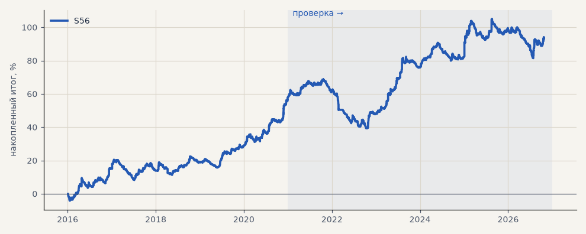

# S56. Лонг по трёхслойному фильтру (H60) на 16 новых акциях

**Семейство:** тренд-фильтр как самостоятельная стратегия · **база:** — · **гипотеза:** H66 · **вердикт:** на проверке лучше «купить и держать» (+31% / −26% против −4% / −55%, на 11 бумагах из 16), на выборе хуже (итог к просадке 5.3 против 6.3) — по критерию не подтвердилась

**Что проверяли.** Правило H60 без изменений — лонг, пока трёхслойный фильтр (режим по дневной EMA200) не покажет вниз, нейтраль позицию не закрывает; вход и выход по открытию часа после сигнала, без стопа — на 16 новых акциях; издержки биржи.

**Зачем.** Гипотеза H66: на SBER, GAZP, LKOH правило было лучше «купить и держать» на единицу риска (H60) — так ли на бумагах, которых не видели.

**Итог простыми словами.** На проверке лучше держания: +31% при просадке −26% против −4% и −55%, лучше на 11 бумагах из 16. На выборе 2016–2020 (растущий рынок) хуже: +71% / −14% против +200% / −32%, лучше только на 5 бумагах. Правило уводит от падений, но в росте отстаёт — по критерию H66 не подтвердилось.

**Издержки:** профиль `exchange` (спред и свопы брокера)

Подробности: [results/new_stocks.md](../../results/new_stocks.md)

Проверка — сделки, открытые с 1 января 2021 года; выбор — до 2021. В скобках — база на тех же инструментах.

| срез | период | сделок | итог % | выигрышей | ожидание на сделку | PF | без 2 лучших | просадка | t | лет в плюсе |
|---|---|---|---|---|---|---|---|---|---|---|
| все инструменты | проверка | 3564 | +31.3 | 34% | +0.141% | 1.13 | +26.8 | -29.4 | 2.11 | 4/6 |
| все инструменты | выбор | 1771 | +62.8 | 38% | +0.567% | 1.44 | +57.0 | -12.2 | 4.44 | 4/5 |
| TATN | проверка | 222 | +80.8 | 38% | +0.364% | 1.36 | +40.4 | -37.1 | 1.37 | 4/6 |
| TATN | выбор | 100 | +74.6 | 42% | +0.746% | 1.56 | +43.7 | -29.1 | 1.57 | 4/5 |
| NVTK | проверка | 229 | +60.2 | 38% | +0.263% | 1.23 | +17.9 | -47.7 | 0.96 | 3/6 |
| NVTK | выбор | 107 | +29.5 | 39% | +0.275% | 1.23 | -10.5 | -31.4 | 0.63 | 4/5 |
| GMKN | проверка | 241 | -51.0 | 31% | -0.212% | 0.81 | -77.7 | -77.6 | -1.07 | 1/6 |
| GMKN | выбор | 89 | +93.2 | 45% | +1.047% | 1.75 | +51.5 | -22.5 | 1.70 | 4/5 |
| ROSN | проверка | 236 | -12.4 | 37% | -0.053% | 0.96 | -62.4 | -98.3 | -0.20 | 4/6 |
| ROSN | выбор | 104 | +75.0 | 42% | +0.721% | 1.58 | +31.3 | -26.9 | 1.42 | 4/5 |
| VTBR | проверка | 208 | +70.7 | 35% | +0.340% | 1.35 | +22.5 | -34.9 | 1.18 | 4/6 |
| VTBR | выбор | 103 | -11.6 | 34% | -0.112% | 0.90 | -37.1 | -50.4 | -0.35 | 2/5 |
| PLZL | проверка | 188 | +93.2 | 39% | +0.496% | 1.41 | +48.8 | -50.2 | 1.50 | 4/6 |
| PLZL | выбор | 121 | +140.3 | 37% | +1.159% | 2.04 | +81.8 | -30.6 | 2.07 | 5/5 |
| SNGSP | проверка | 213 | +35.2 | 35% | +0.165% | 1.17 | -6.4 | -44.6 | 0.66 | 3/6 |
| SNGSP | выбор | 112 | -17.2 | 33% | -0.154% | 0.87 | -49.6 | -50.6 | -0.49 | 3/5 |
| IRAO | проверка | 210 | +22.9 | 32% | +0.109% | 1.12 | -25.7 | -51.0 | 0.42 | 4/6 |
| IRAO | выбор | 135 | +70.1 | 41% | +0.519% | 1.34 | +5.4 | -53.4 | 0.95 | 2/5 |
| CHMF | проверка | 231 | +73.3 | 32% | +0.317% | 1.29 | +17.2 | -61.3 | 1.09 | 4/6 |
| CHMF | выбор | 108 | +63.9 | 42% | +0.592% | 1.49 | +27.4 | -20.7 | 1.37 | 4/5 |
| NLMK | проверка | 217 | +82.1 | 34% | +0.378% | 1.35 | +22.7 | -49.9 | 1.14 | 3/6 |
| NLMK | выбор | 96 | +155.4 | 43% | +1.619% | 2.38 | +73.7 | -22.8 | 2.02 | 4/5 |
| MAGN | проверка | 229 | +81.8 | 37% | +0.357% | 1.33 | +31.9 | -32.2 | 1.25 | 5/6 |
| MAGN | выбор | 117 | +86.4 | 38% | +0.738% | 1.54 | +42.7 | -44.7 | 1.47 | 3/5 |
| RTKM | проверка | 218 | -21.2 | 31% | -0.097% | 0.91 | -55.2 | -67.8 | -0.43 | 2/6 |
| RTKM | выбор | 114 | +1.8 | 33% | +0.016% | 1.02 | -18.3 | -50.5 | 0.06 | 3/5 |
| TRNFP | проверка | 241 | +10.8 | 33% | +0.045% | 1.04 | -31.3 | -46.0 | 0.19 | 3/6 |
| TRNFP | выбор | 108 | +9.3 | 36% | +0.086% | 1.07 | -28.4 | -33.1 | 0.20 | 3/5 |
| AFLT | проверка | 237 | -0.2 | 29% | -0.001% | 1.00 | -39.7 | -59.7 | -0.00 | 3/6 |
| AFLT | выбор | 113 | +101.7 | 35% | +0.900% | 1.61 | +20.3 | -55.5 | 1.27 | 4/5 |
| ALRS | проверка | 223 | -10.0 | 36% | -0.045% | 0.96 | -47.5 | -53.2 | -0.20 | 4/6 |
| ALRS | выбор | 123 | +14.3 | 32% | +0.116% | 1.08 | -27.9 | -46.8 | 0.27 | 3/5 |
| AFKS | проверка | 221 | -15.0 | 37% | -0.068% | 0.95 | -73.6 | -57.0 | -0.24 | 3/6 |
| AFKS | выбор | 121 | +117.8 | 43% | +0.974% | 1.67 | +70.2 | -64.7 | 1.70 | 3/5 |

Журнал сделок: `trades.csv.gz` (инструмент, прогон, сторона, вход, выход, цены, результат после издержек, причина выхода).
