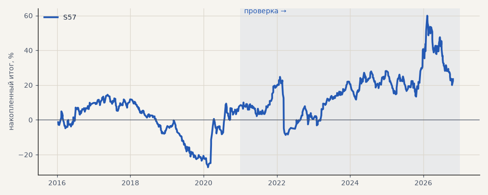

# S57. S42 по металлам на фьючерсах Мосбиржи (SILV, GOLD)

**Семейство:** стратегия без ML (импульс) · **база:** — · **гипотеза:** H68 · **вердикт:** не подтвердилась: PF 1.05 на выборе и на проверке, без 2 лучших в минусе; на ценах CFD без свопов то же правило — PF 1.34 на проверке, совпадает 60% входов

**Что проверяли.** Импульс S42 без изменений по серебру и золоту в обе стороны, но вместо спот-цен под CFD — фьючерсы Мосбиржи SILV и GOLD: ближний контракт, переход за 5 дней до экспирации, прошлое поправлено на разрыв при переходе. Издержки биржи: 0.04% комиссии и 0.05% проскальзывания на сторону, свопов нет.

**Зачем.** Запуск через Т-Инвестиции: металлы там — только фьючерсы, зато в обе стороны и без свопов, которые съедают серебро у CFD-брокера (T01). Гипотеза H68.

**Итог простыми словами.** Слабее CFD: PF 1.05 на выборе и на проверке, итог без 2 лучших в минусе. На ценах CFD с теми же издержками без свопов правило дало бы PF 1.34 на проверке — дело в инструменте: совпадает только 60% входов, ночные движения металлов на фьючерсе приходят гэпом.

**Издержки:** профиль `exchange` (спред и свопы брокера)

Подробности: [results/metals_futures.md](../../results/metals_futures.md)

Проверка — сделки, открытые с 1 января 2021 года; выбор — до 2021. В скобках — база на тех же инструментах.

| срез | период | сделок | итог % | выигрышей | ожидание на сделку | PF | без 2 лучших | просадка | t | лет в плюсе |
|---|---|---|---|---|---|---|---|---|---|---|
| все инструменты | проверка | 464 | +14.9 | 48% | +0.064% | 1.05 | -3.0 | -39.9 | 0.37 | 4/6 |
| все инструменты | выбор | 346 | +8.5 | 42% | +0.049% | 1.05 | -8.9 | -41.7 | 0.31 | 3/5 |
| серебро (фьючерс SILV) | проверка | 231 | -11.6 | 45% | -0.050% | 0.97 | -47.5 | -66.7 | -0.16 | 4/6 |
| серебро (фьючерс SILV) | выбор | 171 | +43.1 | 42% | +0.252% | 1.22 | +8.3 | -39.0 | 0.88 | 3/5 |
| золото (фьючерс GOLD) | проверка | 233 | +41.5 | 50% | +0.178% | 1.26 | +21.9 | -24.3 | 1.24 | 5/6 |
| золото (фьючерс GOLD) | выбор | 175 | -26.1 | 42% | -0.149% | 0.81 | -41.6 | -52.0 | -1.06 | 2/5 |

Журнал сделок: `trades.csv.gz` (инструмент, прогон, сторона, вход, выход, цены, результат после издержек, причина выхода).
