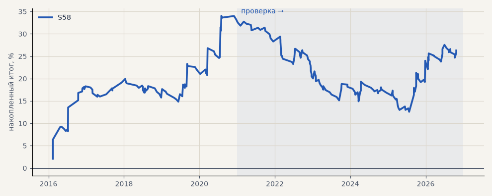

# S58. S46 (пробой 55 дней) на фьючерсах Мосбиржи на металлы

**Семейство:** новые стратегии из блоков ТЗ (перебор) · **база:** — · **гипотеза:** H68 · **вердикт:** в минусе на проверке: PF 2.38 на выборе → 0.88 (на CFD по металлам 0.78)

**Что проверяли.** Стратегия итератора S46 (пробой 55 дней) без изменений на склейке фьючерсов Мосбиржи SILV и GOLD, обе стороны, издержки биржи без свопов.

**Зачем.** Гипотеза H68 — для портфеля: годятся ли фьючерсы на металлы второй стратегией.

**Итог простыми словами.** В минусе на проверке (PF 0.88 при 2.38 на выборе); на CFD по металлам S46 тоже в минусе (0.78).

**Издержки:** профиль `exchange` (спред и свопы брокера)

Подробности: [results/metals_futures.md](../../results/metals_futures.md)

Проверка — сделки, открытые с 1 января 2021 года; выбор — до 2021. В скобках — база на тех же инструментах.

| срез | период | сделок | итог % | выигрышей | ожидание на сделку | PF | без 2 лучших | просадка | t | лет в плюсе |
|---|---|---|---|---|---|---|---|---|---|---|
| все инструменты | проверка | 144 | -7.0 | 29% | -0.097% | 0.88 | -15.5 | -20.7 | -0.58 | 2/6 |
| все инструменты | выбор | 84 | +33.3 | 45% | +0.792% | 2.38 | +20.6 | -5.1 | 2.32 | 4/5 |
| серебро (фьючерс SILV) | проверка | 73 | -22.8 | 27% | -0.313% | 0.68 | -38.2 | -40.5 | -1.22 | 2/6 |
| серебро (фьючерс SILV) | выбор | 37 | +50.0 | 43% | +1.353% | 2.95 | +24.7 | -4.5 | 1.99 | 5/5 |
| золото (фьючерс GOLD) | проверка | 71 | +8.9 | 31% | +0.125% | 1.21 | -3.9 | -12.0 | 0.59 | 4/6 |
| золото (фьючерс GOLD) | выбор | 47 | +16.5 | 47% | +0.351% | 1.74 | +1.3 | -7.1 | 1.21 | 3/5 |

Журнал сделок: `trades.csv.gz` (инструмент, прогон, сторона, вход, выход, цены, результат после издержек, причина выхода).
