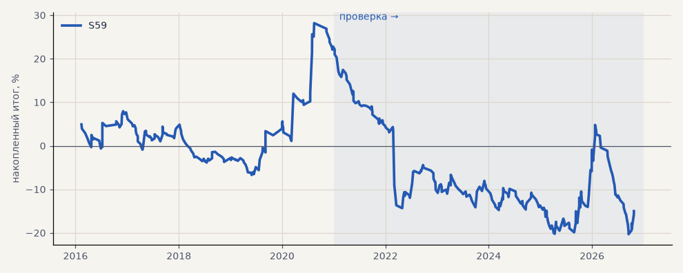

# S59. S48 (пробой 20 дней + 0.25 ATR) на фьючерсах Мосбиржи на металлы

**Семейство:** новые стратегии из блоков ТЗ (перебор) · **база:** — · **гипотеза:** H68 · **вердикт:** в минусе на проверке: PF 1.36 на выборе → 0.73 (на CFD по металлам 0.85)

**Что проверяли.** Стратегия итератора S48 (пробой 20 дней + 0.25 ATR) без изменений на склейке фьючерсов Мосбиржи SILV и GOLD, обе стороны, издержки биржи без свопов.

**Зачем.** Гипотеза H68 — для портфеля.

**Итог простыми словами.** В минусе на проверке (PF 0.73 при 1.36 на выборе); на CFD по металлам S48 тоже в минусе (0.85).

**Издержки:** профиль `exchange` (спред и свопы брокера)

Подробности: [results/metals_futures.md](../../results/metals_futures.md)

Проверка — сделки, открытые с 1 января 2021 года; выбор — до 2021. В скобках — база на тех же инструментах.

| срез | период | сделок | итог % | выигрышей | ожидание на сделку | PF | без 2 лучших | просадка | t | лет в плюсе |
|---|---|---|---|---|---|---|---|---|---|---|
| все инструменты | проверка | 214 | -37.8 | 29% | -0.353% | 0.73 | -48.9 | -43.1 | -1.62 | 2/6 |
| все инструменты | выбор | 143 | +22.8 | 36% | +0.319% | 1.36 | +2.7 | -14.7 | 1.10 | 3/5 |
| серебро (фьючерс SILV) | проверка | 109 | -73.4 | 29% | -0.673% | 0.61 | -95.6 | -81.3 | -1.77 | 1/6 |
| серебро (фьючерс SILV) | выбор | 71 | +43.5 | 34% | +0.612% | 1.57 | +3.2 | -18.5 | 1.15 | 3/5 |
| золото (фьючерс GOLD) | проверка | 105 | -2.2 | 30% | -0.021% | 0.97 | -15.1 | -17.0 | -0.10 | 3/6 |
| золото (фьючерс GOLD) | выбор | 72 | +2.1 | 39% | +0.030% | 1.04 | -15.9 | -12.5 | 0.12 | 2/5 |

Журнал сделок: `trades.csv.gz` (инструмент, прогон, сторона, вход, выход, цены, результат после издержек, причина выхода).
