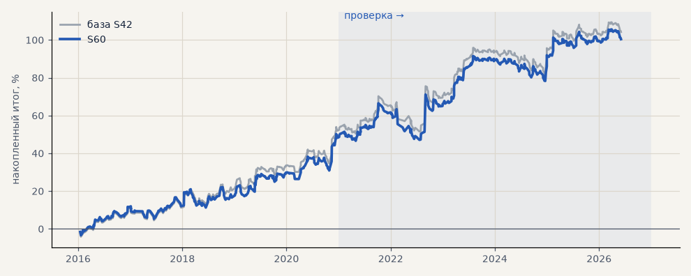

# S60. S42 на акциях с потолком убытка 5%

**Семейство:** стратегия без ML (импульс) · **база:** S42 · **гипотеза:** H71 · **вердикт:** как S42: на проверке +50.8% и PF 1.37 (S42 — те же), на выборе чуть хуже; потолок 5% затрагивает мало сделок

**Что проверяли.** S42 на GAZP, SBER, LKOH, но стоп не дальше 5% от входа: если 6 ATR дальше, стоп ставится на −5%.

**Зачем.** Гипотеза H71 (Тимур): в живой торговле, особенно с плечом, глубокая сделка опасна — сколько стоит ограничить убыток.

**Итог простыми словами.** Почти не меняет стратегию: 6 ATR дальше 5% бывает редко; итог на проверке тот же.

**Издержки:** профиль `exchange` (спред и свопы брокера)

Подробности: [results/h71_stop_caps.md](../../results/h71_stop_caps.md)

Проверка — сделки, открытые с 1 января 2021 года; выбор — до 2021. В скобках — база на тех же инструментах.

| срез | период | сделок | итог % | выигрышей | ожидание на сделку | PF | без 2 лучших | просадка | t | лет в плюсе |
|---|---|---|---|---|---|---|---|---|---|---|
| все инструменты | проверка | 379 (378) | +50.8 (+50.8) | 44% (44%) | +0.402% (+0.403%) | 1.37 (1.37) | +30.6 (+30.6) | -19.4 (-18.7) | 1.90 (1.89) | 6/6 (6/6) |
| все инструменты | выбор | 276 (275) | +49.7 (+53.4) | 52% (53%) | +0.540% (+0.583%) | 1.47 (1.52) | +40.3 (+44.1) | -9.7 (-8.1) | 2.38 (2.59) | 5/5 (5/5) |
| LKOH | проверка | 124 (123) | +22.9 (+32.3) | 44% (45%) | +0.185% (+0.262%) | 1.16 (1.23) | +0.8 (+10.1) | -28.2 (-24.1) | 0.61 (0.87) | 3/6 (4/6) |
| LKOH | выбор | 79 (79) | +65.4 (+65.4) | 59% (59%) | +0.828% (+0.828%) | 1.82 (1.82) | +38.0 (+38.0) | -14.0 (-14.0) | 1.97 (1.97) | 3/5 (3/5) |
| GAZP | проверка | 127 (127) | +69.4 (+60.3) | 43% (43%) | +0.547% (+0.475%) | 1.47 (1.38) | +8.8 (-0.3) | -30.7 (-34.6) | 1.17 (1.00) | 5/6 (5/6) |
| GAZP | выбор | 96 (96) | +44.1 (+44.1) | 48% (48%) | +0.459% (+0.459%) | 1.45 (1.45) | +16.4 (+16.4) | -12.4 (-12.4) | 1.27 (1.27) | 4/5 (4/5) |
| SBER | проверка | 128 (128) | +59.9 (+59.8) | 44% (44%) | +0.468% (+0.467%) | 1.51 (1.50) | +31.3 (+31.1) | -27.7 (-27.9) | 1.53 (1.52) | 5/6 (5/6) |
| SBER | выбор | 101 (100) | +39.5 (+50.8) | 50% (53%) | +0.391% (+0.508%) | 1.28 (1.39) | +15.5 (+26.8) | -41.4 (-28.5) | 0.98 (1.29) | 4/5 (4/5) |

Журнал сделок: `trades.csv.gz` (инструмент, прогон, сторона, вход, выход, цены, результат после издержек, причина выхода).
