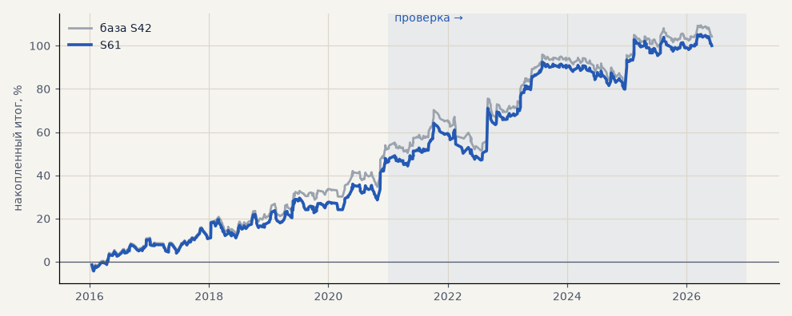

# S61. S42 на акциях с потолком убытка 4%

**Семейство:** стратегия без ML (импульс) · **база:** S42 · **гипотеза:** H71 · **вердикт:** на проверке чуть лучше S42 (+52.7%, PF 1.39, просадка −17.1 против −18.7), на выборе хуже (+47.4 против +53.4)

**Что проверяли.** S42 на GAZP, SBER, LKOH со стопом не дальше 4% от входа.

**Зачем.** Гипотеза H71 — промежуточный потолок между 3 и 5%.

**Итог простыми словами.** На проверке чуть лучше S42, на выборе чуть хуже — в пределах шума.

**Издержки:** профиль `exchange` (спред и свопы брокера)

Подробности: [results/h71_stop_caps.md](../../results/h71_stop_caps.md)

Проверка — сделки, открытые с 1 января 2021 года; выбор — до 2021. В скобках — база на тех же инструментах.

| срез | период | сделок | итог % | выигрышей | ожидание на сделку | PF | без 2 лучших | просадка | t | лет в плюсе |
|---|---|---|---|---|---|---|---|---|---|---|
| все инструменты | проверка | 380 (378) | +52.7 (+50.8) | 43% (44%) | +0.416% (+0.403%) | 1.39 (1.37) | +32.5 (+30.6) | -17.1 (-18.7) | 1.99 (1.89) | 6/6 (6/6) |
| все инструменты | выбор | 278 (275) | +47.4 (+53.4) | 51% (53%) | +0.511% (+0.583%) | 1.44 (1.52) | +38.0 (+44.1) | -8.6 (-8.1) | 2.28 (2.59) | 5/5 (5/5) |
| LKOH | проверка | 124 (123) | +28.2 (+32.3) | 44% (45%) | +0.228% (+0.262%) | 1.20 (1.23) | +6.0 (+10.1) | -24.2 (-24.1) | 0.76 (0.87) | 3/6 (4/6) |
| LKOH | выбор | 79 (79) | +65.7 (+65.4) | 59% (59%) | +0.831% (+0.828%) | 1.82 (1.82) | +38.2 (+38.0) | -13.7 (-14.0) | 1.98 (1.97) | 3/5 (3/5) |
| GAZP | проверка | 128 (127) | +65.4 (+60.3) | 42% (43%) | +0.511% (+0.475%) | 1.43 (1.38) | +4.8 (-0.3) | -29.7 (-34.6) | 1.11 (1.00) | 5/6 (5/6) |
| GAZP | выбор | 97 (96) | +36.2 (+44.1) | 46% (48%) | +0.373% (+0.459%) | 1.35 (1.45) | +8.4 (+16.4) | -12.6 (-12.4) | 1.03 (1.27) | 4/5 (4/5) |
| SBER | проверка | 128 (128) | +64.4 (+59.8) | 44% (44%) | +0.503% (+0.467%) | 1.57 (1.50) | +35.8 (+31.1) | -23.3 (-27.9) | 1.67 (1.52) | 5/6 (5/6) |
| SBER | выбор | 102 (100) | +40.3 (+50.8) | 50% (53%) | +0.395% (+0.508%) | 1.29 (1.39) | +16.3 (+26.8) | -35.6 (-28.5) | 1.02 (1.29) | 4/5 (4/5) |

Журнал сделок: `trades.csv.gz` (инструмент, прогон, сторона, вход, выход, цены, результат после издержек, причина выхода).
