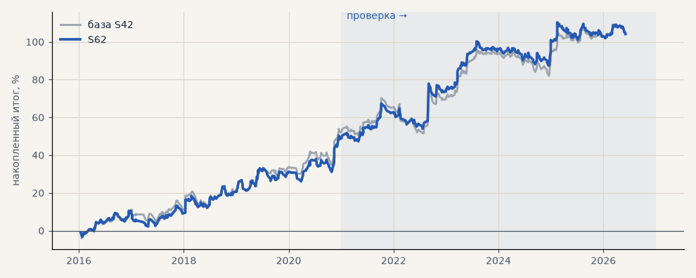

# S62. S42 на акциях с потолком убытка 3%

**Семейство:** стратегия без ML (импульс) · **база:** S42 · **гипотеза:** H71 · **вердикт:** итог тот же, риск меньше: проверка +54.2% против +50.8%, просадка −13.3 против −18.7, PF 1.41; выбор +50.0 против +53.4 при той же просадке

**Что проверяли.** S42 на GAZP, SBER, LKOH со стопом не дальше 3% от входа.

**Зачем.** Гипотеза H71 — самый узкий потолок из предложенных Тимуром.

**Итог простыми словами.** Итог не хуже (на проверке +54% против +51%), а просадка на проверке −13% вместо −19%; на выборе итог на 3 п. п. ниже. Сделки, ушедшие в −3%, в 86% случаев так и закрываются в минус — пересиживать их почти бесполезно.

**Издержки:** профиль `exchange` (спред и свопы брокера)

Подробности: [results/h71_stop_caps.md](../../results/h71_stop_caps.md)

Проверка — сделки, открытые с 1 января 2021 года; выбор — до 2021. В скобках — база на тех же инструментах.

| срез | период | сделок | итог % | выигрышей | ожидание на сделку | PF | без 2 лучших | просадка | t | лет в плюсе |
|---|---|---|---|---|---|---|---|---|---|---|
| все инструменты | проверка | 383 (378) | +54.2 (+50.8) | 42% (44%) | +0.424% (+0.403%) | 1.41 (1.37) | +34.0 (+30.6) | -13.3 (-18.7) | 2.07 (1.89) | 6/6 (6/6) |
| все инструменты | выбор | 282 (275) | +50.0 (+53.4) | 50% (53%) | +0.532% (+0.583%) | 1.47 (1.52) | +40.6 (+44.1) | -8.2 (-8.1) | 2.45 (2.59) | 4/5 (5/5) |
| LKOH | проверка | 125 (123) | +25.2 (+32.3) | 42% (45%) | +0.201% (+0.262%) | 1.18 (1.23) | +3.0 (+10.1) | -25.1 (-24.1) | 0.70 (0.87) | 4/6 (4/6) |
| LKOH | выбор | 79 (79) | +70.6 (+65.4) | 58% (59%) | +0.894% (+0.828%) | 1.92 (1.82) | +43.2 (+38.0) | -12.3 (-14.0) | 2.16 (1.97) | 3/5 (3/5) |
| GAZP | проверка | 129 (127) | +67.1 (+60.3) | 40% (43%) | +0.520% (+0.475%) | 1.45 (1.38) | +6.5 (-0.3) | -27.2 (-34.6) | 1.15 (1.00) | 4/6 (5/6) |
| GAZP | выбор | 100 (96) | +28.8 (+44.1) | 45% (48%) | +0.288% (+0.459%) | 1.26 (1.45) | +1.1 (+16.4) | -17.7 (-12.4) | 0.82 (1.27) | 4/5 (4/5) |
| SBER | проверка | 129 (128) | +70.2 (+59.8) | 43% (44%) | +0.544% (+0.467%) | 1.65 (1.50) | +41.6 (+31.1) | -19.1 (-27.9) | 1.85 (1.52) | 6/6 (5/6) |
| SBER | выбор | 103 (100) | +50.5 (+50.8) | 50% (53%) | +0.490% (+0.508%) | 1.39 (1.39) | +26.5 (+26.8) | -22.9 (-28.5) | 1.32 (1.29) | 4/5 (4/5) |

Журнал сделок: `trades.csv.gz` (инструмент, прогон, сторона, вход, выход, цены, результат после издержек, причина выхода).
