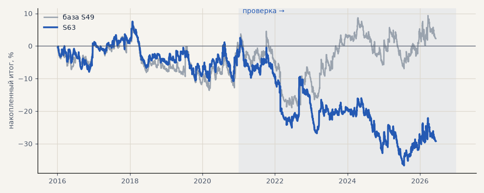

# S63. Сделки по трёхслойному фильтру с трейлингом 6 ATR

**Семейство:** тренд-фильтр как самостоятельная стратегия · **база:** S49 · **гипотеза:** H59 · **вердикт:** хуже S49: PF 1.00 на выборе и 0.90 на проверке против 1.02 и 1.00; ни один из 44 ранних выходов не лучше S49 ни в одном периоде

**Что проверяли.** Сделки по трёхслойному тренд-фильтру, как S49, но с трейлингом 6 ATR от лучшей цены — выход раньше смены тренда.

**Зачем.** Уточнение H59 (Тимур, 04.11): стратегия по фильтру недобирает прибыль и набирает убытки — нужен выход ближе к пику и ранний выход при убытке.

**Итог простыми словами.** Хуже S49 в обоих периодах (PF 0.90 против 1.00 на проверке); это лучший из 44 вариантов раннего выхода — остальные ещё хуже. Убытки S49 — от частых входов, а не от поздних выходов.

**Издержки:** профиль `exchange` (спред и свопы брокера)

Подробности: [results/h59_trend_exits.md](../../results/h59_trend_exits.md)

Проверка — сделки, открытые с 1 января 2021 года; выбор — до 2021. В скобках — база на тех же инструментах.

| срез | период | сделок | итог % | выигрышей | ожидание на сделку | PF | без 2 лучших | просадка | t | лет в плюсе |
|---|---|---|---|---|---|---|---|---|---|---|
| все инструменты | проверка | 2197 (2197) | -30.1 (-0.7) | 31% (31%) | -0.068% (-0.002%) | 0.90 (1.00) | -41.5 (-11.3) | -39.4 (-23.5) | -1.37 (-0.03) | 2/6 (2/6) |
| все инструменты | выбор | 1714 (1716) | +0.9 (+2.9) | 30% (30%) | +0.003% (+0.009%) | 1.00 (1.01) | -6.4 (-8.5) | -18.3 (-19.8) | 0.05 (0.15) | 3/5 (3/5) |
| портфель 4 | проверка | 1477 (1477) | -20.5 (+14.6) | 32% (32%) | -0.056% (+0.040%) | 0.93 (1.05) | -34.8 (+1.3) | -29.3 (-24.6) | -0.79 (0.53) | 2/6 (2/6) |
| портфель 4 | выбор | 1072 (1073) | +18.8 (+18.2) | 32% (31%) | +0.070% (+0.068%) | 1.10 (1.09) | +9.6 (+3.9) | -13.2 (-13.7) | 0.86 (0.77) | 4/5 (4/5) |
| металлы (серебро + золото) | проверка | 1440 (1440) | -65.7 (-65.0) | 30% (31%) | -0.091% (-0.090%) | 0.85 (0.86) | -82.4 (-81.7) | -110.0 (-108.0) | -1.77 (-1.71) | 2/6 (2/6) |
| металлы (серебро + золото) | выбор | 1320 (1322) | -110.1 (-98.8) | 28% (28%) | -0.167% (-0.149%) | 0.69 (0.73) | -128.4 (-116.6) | -113.0 (-108.4) | -3.75 (-3.25) | 0/5 (0/5) |
| серебро | проверка | 720 (720) | -63.0 (-68.3) | 32% (32%) | -0.088% (-0.095%) | 0.89 (0.88) | -96.4 (-101.7) | -140.0 (-143.4) | -0.95 (-1.02) | 1/6 (2/6) |
| серебро | выбор | 678 (679) | -149.6 (-139.5) | 27% (27%) | -0.221% (-0.205%) | 0.68 (0.71) | -186.2 (-175.1) | -152.1 (-148.8) | -2.81 (-2.56) | 0/5 (0/5) |
| золото | проверка | 720 (720) | -68.3 (-61.7) | 29% (29%) | -0.095% (-0.086%) | 0.79 (0.81) | -88.6 (-83.5) | -81.0 (-78.9) | -2.00 (-1.70) | 1/6 (1/6) |
| золото | выбор | 642 (643) | -70.6 (-58.1) | 28% (28%) | -0.110% (-0.090%) | 0.71 (0.76) | -82.6 (-71.7) | -80.6 (-75.7) | -2.86 (-2.16) | 0/5 (1/5) |
| LKOH | проверка | 253 (253) | -27.5 (+9.7) | 30% (29%) | -0.109% (+0.038%) | 0.87 (1.04) | -50.8 (-14.2) | -53.2 (-42.8) | -0.67 (0.21) | 2/6 (3/6) |
| LKOH | выбор | 130 (130) | +81.1 (+66.4) | 42% (41%) | +0.624% (+0.511%) | 1.86 (1.66) | +52.8 (+33.8) | -14.7 (-14.6) | 2.15 (1.72) | 5/5 (5/5) |
| GAZP | проверка | 255 (255) | +12.9 (+47.2) | 33% (31%) | +0.051% (+0.185%) | 1.06 (1.23) | -39.6 (-3.7) | -49.0 (-25.6) | 0.22 (0.83) | 3/6 (4/6) |
| GAZP | выбор | 144 (144) | +33.0 (+44.7) | 36% (35%) | +0.229% (+0.310%) | 1.30 (1.38) | +8.0 (-6.2) | -18.0 (-20.9) | 1.00 (0.92) | 5/5 (4/5) |
| SBER | проверка | 249 (249) | -4.6 (+69.9) | 33% (34%) | -0.018% (+0.281%) | 0.97 (1.40) | -33.4 (+29.6) | -35.1 (-37.6) | -0.12 (1.41) | 3/6 (4/6) |
| SBER | выбор | 120 (120) | +110.6 (+101.2) | 40% (41%) | +0.922% (+0.843%) | 2.07 (1.90) | +77.5 (+74.3) | -20.2 (-23.1) | 2.41 (2.29) | 4/5 (4/5) |

Журнал сделок: `trades.csv.gz` (инструмент, прогон, сторона, вход, выход, цены, результат после издержек, причина выхода).
