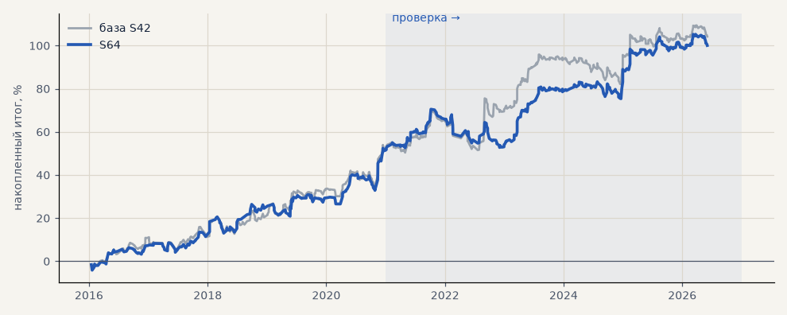

# S64. S42 на акциях без режима «рост ровным ходом» (карта режимов)

**Семейство:** стратегия без ML (импульс) · **база:** S42 · **гипотеза:** H75 · **вердикт:** не подтвердилась по критерию: проверка PF 1.37 → 1.43, t 1.89 → 2.23, но итог к просадке 2.71 → 2.67; при k = 4 и 6 эффекта нет

**Что проверяли.** S42 на GAZP, SBER, LKOH, но без входов в режиме «рост ровным ходом»: режим определяется по неделе часовых свечей перед сигналом (карта режимов по образцу TokDiT).

**Зачем.** Гипотеза H75 (идея Дениса, созвон 05.11): импульс зарабатывает не во всех режимах рынка — убыточные можно пропускать.

**Итог простыми словами.** На проверке PF и t выше, но итог к просадке чуть ниже — по критерию не прошла; при другом числе режимов эффект пропадает. S42 работает почти во всех режимах, лучше всего — в боковике.

**Издержки:** профиль `exchange` (спред и свопы брокера)

Подробности: [results/h75_regimes.md](../../results/h75_regimes.md)

Проверка — сделки, открытые с 1 января 2021 года; выбор — до 2021. В скобках — база на тех же инструментах.

| срез | период | сделок | итог % | выигрышей | ожидание на сделку | PF | без 2 лучших | просадка | t | лет в плюсе |
|---|---|---|---|---|---|---|---|---|---|---|
| все инструменты | проверка | 318 (378) | +47.4 (+50.8) | 47% (44%) | +0.447% (+0.403%) | 1.43 (1.37) | +36.6 (+30.6) | -17.7 (-18.7) | 2.23 (1.89) | 5/6 (6/6) |
| все инструменты | выбор | 211 (275) | +52.7 (+53.4) | 53% (53%) | +0.749% (+0.583%) | 1.67 (1.52) | +43.3 (+44.1) | -7.6 (-8.1) | 2.75 (2.59) | 5/5 (5/5) |
| LKOH | проверка | 103 (123) | +50.7 (+32.3) | 50% (45%) | +0.493% (+0.262%) | 1.48 (1.23) | +28.6 (+10.1) | -19.6 (-24.1) | 1.46 (0.87) | 4/6 (4/6) |
| LKOH | выбор | 57 (79) | +69.3 (+65.4) | 60% (59%) | +1.217% (+0.828%) | 2.33 (1.82) | +41.9 (+38.0) | -10.8 (-14.0) | 2.30 (1.97) | 3/5 (3/5) |
| GAZP | проверка | 108 (127) | +23.5 (+60.3) | 44% (43%) | +0.218% (+0.475%) | 1.17 (1.38) | -5.2 (-0.3) | -35.6 (-34.6) | 0.58 (1.00) | 4/6 (5/6) |
| GAZP | выбор | 81 (96) | +44.6 (+44.1) | 49% (48%) | +0.550% (+0.459%) | 1.52 (1.45) | +16.8 (+16.4) | -12.7 (-12.4) | 1.32 (1.27) | 4/5 (4/5) |
| SBER | проверка | 107 (128) | +68.0 (+59.8) | 47% (44%) | +0.635% (+0.467%) | 1.76 (1.50) | +39.3 (+31.1) | -22.9 (-27.9) | 1.93 (1.52) | 5/6 (5/6) |
| SBER | выбор | 73 (100) | +44.1 (+50.8) | 52% (53%) | +0.605% (+0.508%) | 1.45 (1.39) | +20.1 (+26.8) | -20.8 (-28.5) | 1.24 (1.29) | 3/5 (4/5) |

Журнал сделок: `trades.csv.gz` (инструмент, прогон, сторона, вход, выход, цены, результат после издержек, причина выхода).
