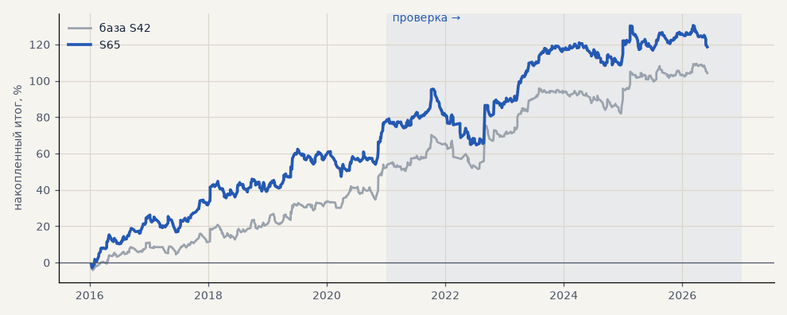

# S65. Импульс на 15-минутных свечах: ход за 3 ч ≥ 4 ATR, стоп 12 ATR

**Семейство:** стратегия без ML (импульс) · **база:** S42 · **гипотеза:** H77 · **вердикт:** хуже S42 на проверке: PF 1.21 против 1.37, итог +40% против +51%, просадка −31% против −19%; на выборе PF 1.56 — подгонка

**Что проверяли.** Тот же импульс, что S42, на GAZP, SBER, LKOH, но на 15-минутных свечах: вход, когда цена за 3 часа прошла 4 ATR короткой свечи.

**Зачем.** Гипотеза H77 (Тимур, созвон 05.11): на 15-минутках вход раньше и, возможно, больше хороших сделок.

**Итог простыми словами.** На выборе лучше S42, на проверке хуже по всем метрикам (PF 1.21 против 1.37, просадка −31% против −19%). На коротких свечах больше шума и сделок при тех же издержках — S42 остаётся на часах.

**Издержки:** профиль `exchange` (спред и свопы брокера)

Подробности: [results/h77_m15.md](../../results/h77_m15.md)

Проверка — сделки, открытые с 1 января 2021 года; выбор — до 2021. В скобках — база на тех же инструментах.

| срез | период | сделок | итог % | выигрышей | ожидание на сделку | PF | без 2 лучших | просадка | t | лет в плюсе |
|---|---|---|---|---|---|---|---|---|---|---|
| все инструменты | проверка | 521 (378) | +40.1 (+50.8) | 43% (44%) | +0.231% (+0.403%) | 1.21 (1.37) | +18.3 (+30.6) | -30.8 (-18.7) | 1.34 (1.89) | 5/6 (6/6) |
| все инструменты | выбор | 370 (275) | +78.6 (+53.4) | 51% (53%) | +0.637% (+0.583%) | 1.56 (1.52) | +67.2 (+44.1) | -15.0 (-8.1) | 3.10 (2.59) | 5/5 (5/5) |
| LKOH | проверка | 185 (123) | -11.1 (+32.3) | 38% (45%) | -0.060% (+0.262%) | 0.95 (1.23) | -30.1 (+10.1) | -47.7 (-24.1) | -0.26 (0.87) | 1/6 (4/6) |
| LKOH | выбор | 108 (79) | +84.1 (+65.4) | 55% (59%) | +0.778% (+0.828%) | 1.87 (1.82) | +57.4 (+38.0) | -14.8 (-14.0) | 2.29 (1.97) | 5/5 (3/5) |
| GAZP | проверка | 156 (127) | +69.6 (+60.3) | 45% (43%) | +0.446% (+0.475%) | 1.35 (1.38) | +4.4 (-0.3) | -28.7 (-34.6) | 1.04 (1.00) | 4/6 (5/6) |
| GAZP | выбор | 125 (96) | +60.4 (+44.1) | 49% (48%) | +0.483% (+0.459%) | 1.41 (1.45) | +26.3 (+16.4) | -24.7 (-12.4) | 1.34 (1.27) | 5/5 (4/5) |
| SBER | проверка | 180 (128) | +61.8 (+59.8) | 46% (44%) | +0.343% (+0.467%) | 1.41 (1.50) | +33.3 (+31.1) | -22.1 (-27.9) | 1.51 (1.52) | 3/6 (5/6) |
| SBER | выбор | 137 (100) | +91.2 (+50.8) | 51% (53%) | +0.666% (+0.508%) | 1.52 (1.39) | +63.8 (+26.8) | -28.3 (-28.5) | 1.85 (1.29) | 4/5 (4/5) |

Журнал сделок: `trades.csv.gz` (инструмент, прогон, сторона, вход, выход, цены, результат после издержек, причина выхода).
