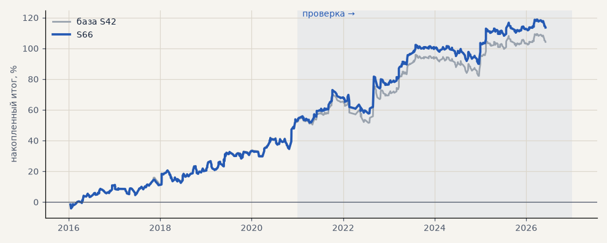

# S66. S42 на акциях без входов за сутки до решения ЦБ по ставке

**Семейство:** стратегия без ML (импульс) · **база:** S42 · **гипотеза:** H79 · **вердикт:** подтвердилась: проверка PF 1.37 → 1.47, итог к просадке 2.74 → 3.93; выбор 1.53 → 1.55; убрано 10 и 5 сделок (на проверке 9 из 10 — стоп), окна 6–120 ч тоже лучше

**Что проверяли.** S42 на GAZP, SBER, LKOH, но без новых входов за сутки до решения Банка России по ключевой ставке (решение публикуется в 13:30 МСК).

**Зачем.** Гипотеза H79 (созвон 05.11): акции ведут себя иначе вокруг заранее известных событий; календарь заседаний ЦБ 2016–2026 собран из архива сайта ЦБ.

**Итог простыми словами.** Лучше S42 в обоих периодах: на проверке PF 1.37 → 1.47, итог к просадке 2.74 → 3.93. Убирается всего 10 сделок за 6 лет, но 9 из них закрылись по стопу; после 2021 года в час решения акции ходят вдвое сильнее обычного. Держать позицию через решение не вредно — не стоит только открывать новую.

**Издержки:** профиль `exchange` (спред и свопы брокера)

Подробности: [results/h79_calendar.md](../../results/h79_calendar.md)

Проверка — сделки, открытые с 1 января 2021 года; выбор — до 2021. В скобках — база на тех же инструментах.

| срез | период | сделок | итог % | выигрышей | ожидание на сделку | PF | без 2 лучших | просадка | t | лет в плюсе |
|---|---|---|---|---|---|---|---|---|---|---|
| все инструменты | проверка | 368 (378) | +59.5 (+50.8) | 45% (44%) | +0.485% (+0.403%) | 1.46 (1.37) | +39.3 (+30.6) | -15.3 (-18.7) | 2.23 (1.89) | 6/6 (6/6) |
| все инструменты | выбор | 270 (275) | +54.1 (+53.4) | 53% (53%) | +0.601% (+0.583%) | 1.54 (1.52) | +44.7 (+44.1) | -8.1 (-8.1) | 2.64 (2.59) | 4/5 (5/5) |
| LKOH | проверка | 118 (123) | +42.4 (+32.3) | 46% (45%) | +0.359% (+0.262%) | 1.33 (1.23) | +20.2 (+10.1) | -21.6 (-24.1) | 1.16 (0.87) | 4/6 (4/6) |
| LKOH | выбор | 77 (79) | +62.1 (+65.4) | 60% (59%) | +0.807% (+0.828%) | 1.79 (1.82) | +34.6 (+38.0) | -14.0 (-14.0) | 1.89 (1.97) | 3/5 (3/5) |
| GAZP | проверка | 124 (127) | +72.6 (+60.3) | 44% (43%) | +0.585% (+0.475%) | 1.50 (1.38) | +11.9 (-0.3) | -31.8 (-34.6) | 1.22 (1.00) | 5/6 (5/6) |
| GAZP | выбор | 94 (96) | +46.0 (+44.1) | 48% (48%) | +0.489% (+0.459%) | 1.49 (1.45) | +18.2 (+16.4) | -12.4 (-12.4) | 1.33 (1.27) | 4/5 (4/5) |
| SBER | проверка | 126 (128) | +63.5 (+59.8) | 44% (44%) | +0.504% (+0.467%) | 1.55 (1.50) | +34.9 (+31.1) | -27.9 (-27.9) | 1.62 (1.52) | 5/6 (5/6) |
| SBER | выбор | 99 (100) | +54.2 (+50.8) | 54% (53%) | +0.548% (+0.508%) | 1.43 (1.39) | +30.2 (+26.8) | -25.1 (-28.5) | 1.38 (1.29) | 4/5 (4/5) |

Журнал сделок: `trades.csv.gz` (инструмент, прогон, сторона, вход, выход, цены, результат после издержек, причина выхода).
