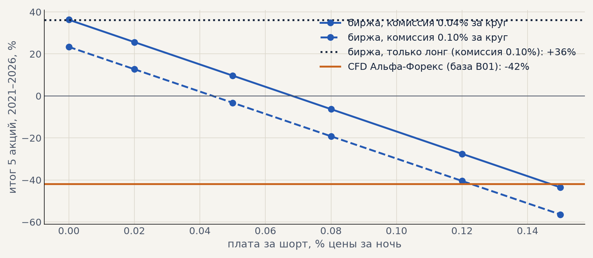

# Акции на бирже вместо CFD (H04, 12.10)

Через CFD Альфа-Форекс акции убыточны: плата за перенос 0.068% в день в обе стороны съедает доход
импульса (база B01, портфель 4 на проверке −2%). Проверили, что даёт Мосбиржа: лонг своими деньгами
не платит за перенос, шорт платит брокеру за непокрытую позицию. Сделки — база B01, издержки
пересчитаны по профилю `configs/costs/exchange.yaml` (комиссия брокера и биржи 0.1% за круг,
проскальзывание 0.05% на сторону; металлы и эфир — как в базе, через CFD). Расчёт —
`scripts/exchange_costs.py`, таблицы — [exchange/summary.txt](exchange/summary.txt). В журнале — S24 и S25.

| вариант | 5 акций, выбор | 5 акций, проверка | портфель 4, выбор | портфель 4, проверка (PF) |
|---|---|---|---|---|
| CFD Альфа-Форекс (база B01) | −61% | −42% | −12% | −2% (0.99) |
| биржа, шорт 0.05% в день (S24) | −20% | −3% | +21% | +27% (1.09) |
| **биржа, только лонг (S25)** | **+35%** | **+36%** | **+47%** | **+54% (1.32)** |

Портфель 4 — серебро через CFD плюс LKOH, GAZP, SBER на бирже. Выбор — 2016–2020, проверка — 2021–2026.

**Уточнение 13.10.** В этой таблице шорты убраны из готовых сделок и успевали занять время. Штатный расчёт
(шорт гасится до симуляции, S25 в журнале): портфель 4 +46.4% на выборе и +52.6% на проверке (PF 1.29).
На свежих данных июнь–октябрь 2026 — +6.7% на три бумаги, см. [forward_test.md](forward_test.md).

* **Шорт по акциям убыточен сам по себе.** Даже без платы за перенос шорты акций в минусе в обоих
  периодах: акции в среднем растут и платят дивиденды, которые шорт возмещает. Безубыточная плата за
  шорт для 5 акций — около 0.04% в день при комиссии 0.1% за круг (0.07% при 0.04%).
* **Только лонг — лучший вариант на честных издержках.** Портфель 4 на проверке +54% (PF 1.32, t 2.18,
  5 лет из 6 в плюсе), на выборе +47% (PF 1.39). Газпром, Сбербанк, Лукойл в плюсе в обоих периодах;
  Мосбиржа около нуля, МТС на выборе в минусе.
* **Чего нет в расчёте.** Налог 13% с дивидендов у лонга, держащего позицию через отсечку, — 21 такая
  сделка, около −1…−3 п.п. на портфель; реальный тариф брокера (взяли 0.05% на сторону). Шорт
  исключён из готовых сделок — освободившееся время не занимается другими сигналами (при шорте гейт
  смотрит вниз, лонговых сигналов в это время почти нет).

**Что дальше.** Запускать: металлы через CFD (обе стороны) + акции GAZP, SBER, LKOH на бирже только в
лонг. Уточнить тариф брокера по акциям; ставка шорта больше не важна.
