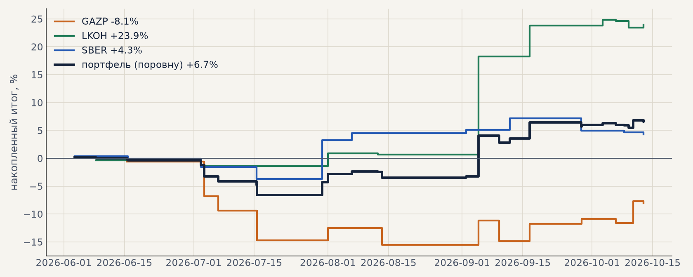

# Проверка на свежих данных: июнь — октябрь 2026

История заканчивалась 28.05–11.06.2026; ни один день после этого не участвовал ни в выборе правил, ни в
проверке. 12–13.10 докачали свежие данные и прогнали лучшую стратегию тем же кодом, что бэктест и
живой контур. Расчёты — `scripts/forward_test.py` (акции), `scripts/metals_forward.py` (металлы),
таблицы — [forward_test/summary.txt](forward_test/summary.txt), [forward_test/metals_summary.txt](forward_test/metals_summary.txt).

## 1. Верны ли данные и расчёты

* **Данные Мосбиржи (ISS)** совпали с нашими историческими файлами минута в минуту на последних днях
  истории: SBER, GAZP, LKOH — 100% совпадение цен закрытия.
* **Дивиденды**: в таблицу добавилась свежая отсечка SBER 18.07.2026 (37.64 ₽, гэп 0.87 дивиденда);
  `scripts/fetch_dividends.py --live` ищет отсечки по свежим минутам.
* **Код**: живой контур на истории 2026 года дал те же сделки, что бэктест: GAZP 9 из 9, LKOH 9 из 9 —
  результат до сотых. Расхождения (SBER, лишние сделки LKOH) объяснились одной причиной: в первой оценке
  S25 шорты убирались уже после симуляции и успевали занять время, блокируя лонговые сигналы. Поэтому
  S25 пересчитан штатно — шорты гасятся до симуляции (`impulse:6:3:long`, прогоны `*_lo`). Итог почти
  тот же: портфель 4 на проверке +52.6% (PF 1.29) вместо оценки +54.4%, на выборе +46.4% вместо +47.3%.

## 2. Акции на бирже, только лонг — свежий период

| бумага | период | сделок | итог | средняя сделка | выигрышей | бэктест 2021–26: средняя сделка |
|---|---|---|---|---|---|---|
| SBER | 29.05 – 12.10 | 11 | +4.3% | +0.39% | 45% | +0.47% |
| GAZP | 12.06 – 12.10 | 13 | −8.1% | −0.62% | 38% | +0.48% |
| LKOH | 04.06 – 12.10 | 11 | +23.9% | +2.18% | 55% | +0.26% |
| **3 бумаги поровну** | | **35** | **+6.7%** | +0.58% | | ≈ +0.4% |

Издержки биржи учтены (комиссия 0.1% за круг, проскальзывание 0.05% на сторону). Три сделки открыты
на 12.10 и посчитаны по последней цене.

Итог совпадает с ожиданием бэктеста: средняя сделка +0.58% против ≈ +0.4%, разброс сделки ±3.5–5.5%
— на 35 сделках такое отличие в пределах шума. Как и в бэктесте, результат держится на крупных
сделках: LKOH 25.08–04.09 дал +17.6%, без неё портфель был бы около +1%. Сделок больше обычного
(2.6 в месяц на бумагу против 1.75) — лето было волатильным.

## 3. Металлы — приблизительно

Свежего спота нет, поэтому взяты часовые фьючерсы COMEX (Yahoo, SI=F и GC=F). Проверка на общем
отрезке 12.2024–05.2026 показала, насколько этому можно верить:

| серебро / золото, 12.2024–05.2026 | серебро | золото |
|---|---|---|
| бэктест по минутам спота | +25% | +46% |
| то же правило по часам спота | +21% (95–96% тех же сделок) | +39% |
| по часам фьючерса | +11% (55% тех же сделок) | +28% (62%) |

Часы вместо минут почти не меняют сделки; фьючерс вместо спота меняет почти половину сделок и
занижает итог примерно вдвое. На свежем периоде по фьючерсу: **серебро −10.6%, золото −9.5%** (39
сделок, много стопов: серебро упало с $77 до $58 и металось). С поправкой на занижение — около −5…−6%.
Металлы этим летом, вероятно, были в минусе; точно — только по споту от брокера.

## Вывод

Расчёты верны: данные, дивиденды и код сходятся с бэктестом. На свежих данных акции в лонг заработали
столько, сколько и ожидалось (+6.7% за 4.5 месяца на три бумаги), металлы — скорее в минусе. Это
довод начинать запуск с акций (GAZP, SBER, LKOH в лонг), а металлы подключать после того, как появится
спотовый поток брокера и по нему подтвердится результат.
