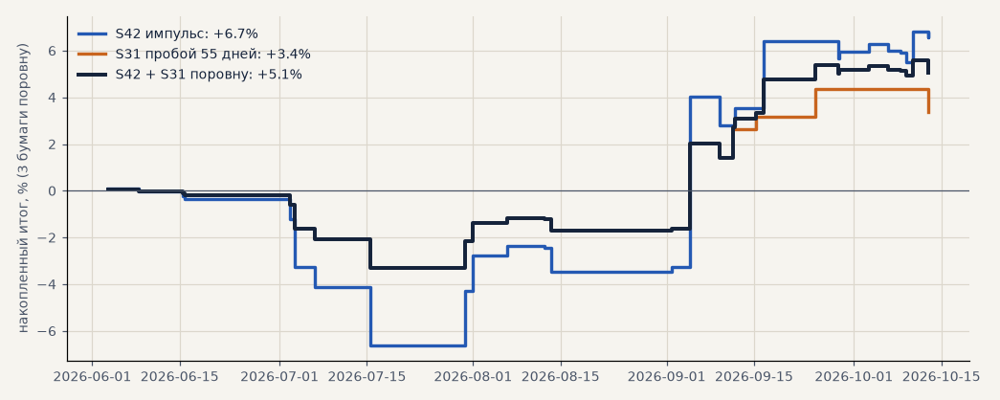

# Свежие данные июнь–октябрь 2026: импульс и пробой 55 дней на акциях

Задача **T28** (гипотезы H47, H53). Акции GAZP, SBER, LKOH на Мосбирже только в лонг, издержки биржи; свежий период — после конца истории (SBER 28.05–12.10.2026, GAZP 11.06–12.10.2026, LKOH 03.06–12.10.2026): ни один день не участвовал ни в выборе, ни в проверке. Код сделок — тот же, что у walk-forward и журнала (`scripts/fresh_check.py`). Металлы не считались: свежего спота нет, а фьючерс меняет почти половину сделок ([forward_test.md](forward_test.md)). Открытые сделки — по последней цене.

<!-- вывод -->
## Вывод

**S31 на свежих данных в плюсе, но сделок слишком мало, чтобы это что-то доказывало.** Пробой 55 дней на акциях
в лонг за 4.5 месяца дал 4 сделки, +3.4% на три бумаги (3 из 4 в плюсе). По истории ожидалось около 7 сделок
(1.6 в месяц) со средней +0.4% и разбросом ±3.5% на сделку — четыре сделки со средней +2.5% в эти границы
укладываются. Сигнал редкий: за лето SBER не дал ни одного входа.

* **Импульс (S42) воспроизведён до цифры**: +6.7% на три бумаги, как в [forward_test.md](forward_test.md), —
  этот скрипт и журнал считают одинаково (на истории 2026 года все сделки совпали по входу, результат — до сотых;
  одна сделка LKOH журнала начата до окна скрипта).
* **Вместе на половине капитала** — +5.1% против +6.7% у одного импульса: как и на проверке 2021–2026
  ([portfolio.md](portfolio.md)), S31 сглаживает, но итог на капитал не увеличивает.

**Решение не меняется:** первым этапом — импульс на акциях; S31 — кандидат второго этапа. Чтобы судить о нём,
нужно 20–30 сделок, то есть около года живой статистики: держать его рядом в бумажном режиме (сигналы
считать, не торговать) — `scripts/fresh_check.py` для этого готов.
<!-- /вывод -->

## Итог на свежем периоде

| стратегия | бумага | сделок | итог % | средняя сделка % | выигрышей |
|---|---|---|---|---|---|
| S42 импульс | SBER | 11 | +4.3 | +0.39 | 45% |
| S42 импульс | GAZP | 13 | -8.1 | -0.62 | 38% |
| S42 импульс | LKOH | 11 | +23.9 | +2.18 | 55% |
| S42 импульс | 3 бумаги поровну | 35 | +6.7 | +0.58 | 46% |
| S31 пробой 55 дней | SBER | 0 | +0.0 | — | — |
| S31 пробой 55 дней | GAZP | 1 | +3.6 | +3.65 | 100% |
| S31 пробой 55 дней | LKOH | 3 | +6.5 | +2.17 | 67% |
| S31 пробой 55 дней | 3 бумаги поровну | 4 | +3.4 | +2.54 | 75% |

Портфель S42 + S31 поровну (капитал пополам): **+5.1%**.

## Сверка с журналом на истории (январь — конец истории 2026)

| стратегия | бумага | сделок скрипт | сделок журнал | совпали по входу | расхождение результата, п.п. |
|---|---|---|---|---|---|
| S42 импульс | SBER | 13 | 13 | 13 | 0.000 |
| S42 импульс | GAZP | 9 | 9 | 9 | 0.000 |
| S42 импульс | LKOH | 11 | 12 | 11 | 0.000 |
| S31 пробой 55 дней | SBER | 4 | 4 | 4 | 0.000 |
| S31 пробой 55 дней | GAZP | 1 | 1 | 1 | 0.000 |
| S31 пробой 55 дней | LKOH | 1 | 1 | 1 | 0.000 |

## Сделки свежего периода

### S42 импульс

| бумага | вход | выход | цена входа | цена выхода | причина | итог % |
|---|---|---|---|---|---|---|
| SBER | 01.06 12:01 | 03.06 11:35 | 279.71 | 281.21 | trailing_stop | +0.34 |
| LKOH | 08.06 06:59 | 08.06 10:20 | 4867.00 | 4857.36 | trailing_stop | -0.40 |
| GAZP | 15.06 06:59 | 15.06 13:44 | 113.75 | 113.28 | trailing_stop | -0.62 |
| SBER | 15.06 07:01 | 15.06 18:16 | 280.14 | 279.60 | trailing_stop | -0.39 |
| LKOH | 26.06 16:01 | 02.07 14:54 | 4371.00 | 4333.93 | trailing_stop | -1.05 |
| SBER | 29.06 16:01 | 02.07 16:51 | 263.81 | 260.39 | trailing_stop | -1.50 |
| GAZP | 29.06 20:01 | 03.07 10:52 | 102.31 | 96.16 | stop_loss | -6.21 |
| GAZP | 05.07 10:01 | 06.07 16:00 | 98.37 | 96.02 | stop_loss | -2.59 |
| LKOH | 12.07 11:01 | 13.07 17:14 | 4454.00 | 4465.50 | trailing_stop | +0.06 |
| SBER | 13.07 11:01 | 15.07 12:00 | 256.22 | 251.13 | stop_loss | -2.19 |
| GAZP | 13.07 16:01 | 15.07 13:52 | 94.65 | 89.83 | stop_loss | -5.29 |
| SBER | 20.07 17:01 | 30.07 17:01 | 256.64 | 275.05 | timeout | +6.97 |
| GAZP | 22.07 13:01 | 31.07 23:49 | 89.92 | 92.06 | timeout | +2.18 |
| LKOH | 22.07 13:01 | 31.07 23:49 | 4517.50 | 4630.50 | timeout | +2.30 |
| SBER | 03.08 09:01 | 06.08 11:56 | 279.42 | 283.45 | trailing_stop | +1.24 |
| GAZP | 09.08 09:59 | 13.08 10:30 | 93.55 | 90.95 | stop_loss | -2.98 |
| LKOH | 09.08 10:01 | 12.08 11:44 | 4664.00 | 4662.07 | trailing_stop | -0.24 |
| GAZP | 25.08 18:01 | 04.09 18:01 | 86.72 | 90.62 | timeout | +4.30 |
| LKOH | 25.08 19:01 | 04.09 19:01 | 4284.00 | 5047.00 | timeout | +17.61 |
| SBER | 31.08 12:01 | 01.09 20:51 | 271.93 | 274.05 | trailing_stop | +0.58 |
| SBER | 03.09 19:01 | 11.09 23:49 | 276.86 | 283.32 | timeout | +2.13 |
| LKOH | 07.09 21:01 | 16.09 13:03 | 5117.50 | 5411.86 | trailing_stop | +5.55 |
| GAZP | 08.09 15:01 | 09.09 12:30 | 92.28 | 89.06 | stop_loss | -3.69 |
| GAZP | 10.09 18:01 | 16.09 13:09 | 92.20 | 95.26 | trailing_stop | +3.12 |
| GAZP | 18.09 17:01 | 28.09 14:52 | 96.61 | 97.66 | trailing_stop | +0.89 |
| SBER | 22.09 16:01 | 28.09 11:31 | 280.40 | 274.75 | stop_loss | -2.21 |
| LKOH | 23.09 11:01 | 03.10 11:01 | 5370.00 | 5433.50 | timeout | +0.98 |
| LKOH | 03.10 15:01 | 06.10 11:42 | 5488.50 | 5489.86 | trailing_stop | -0.18 |
| GAZP | 04.10 10:01 | 06.10 11:39 | 97.07 | 96.55 | trailing_stop | -0.74 |
| SBER | 05.10 11:01 | 08.10 09:29 | 280.77 | 280.47 | trailing_stop | -0.31 |
| LKOH | 06.10 19:01 | 09.10 10:31 | 5585.50 | 5530.64 | trailing_stop | -1.18 |
| GAZP | 09.10 17:01 | 10.10 11:31 | 97.82 | 101.89 | trailing_stop | +3.96 |
| LKOH | 09.10 23:01 | 12.10 21:35 (открыта) | 5954.50 | 5994.50 | timeout | +0.47 |
| SBER | 10.10 10:01 | 12.10 21:20 (открыта) | 285.72 | 285.28 | timeout | -0.35 |
| GAZP | 10.10 13:01 | 12.10 21:21 (открыта) | 102.30 | 102.12 | timeout | -0.38 |

### S31 пробой 55 дней

| бумага | вход | выход | цена входа | цена выхода | причина | итог % |
|---|---|---|---|---|---|---|
| LKOH | 03.09 08:01 | 11.09 15:23 | 4812.50 | 5202.50 | trailing_stop | +7.90 |
| LKOH | 14.09 10:01 | 15.09 07:00 | 5348.00 | 5441.86 | trailing_stop | +1.55 |
| GAZP | 14.09 19:01 | 24.09 19:01 | 97.75 | 101.51 | timeout | +3.65 |
| LKOH | 10.10 10:01 | 12.10 21:35 (открыта) | 6164.50 | 5994.50 | timeout | -2.96 |
