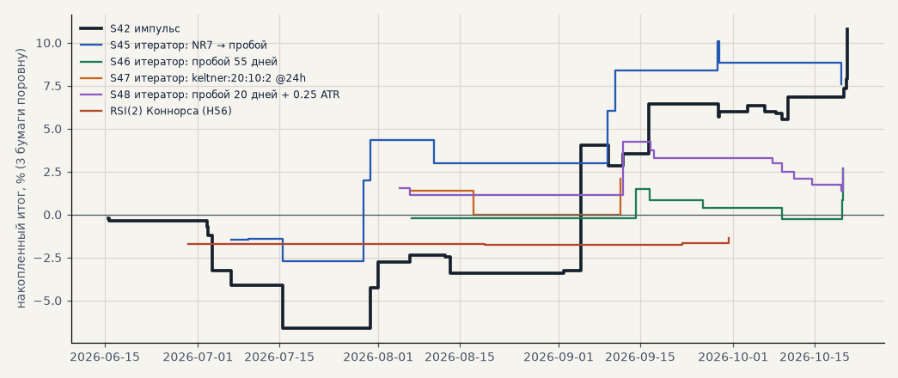

# Лучшие стратегии на свежих данных

SBER, GAZP, LKOH на бирже только в лонг, сделки, открытые 12.06.2026 — 21.10.2026 (131 дней) и закрытые до конца данных. Конец истории — 28.05.2026: свежие дни не участвовали ни в выборе, ни в проверке. Итог — на капитал трёх бумаг поровну, после издержек биржи (0.05% комиссии и 0.05% проскальзывания на сторону). Расчёт — `scripts/fresh_strategies.py`.

<!-- вывод -->
## Вывод

**На 4 свежих месяцах, которых не было ни в выборе, ни в проверке, импульс S42 работает лучше своей нормы: 33
сделки, +10.8%, PF 2.03 — лучше 78% окон той же длины на проверке 2021–2026.** Стратегии итератора тоже в плюсе
(S45 +7.6%, S46 +2.7%, S47 +2.1%, S48 +2.6%), RSI(2) — в минусе (−1.4%, 4 сделки, 13-й процентиль окон).

* Сделок мало (3–33), один свежий период — это проверка «не сломалось», а не доказательство: большинство
  результатов внутри обычного разброса окон (57–89-й процентиль).
* Код и данные согласованы: на истории сделки S45–S48, пересчитанные по живым файлам, совпали с журналом до сделки
  и до десятой процента на всех трёх бумагах.
* Как это исполнил бы живой контур — `docs/results/paper_replay.md` (после исправления — 33 из 33, +11.6%).
<!-- /вывод -->

## Свежие данные против проверки 2021 — май 2026

| стратегия | сделок | итог % | PF | средняя сделка % | проверка: сделок в год | проверка: PF | проверка: средняя % | окон по 131 дней на проверке с итогом не выше, % | медиана окон, % |
|---|---|---|---|---|---|---|---|---|---|
| S42 импульс | 33 | +10.8 | 2.03 | +0.98 | 70 | 1.38 | +0.41 | 78 | +3.0 |
| S45 итератор: NR7 → пробой | 11 | +7.6 | 2.15 | +2.08 | 17 | 0.93 | -0.16 | 89 | +0.4 |
| S46 итератор: пробой 55 дней | 7 | +2.7 | 2.36 | +1.15 | 17 | 2.60 | +1.50 | 64 | +0.7 |
| S47 итератор: keltner:20:10:2 @24h | 3 | +2.1 | 2.49 | +2.10 | 26 | 1.40 | +0.63 | 57 | +0.9 |
| S48 итератор: пробой 20 дней + 0.25 ATR | 11 | +2.6 | 1.82 | +0.72 | 31 | 1.49 | +0.49 | 65 | +0.8 |
| RSI(2) Коннорса (H56) | 4 | -1.4 | 0.22 | -1.03 | 23 | 1.47 | +0.38 | 13 | +1.4 |

## Сверка с журналом на истории (S45–S48, сделки до конца истории минус 30 дней)

| стратегия | бумага | сделок: заново | в журнале | итог %: заново | в журнале |
|---|---|---|---|---|---|
| S45 | sber | 57 | 57 | +45.3 | +45.3 |
| S46 | sber | 76 | 76 | +107.7 | +107.7 |
| S47 | sber | 97 | 97 | +124.7 | +124.7 |
| S48 | sber | 122 | 122 | +98.0 | +98.0 |
| S45 | gazp | 57 | 57 | +52.9 | +52.9 |
| S46 | gazp | 45 | 45 | +46.7 | +46.7 |
| S47 | gazp | 74 | 74 | +61.8 | +61.8 |
| S48 | gazp | 84 | 84 | +55.5 | +55.5 |
| S45 | lkoh | 48 | 48 | +22.4 | +22.4 |
| S46 | lkoh | 67 | 67 | +65.2 | +65.2 |
| S47 | lkoh | 94 | 94 | +70.5 | +70.5 |
| S48 | lkoh | 123 | 123 | +19.3 | +19.3 |
