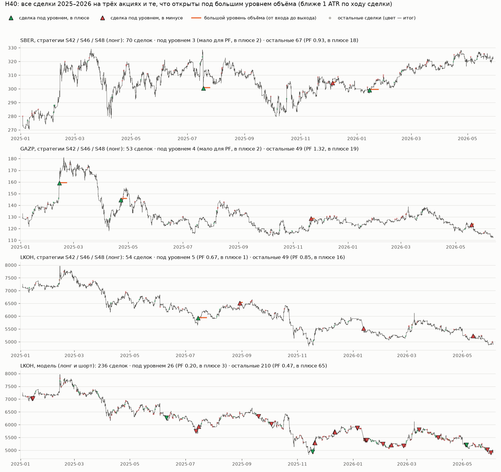
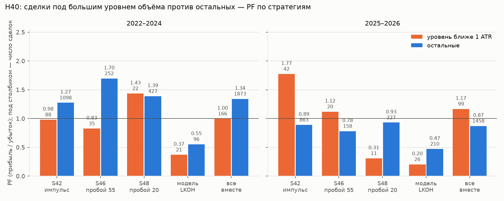
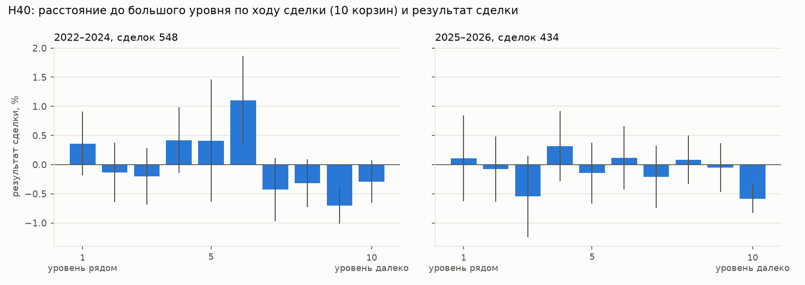
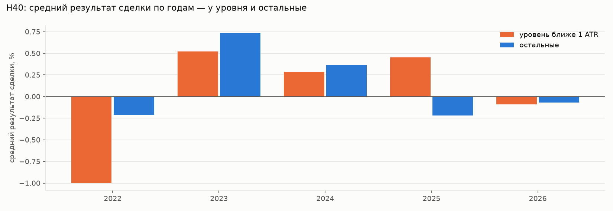
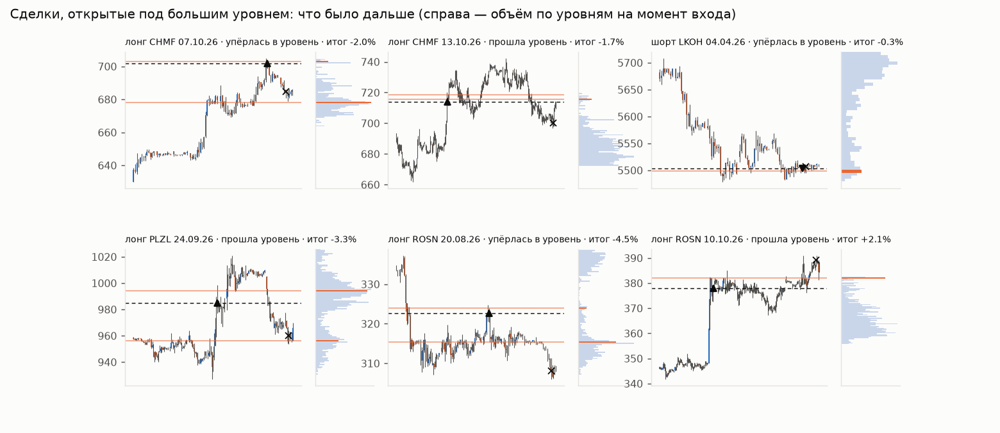

# Сделки под большим уровнем объёма (H40, план 14.11)

Проверка из банка гипотез: не «уровень как сигнал» (это было 08.11, [h40_profile.md](h40_profile.md)), а разбор сделок
журнала — **сделки наших стратегий, открытые прямо под большим свежим уровнем объёма, идут хуже остальных**, потому что
цена упирается в уровень. План подтверждён в банке 14.11, считалось по нему и по ответам автора на вопросы.

**Сделки** (журнал экспериментов, издержки биржи, дивиденды учтены, цены переведены в масштаб биржевых свечей):
S42 (импульс) — S42 на SBER, GAZP, LKOH и S51 на 16 акциях индекса; S46 (пробой 55 дней) — S46 и S53; S48 (пробой
20 дней) — S48 и S55; сделки модели по LKOH (L10, CatBoost на 3 класса, seed 42) в обе стороны — по ответу автора,
«не ограничиваться лонгами стратегий». Период — входы 2022–2026 (половины 2022–2024 и 2025–2026, как в критерии).

**Уровни.** Профиль объёма по ценам с шагом 0.1% (уровень = floor(log(цена) / log(1.001))). Основной источник — минутки
(объём минуты попадает в уровень её средней цены, `scripts/h40_levels_min.py`): они есть на всю историю сделок.
Лента обезличенных сделок (ALGOPACK с Диска, `scripts/h40_levels.py`) выгружается часами, поэтому на ней сделана
сверка: совпадают ли уровни двух источников на днях, где есть оба (раздел «Лента против минуток»).

**Большой уровень** — локальный максимум сглаженного профиля, где объём в X раз выше среднего по соседним ±2% цены
(X = 2 в основном расчёте, 1.5 и 3 — в сетке устойчивости). Профиль — по прошлым N торговым дням (N = 20; 10 и 40 в
сетке) и только по часам **строго до часа входа**: объём часа, в котором открыта сделка, в расчёт не идёт (иначе
собственный объём пробоя рисует «уровень» ровно на цене входа).

**Свежесть** — правило автора: уровень живёт, пока цена не вернулась к нему с расстояния k·ATR; после возврата объём на
уровне копится заново (k = 1, 2, 3 в сетке; 0 — весь объём окна).

**Группы.** Для каждой сделки — расстояние от входа до ближайшего большого уровня по ходу сделки (для лонга сверху, для
шорта снизу) в ATR(14 ч). «Уровень ближе 1 ATR» против «остальных» (у остальных уровень дальше или его нет).

**Критерий плана:** разница PF между группами одного знака в 2022–2024 и в 2025–2026 и хотя бы у двух стратегий из трёх;
в меньшей группе не меньше 30 сделок.

Расчёт: `scripts/h40_trades.py`, `scripts/h40_levels_min.py`, `scripts/h40_levels.py`, `scripts/h40_sig.py`,
`scripts/h40_stall.py`, `scripts/h40_cmp.py`, отчёт — `scripts/h40_report.py`.

## Картинки по замечанию Тимура (созвон 17.11)

Тимуру было мало гистограммы: нужно видеть сами случаи. Поэтому по SBER, GAZP и LKOH за 2025–2026 нарисованы все
413 сделок, а 38 сделок «под уровнем» выделены вместе с самим уровнем (`scripts/h40_overview.py`).

Каждая из 38 сделок крупно: свечи, профиль объёма за 20 дней до входа, уровень, вход, выход, прошла ли цена уровень —
[лист 1](h40_trades/cases_2025_2026_1.png), [лист 2](h40_trades/cases_2025_2026_2.png),
[лист 3](h40_trades/cases_2025_2026_3.png), [лист 4](h40_trades/cases_2025_2026_4.png). Таблица случаев —
`reports/h40_trades/cases_2025_2026.csv`.

Что видно: у стратегий под уровнем 12 сделок, PF 1.43 против 1.02 у остальных 165, то есть не хуже. У модели LKOH
26 сделок, PF 0.20 против 0.47 у остальных 210: хуже, но и сама модель в эти годы в минусе. Цена прошла уровень в
22 случаях из 38 (средняя сделка +0.34%) и не прошла в 16 (−0.67%). Заранее это не известно, поэтому правилом
входа это не становится. Вывод H40 не меняется. Картинки есть и в журнале экспериментов: раздел «Проверено без журнала
сделок», адрес `#H40`.

<!-- вывод -->
## Вывод

**H40 в формулировке плана не подтвердилась: сделки, открытые под большим уровнем объёма, идут не хуже остальных.**
Разница между группами меняет знак от половины к половине и не выдерживает перестановочный тест.

* **Критерий не выполнен ни одной стратегией** (нужно ≥ 2 из 3). PF у сделок с уровнем ближе 1 ATR против остальных:
  S42 — 0.98 против 1.27 в 2022–2024 и 1.77 против 0.89 в 2025–2026; S46 — 0.83 против 1.70, затем 1.12 против 0.78;
  S48 — 1.43 против 1.39, затем 0.31 против 0.93. У каждой стратегии знак разницы в половинах разный.
* **Всего по 3596 сделкам** — PF 1.06 у сделок под уровнем против 1.13 у остальных; разница −0.08% на сделку,
  перестановочный тест p = 0.74 (внутри года и бумаги). По половинам: −0.42% (p = 0.20) и +0.38% (p = 0.27) —
  то есть и размер, и знак разницы в пределах случайности.
* **Чем строже уровень, тем хуже выглядят такие сделки, но сделок остаётся мало.** При X = 3 (объём втрое выше
  соседних уровней) PF рядом 0.75 против 1.14, но это 67 сделок за 5 лет, знак держится в обеих половинах, а p = 0.34.
  Это единственное место, где гипотеза видна, — кандидат на повторную проверку, когда наберётся больше сделок.
* **Правило свежести автора** (уровень живёт, пока цена не вернулась к нему с 1/2/3 ATR, после возврата объём копится
  заново) ничего не меняет: PF рядом 1.13–1.26 против 1.11–1.13, критерий не проходит ни при каком k.
* **Опора снизу (шаг 5)** тоже не работает: 1.21 против 1.12 по всем сделкам, но у S48 1.03 против 1.19, а знак по
  половинам снова разный.
* **Цена у уровня не останавливается чаще, чем в пустом месте.** Лучший ход сделки совпадает с уровнем (±0.2 ATR) в
  12.8% случаев, а с «пустышкой» в 0.5 ATR дальше — в 11.3%. При этом до уровня цена доходит в 87% сделок — то есть
  уровень чаще проходится, чем держит.
* **Сверка источников:** уровни по минуткам и по ленте обезличенных сделок совпадают. На 19 акциях за 02–04.2024
  (196 сделок, выгруженная часть ленты ALGOPACK) признак «уровень ближе 1 ATR» совпал в 99.0% сделок, корреляция
  расстояний 0.998; на LKOH за 02.2024 — 04.2026 (277 сделок, секундные агрегаты ленты) — 98.6% и 0.926, PF у сделок
  под уровнем 0.35 по ленте против 0.35 по минуткам. Вывод не зависит от того, по чему считать профиль.
* **Покупки и продажи по уровням (вопрос автора) — одно и то же.** На ленте LKOH уровни «по покупкам», «по продажам»
  и «по всем сделкам» дают почти один и тот же набор сделок у уровня (совпадение 94.6%, корреляция расстояний 0.755)
  и тот же результат: PF рядом 0.56 / 0.39 / 0.38 против 0.75 / 0.77 / 0.78 у остальных (2025–2026, 19–26 сделок).

Почему так, видно из самих данных: **у 73% наших входов большого уровня по ходу сделки вообще нет** — стратегии входят
на пробое, выше всего накопленного объёма, в пустом месте. Правило «не входить под уровнем» коснулось бы 7% сделок,
и на итог портфеля оно повлиять не может.

Отдельно: если в профиль включить объём часа, в котором открыта сделка (соблазнительный «текущий профиль»), на цене
входа появляется собственный уровень пробоя и картина переворачивается — PF рядом 1.34 против 1.11. Это заглядывание
вперёд; в расчёте берутся только часы строго до входа.

**Что идёт дальше (не меняет вывода).** Выгрузка ленты с Диска за 2022–2026 продолжается в фоне
(`scripts/h40_levels.py`, журнал `reports/h40_trades/levels.log`, ~15 с на день, 117 ГБ всего): когда она дойдёт до
конца, тот же расчёт можно повторить целиком на ленте одной командой `--source tape`. Сверка на двух независимых кусках
(19 акций за 02–04.2024 и LKOH за 2 года) показывает, что результат от этого не изменится.
<!-- /вывод -->

Сделок в разборе: 3596 (2022-01-03 — 2026-10-23), бумаг 19; большой уровень по ходу сделки ближе 1 ATR — у 7% сделок, уровня в окне нет вовсе — у 73%.

## Сделки у уровня против остальных

| стратегия | период | сделок у уровня | PF у уровня | средняя у уровня, % | выигрышей у уровня, % | сделок остальных | PF остальных | средняя остальных, % | выигрышей остальных, % |
|---|---|---|---|---|---|---|---|---|---|
| S42 импульс | 2022–2024 | 88 | 0.98 | -0.03 | 41 | 1098 | 1.27 | +0.36 | 44 |
| S42 импульс | 2025–2026 | 42 | 1.77 | +1.13 | 43 | 863 | 0.89 | -0.15 | 40 |
| S42 импульс | 2022–2026 | 130 | 1.23 | +0.35 | 42 | 1961 | 1.10 | +0.14 | 43 |
| S46 пробой 55 дней | 2022–2024 | 35 | 0.83 | -0.23 | 29 | 252 | 1.70 | +0.86 | 35 |
| S46 пробой 55 дней | 2025–2026 | 20 | 1.12 | +0.18 | 20 | 158 | 0.78 | -0.30 | 27 |
| S46 пробой 55 дней | 2022–2026 | 55 | 0.94 | -0.08 | 25 | 410 | 1.32 | +0.41 | 32 |
| S48 пробой 20 дней | 2022–2024 | 22 | 1.43 | +0.81 | 36 | 427 | 1.39 | +0.43 | 34 |
| S48 пробой 20 дней | 2025–2026 | 11 | 0.31 | -1.91 | 18 | 227 | 0.93 | -0.10 | 27 |
| S48 пробой 20 дней | 2022–2026 | 33 | 0.95 | -0.10 | 30 | 654 | 1.20 | +0.25 | 32 |
| модель LKOH | 2022–2024 | 21 | 0.37 | -0.37 | 33 | 96 | 0.55 | -0.20 | 27 |
| модель LKOH | 2025–2026 | 26 | 0.20 | -0.31 | 12 | 210 | 0.47 | -0.15 | 31 |
| модель LKOH | 2022–2026 | 47 | 0.30 | -0.34 | 21 | 306 | 0.51 | -0.16 | 30 |
| все | 2022–2024 | 166 | 1.00 | -0.00 | 37 | 1873 | 1.34 | +0.42 | 40 |
| все | 2025–2026 | 99 | 1.17 | +0.22 | 27 | 1458 | 0.87 | -0.16 | 35 |
| все | 2022–2026 | 265 | 1.06 | +0.08 | 33 | 3331 | 1.13 | +0.16 | 38 |

## Критерий плана

| стратегия | PF рядом 22–24 | PF ост. 22–24 | PF рядом 25–26 | PF ост. 25–26 | n рядом 22–24 | n рядом 25–26 | разница одного знака | сделок ≥ 30 | прошла |
|---|---|---|---|---|---|---|---|---|---|
| S42 импульс | 0.98 | 1.27 | 1.77 | 0.89 | 88 | 42 | нет | да | нет |
| S46 пробой 55 дней | 0.83 | 1.70 | 1.12 | 0.78 | 35 | 20 | нет | нет | нет |
| S48 пробой 20 дней | 1.43 | 1.39 | 0.31 | 0.93 | 22 | 11 | нет | нет | нет |

**стратегий с устойчивой разницей 0 из 3 (нужно ≥ 2); критерий не выполнен.**

## Устойчивость к настройкам

| X (во сколько раз выше соседей) | окно, дней | свежесть, ATR | группа «рядом», ATR | сделок рядом | PF рядом | PF остальных | критерий |
|---|---|---|---|---|---|---|---|
| 1.5 | 10 | 0 | 0.5 | 445 | 1.06 | 1.14 | нет |
| 1.5 | 10 | 0 | 1.0 | 655 | 1.09 | 1.14 | нет |
| 1.5 | 20 | 0 | 0.5 | 390 | 1.06 | 1.14 | нет |
| 1.5 | 20 | 0 | 1.0 | 573 | 1.13 | 1.13 | нет |
| 1.5 | 40 | 0 | 0.5 | 333 | 1.20 | 1.12 | нет |
| 1.5 | 40 | 0 | 1.0 | 522 | 1.12 | 1.13 | нет |
| 2.0 | 10 | 0 | 0.5 | 245 | 1.17 | 1.13 | нет |
| 2.0 | 10 | 0 | 1.0 | 340 | 1.27 | 1.11 | нет |
| 2.0 | 20 | 0 | 0.5 | 194 | 1.00 | 1.14 | нет |
| 2.0 | 20 | 0 | 1.0 | 265 | 1.06 | 1.13 | нет |
| 2.0 | 40 | 0 | 0.5 | 147 | 1.05 | 1.13 | нет |
| 2.0 | 40 | 0 | 1.0 | 206 | 1.06 | 1.13 | нет |
| 3.0 | 10 | 0 | 0.5 | 92 | 1.01 | 1.13 | нет |
| 3.0 | 10 | 0 | 1.0 | 110 | 1.08 | 1.13 | нет |
| 3.0 | 20 | 0 | 0.5 | 68 | 0.80 | 1.14 | нет |
| 3.0 | 20 | 0 | 1.0 | 80 | 0.84 | 1.14 | нет |
| 3.0 | 40 | 0 | 0.5 | 57 | 0.75 | 1.14 | нет |
| 3.0 | 40 | 0 | 1.0 | 67 | 0.75 | 1.14 | нет |
| 2.0 | 20 | 1 | 0.5 | 475 | 1.19 | 1.12 | нет |
| 2.0 | 20 | 1 | 1.0 | 755 | 1.13 | 1.13 | нет |
| 2.0 | 20 | 2 | 0.5 | 406 | 1.17 | 1.12 | нет |
| 2.0 | 20 | 2 | 1.0 | 704 | 1.17 | 1.12 | нет |
| 2.0 | 20 | 3 | 0.5 | 351 | 1.26 | 1.11 | нет |
| 2.0 | 20 | 3 | 1.0 | 629 | 1.21 | 1.11 | нет |

## Опора за спиной (шаг 5 плана): большой уровень с другой стороны входа

| стратегия | период | сделок у уровня | PF у уровня | средняя у уровня, % | выигрышей у уровня, % | сделок остальных | PF остальных | средняя остальных, % | выигрышей остальных, % |
|---|---|---|---|---|---|---|---|---|---|
| S42 импульс | 2022–2024 | 104 | 1.00 | +0.00 | 43 | 1082 | 1.28 | +0.36 | 44 |
| S42 импульс | 2025–2026 | 47 | 1.74 | +0.97 | 49 | 858 | 0.89 | -0.15 | 40 |
| S42 импульс | 2022–2026 | 151 | 1.21 | +0.30 | 45 | 1940 | 1.10 | +0.14 | 42 |
| S46 пробой 55 дней | 2022–2024 | 43 | 1.92 | +0.98 | 42 | 244 | 1.53 | +0.68 | 33 |
| S46 пробой 55 дней | 2025–2026 | 32 | 1.08 | +0.10 | 38 | 146 | 0.77 | -0.32 | 23 |
| S46 пробой 55 дней | 2022–2026 | 75 | 1.52 | +0.61 | 40 | 390 | 1.23 | +0.31 | 29 |
| S48 пробой 20 дней | 2022–2024 | 20 | 2.18 | +1.96 | 50 | 429 | 1.34 | +0.38 | 34 |
| S48 пробой 20 дней | 2025–2026 | 23 | 0.34 | -1.57 | 17 | 215 | 0.97 | -0.04 | 27 |
| S48 пробой 20 дней | 2022–2026 | 43 | 1.03 | +0.07 | 33 | 644 | 1.19 | +0.24 | 32 |
| модель LKOH | 2022–2024 | 32 | 0.87 | -0.07 | 41 | 85 | 0.36 | -0.29 | 24 |
| модель LKOH | 2025–2026 | 22 | 0.45 | -0.14 | 36 | 214 | 0.43 | -0.17 | 28 |
| модель LKOH | 2022–2026 | 54 | 0.77 | -0.10 | 39 | 299 | 0.40 | -0.20 | 27 |
| все | 2022–2024 | 199 | 1.31 | +0.40 | 43 | 1840 | 1.31 | +0.38 | 39 |
| все | 2025–2026 | 124 | 1.06 | +0.08 | 38 | 1433 | 0.88 | -0.15 | 35 |
| все | 2022–2026 | 323 | 1.21 | +0.28 | 41 | 3273 | 1.12 | +0.15 | 37 |

## Останавливается ли цена у уровня

Доля сделок, где лучший ход (MFE) совпал с уровнем (±0.2 ATR), и то же для «пустышки» — точки на 0.5 и 1 ATR дальше уровня, где уровня нет.

| уровень ближе ATR | сделок | у уровня | +0.5 ATR | +1 ATR | дошёл до уровня |
|---|---|---|---|---|---|
| 1.0 | 265.0 | 12.8 | 11.3 | 7.9 | 87.2 |
| 2.0 | 378.0 | 11.4 | 8.2 | 7.7 | 79.4 |
| 99.0 | 982.0 | 6.3 | 4.5 | 4.6 | 50.6 |

## Случайна ли разница (перестановки внутри года и бумаги)

| период | порог_ATR | сделок_рядом | сделок_остальных | PF_рядом | PF_остальные | средняя_рядом | средняя_остальные | разница | p |
|---|---|---|---|---|---|---|---|---|---|
| 2022–2026 | 0.5 | 194 | 3402 | 1.003 | 1.137 | 0.004 | 0.167 | -0.163 | 0.5742 |
| 2022–2024 | 0.5 | 128 | 1911 | 0.992 | 1.336 | -0.012 | 0.408 | -0.42 | 0.2678 |
| 2025–2026 | 0.5 | 66 | 1491 | 1.025 | 0.885 | 0.036 | -0.141 | 0.177 | 0.6998 |
| 2022–2026 | 1.0 | 265 | 3331 | 1.059 | 1.135 | 0.081 | 0.165 | -0.084 | 0.7414 |
| 2022–2024 | 1.0 | 166 | 1873 | 0.997 | 1.342 | -0.004 | 0.416 | -0.42 | 0.2032 |
| 2025–2026 | 1.0 | 99 | 1458 | 1.167 | 0.872 | 0.222 | -0.158 | 0.38 | 0.2742 |

## Лента против минуток

План называл источником уровней ленту обезличенных сделок. Профиль по минуткам даёт те же уровни: признак «большой уровень по ходу ближе 1 ATR» совпадает почти всегда.

**19 акций, лента ALGOPACK с Диска (выгружено на момент расчёта)**

| что | значение |
|---|---|
| общих сделок | 196 |
| период | 2024-02-12 — 2024-04-29 |
| есть уровень (минутки), % | 14.3 |
| есть уровень (лента), % | 11.7 |
| совпал признак «ближе 1 ATR», % | 99.0 |
| корреляция расстояний | 0.998 |
| PF рядом (минутки) | 0.482 |
| PF рядом (лента) | 0.756 |
| PF остальные (минутки) | 2.103 |
| PF остальные (лента) | 2.094 |

**LKOH, секундные агрегаты ленты (data/raw/orderflow_lkoh_1s.parquet)**

| что | значение |
|---|---|
| общих сделок | 277 |
| период | 2024-02-13 — 2026-04-04 |
| есть уровень (минутки), % | 40.4 |
| есть уровень (лента), % | 41.5 |
| совпал признак «ближе 1 ATR», % | 98.6 |
| корреляция расстояний | 0.926 |
| PF рядом (минутки) | 0.347 |
| PF рядом (лента) | 0.353 |
| PF остальные (минутки) | 0.873 |
| PF остальные (лента) | 0.872 |

## Покупки и продажи по уровням отдельно (вопрос автора), лента LKOH 2025–2026

| объём уровня | сделок рядом | PF рядом | сделок остальных | PF остальных |
|---|---|---|---|---|
| все сделки | 24 | 0.38 | 212 | 0.78 |
| только покупки | 19 | 0.56 | 217 | 0.75 |
| только продажи | 26 | 0.39 | 210 | 0.77 |

## Графики

Все ситуации входов 2025–2026 с профилем объёма на момент входа (замечание автора к плану) — `docs/results/h40_trades/entries_<бумага>_min_main_*.png`.
