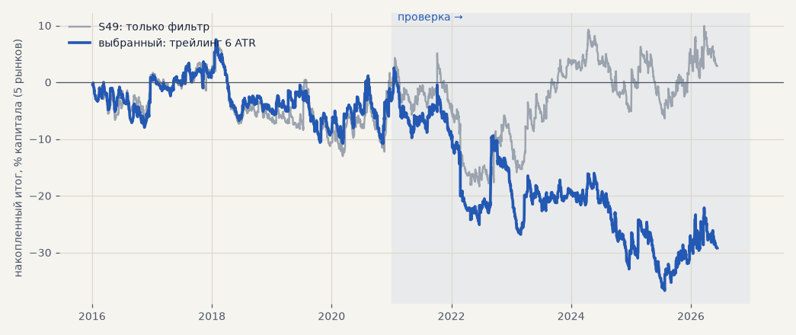

# Стратегия по тренд-фильтру: выход раньше смены тренда (H59, уточнение 04.11)

Тимур: S49 «недобирает прибыль, но генерит почти максимально возможное количество убытков» — нужен выход ближе к пику и ранний выход при убытке. Вход как у S49 (трёхслойный фильтр включил направление; металлы через CFD в обе стороны, акции в лонг); выход — что раньше: фильтр, начальный стоп, трейлинг от лучшей цены, «мягкая EMA 5» (закрытие по другую сторону EMA 5 — только после того, как сделка прошла +X ATR). Сетка 45 вариантов; выбор — среди вариантов с ранним выходом только по 2016–2020 (≥ 10 сделок в год, без 2 лучших > 0, наибольший PF; не прошёл никто — лучший по PF), проверка — один раз. Издержки как в журнале. Расчёт — `scripts/h59_trend_exits.py`.

<!-- вывод -->
## Вывод

**Уточнение H59 не подтвердилось: ни один ранний выход не улучшает стратегию по тренд-фильтру — все 44 варианта хуже
самого фильтра (S49) и на выборе, и на проверке.** В журнале — лучший из них по выбору (S63, трейлинг 6 ATR):
PF 1.00 на выборе и 0.90 на проверке против 1.02 и 1.00 у S49.

* **Почему не помогает.** Сделка по фильтру и так короткая — 340–400 сделок в год на набор, обычно 2–4 дня; фильтр
  часто мигает «направление ↔ нейтраль» (разбор 22.10). Стоп и трейлинг в ATR часа срабатывают на обычном шуме раньше,
  чем фильтр сам закрыл бы сделку, и режут именно те редкие длинные ходы, которые держат итог около нуля. Чем ближе
  стоп (2 ATR) или трейлинг (2–4 ATR), тем хуже: PF проверки 0.62–0.87.
* **«Мягкая EMA 5»** (закрытие ниже EMA 5 после того, как сделка прошла +1 или +2 ATR) — тоже хуже: PF 0.66–0.83 на выборе и 0.62–0.78 на проверке. Тимур
  был прав, что в чистом виде правило вредит; «после прибыли» этого не меняет.
* **Убытки S49 — от входов, а не от выходов.** Терять меньше на сделке не получается, не теряя больше на длинных
  ходах. Улучшать нужно момент входа: фильтр должен реже переключаться (у S50 — акции в лонг «держать до
  противоположного сигнала» — итог в плюсе, H60), или входить по фильтру только с подтверждением (как сделки импульса).

**Что дальше.** Отдельной стратегией по тренд-фильтру не заниматься; фильтр — в модель (H69, решение созвона 16.10) и как
условие для импульса, где он уже работает.
<!-- /вывод -->

## Выбор 2016–2020

| вариант | сделок в год | итог % | PF | без 2 лучших | просадка | t мес | с S42: t мес | итог / просадка |
|---|---|---|---|---|---|---|---|---|
| S42 один | 147.0 | +27.5 | 1.19 | +19.9 | -11.2 | 1.33 | — | 2.46 |
| S49: только фильтр | 339.5 | +3.5 | 1.02 | -7.9 | -19.8 | 0.17 | 0.84 | 1.09 |
| **выбранный: трейлинг 6 ATR** | 340.6 | +0.9 | 1.00 | -6.4 | -18.3 | 0.05 | 0.82 | 1.07 |

## Проверка 2021 — июнь 2026

| вариант | сделок в год | итог % | PF | без 2 лучших | просадка | t мес | с S42: t мес | итог / просадка |
|---|---|---|---|---|---|---|---|---|
| S42 один | 163.6 | +47.0 | 1.26 | +34.7 | -12.2 | 1.93 | — | 3.85 |
| S49: только фильтр | 404.9 | -0.7 | 1.00 | -11.3 | -23.5 | -0.03 | 1.11 | 1.42 |
| **выбранный: трейлинг 6 ATR** | 404.9 | -30.1 | 0.90 | -41.5 | -39.4 | -1.34 | 0.40 | 0.50 |

## Вся сетка

PF на выборе → на проверке; жирным — прошёл отбор по выбору.

| вариант | выбор: сделок в год | выбор: PF | выбор: без 2 лучших | проверка: PF | проверка: без 2 лучших |
|---|---|---|---|---|---|
| как S49 (только фильтр) | 339.5 | 1.02 | -7.9 | 1.00 | -11.3 |
| трейлинг 6 ATR | 340.6 | 1.00 | -6.4 | 0.90 | -41.5 |
| стоп 3 ATR, трейлинг 6 ATR | 340.6 | 0.96 | -15.7 | 0.90 | -40.6 |
| стоп 3 ATR | 339.5 | 0.95 | -21.0 | 0.96 | -21.2 |
| стоп 2 ATR, трейлинг 6 ATR | 340.6 | 0.91 | -23.4 | 0.83 | -55.4 |
| стоп 2 ATR | 339.5 | 0.90 | -29.6 | 0.87 | -45.0 |
| трейлинг 4 ATR | 342.5 | 0.89 | -28.0 | 0.84 | -55.7 |
| стоп 3 ATR, трейлинг 4 ATR | 342.5 | 0.89 | -27.8 | 0.84 | -52.6 |
| стоп 2 ATR, трейлинг 4 ATR | 342.5 | 0.84 | -35.1 | 0.81 | -59.2 |
| трейлинг 6 ATR, EMA 5 после +2 ATR | 343.6 | 0.83 | -31.0 | 0.77 | -66.8 |
| EMA 5 после +2 ATR | 343.6 | 0.82 | -32.5 | 0.78 | -62.1 |
| трейлинг 4 ATR, EMA 5 после +2 ATR | 343.6 | 0.81 | -34.2 | 0.75 | -68.8 |
| стоп 3 ATR, трейлинг 4 ATR, EMA 5 после +2 ATR | 343.6 | 0.80 | -34.7 | 0.76 | -66.8 |
| стоп 3 ATR, трейлинг 6 ATR, EMA 5 после +2 ATR | 343.6 | 0.80 | -35.8 | 0.77 | -63.8 |
| стоп 3 ATR, EMA 5 после +2 ATR | 343.6 | 0.80 | -35.8 | 0.76 | -64.6 |
| стоп 2 ATR, EMA 5 после +2 ATR | 343.6 | 0.75 | -40.6 | 0.73 | -69.4 |
| стоп 2 ATR, трейлинг 6 ATR, EMA 5 после +2 ATR | 343.6 | 0.75 | -40.6 | 0.73 | -68.6 |
| стоп 2 ATR, трейлинг 4 ATR, EMA 5 после +2 ATR | 343.6 | 0.75 | -40.6 | 0.73 | -69.9 |
| стоп 3 ATR, трейлинг 3 ATR, EMA 5 после +2 ATR | 343.6 | 0.75 | -40.9 | 0.75 | -65.3 |
| трейлинг 3 ATR, EMA 5 после +2 ATR | 343.6 | 0.75 | -40.9 | 0.75 | -65.3 |
| стоп 2 ATR, трейлинг 3 ATR, EMA 5 после +2 ATR | 343.6 | 0.74 | -41.3 | 0.72 | -70.6 |
| трейлинг 6 ATR, EMA 5 после +1 ATR | 343.6 | 0.73 | -37.6 | 0.72 | -64.8 |
| стоп 3 ATR, трейлинг 3 ATR | 342.5 | 0.73 | -48.5 | 0.79 | -60.4 |
| трейлинг 3 ATR | 342.5 | 0.73 | -48.5 | 0.79 | -60.4 |
| EMA 5 после +1 ATR | 343.6 | 0.72 | -38.5 | 0.72 | -63.0 |
| трейлинг 4 ATR, EMA 5 после +1 ATR | 343.6 | 0.72 | -38.3 | 0.72 | -64.2 |
| стоп 3 ATR, трейлинг 4 ATR, EMA 5 после +1 ATR | 343.6 | 0.72 | -38.5 | 0.73 | -61.8 |
| стоп 3 ATR, трейлинг 6 ATR, EMA 5 после +1 ATR | 343.6 | 0.72 | -38.9 | 0.73 | -60.9 |
| стоп 3 ATR, EMA 5 после +1 ATR | 343.6 | 0.72 | -38.9 | 0.72 | -61.6 |
| стоп 2 ATR, трейлинг 3 ATR | 342.5 | 0.71 | -49.8 | 0.76 | -65.8 |
| стоп 3 ATR, трейлинг 3 ATR, EMA 5 после +1 ATR | 343.6 | 0.68 | -42.5 | 0.71 | -63.4 |
| трейлинг 3 ATR, EMA 5 после +1 ATR | 343.6 | 0.68 | -42.5 | 0.71 | -63.4 |
| стоп 2 ATR, EMA 5 после +1 ATR | 343.6 | 0.68 | -42.0 | 0.69 | -67.2 |
| стоп 2 ATR, трейлинг 6 ATR, EMA 5 после +1 ATR | 343.6 | 0.68 | -42.0 | 0.69 | -66.6 |
| стоп 2 ATR, трейлинг 4 ATR, EMA 5 после +1 ATR | 343.6 | 0.68 | -42.0 | 0.69 | -67.7 |
| трейлинг 2 ATR, EMA 5 после +2 ATR | 343.6 | 0.67 | -45.1 | 0.64 | -73.4 |
| стоп 3 ATR, трейлинг 2 ATR, EMA 5 после +2 ATR | 343.6 | 0.67 | -45.1 | 0.64 | -73.4 |
| стоп 2 ATR, трейлинг 2 ATR, EMA 5 после +2 ATR | 343.6 | 0.67 | -45.1 | 0.64 | -73.4 |
| стоп 2 ATR, трейлинг 3 ATR, EMA 5 после +1 ATR | 343.6 | 0.67 | -43.0 | 0.68 | -68.6 |
| стоп 3 ATR, трейлинг 2 ATR, EMA 5 после +1 ATR | 343.6 | 0.66 | -42.3 | 0.62 | -71.7 |
| трейлинг 2 ATR, EMA 5 после +1 ATR | 343.6 | 0.66 | -42.3 | 0.62 | -71.7 |
| стоп 2 ATR, трейлинг 2 ATR, EMA 5 после +1 ATR | 343.6 | 0.66 | -42.3 | 0.62 | -71.7 |
| трейлинг 2 ATR | 342.5 | 0.63 | -50.6 | 0.64 | -73.7 |
| стоп 2 ATR, трейлинг 2 ATR | 342.5 | 0.63 | -50.6 | 0.64 | -73.7 |
| стоп 3 ATR, трейлинг 2 ATR | 342.5 | 0.63 | -50.6 | 0.64 | -73.7 |

## Выбранный вариант по рынкам — проверка

| рынок | сделок | итог % | PF | средняя сделка % | выходы |
|---|---|---|---|---|---|
| silver | 720 | -63.0 | 0.89 | -0.09 | фильтр 604, трейлинг 116 |
| gold | 720 | -68.3 | 0.79 | -0.09 | фильтр 584, трейлинг 135, конец данных 1 |
| gazp | 255 | +12.9 | 1.06 | +0.05 | фильтр 186, трейлинг 69 |
| sber | 249 | -4.6 | 0.97 | -0.02 | фильтр 181, трейлинг 68 |
| lkoh | 253 | -27.5 | 0.87 | -0.11 | фильтр 186, трейлинг 67 |
