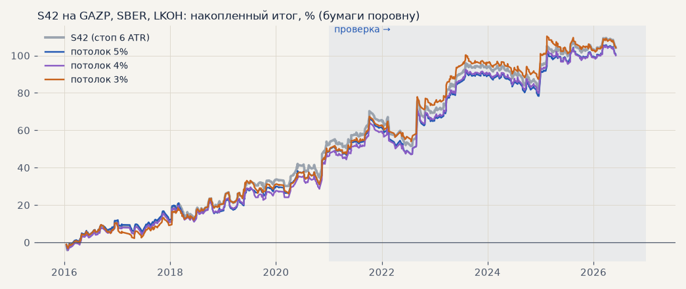

# Потолок убытка сделки 3 / 4 / 5% у S42 (H71, T46)

Вопрос Тимура: в живой торговле, особенно с плечом, глубокая сделка опасна — как меняется импульсная стратегия, если ограничить убыток сделки 3, 4 или 5%, и как часто сделка в глубоком минусе потом выходит хотя бы в ноль.

Как считали: S42 на акциях (GAZP, SBER, LKOH на бирже в лонг, дивиденды, издержки биржи) — штатный walk-forward, минутный симулятор; стоп = ближний из «6 ATR от входа» и «X% от входа» (`simulation.max_loss_pct`), трейлинг, гейт и выход 240 ч — как у S42. Бумаги поровну, метрики — кодом журнала. Расчёт — `scripts/queues/h71_stop_caps.sh`, `scripts/h71_stop_caps.py`.

<!-- вывод -->
## Вывод

**H71 подтвердилась как страховка, а не как улучшение: потолок 3–4% убытка почти не меняет доходность S42, но
заметно режет просадку на проверке.** Журнал: S60 (5%), S61 (4%), S62 (3%).

* **Потолок 3%** — проверка 2021–2026: итог +54.2% против +50.8% у S42, PF 1.41 против 1.37, просадка **−13.3% против
  −18.7%**, t 2.07 против 1.89. Выбор 2016–2020: +50.0% против +53.4%, PF 1.47 против 1.52, просадка та же, лет в плюсе
  4 из 5 против 5 из 5. Итог в пределах шума в обе стороны, риск ниже.
* **Потолок 5%** почти ничего не меняет — 6 ATR дальше 5% от входа бывает редко. 4% — посередине.
* **Глубокая сделка почти не возвращается.** Из 125 сделок S42, ушедших в −3%, закрылись не в минус только 14%;
  из ушедших в −5% — 17%. Средний итог таких сделок около −3%. «Пересиживать» −3% в надежде на возврат почти бесполезно.
* **Гэп потолок не отменяет.** Худшая сделка с потолком 3% — −4.3% на проверке и −5.3% на выборе: стоп исполняется по
  первой цене после разрыва (ночь, выходные, новости).
* **Сделка этой недели.** GAZP 30.10 → 04.11 закрылась по стопу 6 ATR на −4.5%; с потолком 3% стоп стоял бы на 113.8 и
  сработал бы 03.11 — около −3%. LKOH (−2.7%) потолок не затронул бы.

**Принято 04.11 (Денис):** на счёте потолок 4% (`max_loss_pct: 4` в configs/account.yaml, было 10 — фактически
не работало); 3% — если вернёмся к плечу. Механика уже есть: счёт ставит у брокера стоп = ближний из стопа стратегии
и потолка; сработал потолок — бумаг у брокера нет, и контур закрывает позицию счёта сам. Сигналы стратегии и её
бумажный журнал при этом не меняются — разница видна только на сделках, где 6 ATR дальше потолка (при 4% — около
21% сделок S42 на проверке).
<!-- /вывод -->

## Метрики

| вариант | период | сделок | итог, % | PF | без 2 лучших | просадка | t | лет в плюсе | худшая сделка | по стопу |
|---|---|---|---|---|---|---|---|---|---|---|
| S42 (стоп 6 ATR) | выбор | 275 | +53.4 | 1.52 | +44.1 | -8.1 | +2.59 | 5/5 | -7.7% | 23% |
| S42 (стоп 6 ATR) | проверка | 378 | +50.8 | 1.37 | +30.6 | -18.7 | +1.89 | 6/6 | -9.0% | 26% |
| потолок 5% | выбор | 276 | +49.7 | 1.47 | +40.3 | -9.7 | +2.38 | 5/5 | -5.3% | 24% |
| потолок 5% | проверка | 379 | +50.8 | 1.37 | +30.6 | -19.4 | +1.90 | 6/6 | -5.2% | 27% |
| потолок 4% | выбор | 278 | +47.4 | 1.44 | +38.0 | -8.6 | +2.28 | 5/5 | -5.3% | 25% |
| потолок 4% | проверка | 380 | +52.7 | 1.39 | +32.5 | -17.1 | +1.99 | 6/6 | -4.3% | 28% |
| потолок 3% | выбор | 282 | +50.0 | 1.47 | +40.6 | -8.2 | +2.45 | 4/5 | -5.3% | 29% |
| потолок 3% | проверка | 383 | +54.2 | 1.41 | +34.0 | -13.3 | +2.07 | 6/6 | -4.3% | 29% |

## Возвращается ли сделка из глубокого минуса

Сделки S42 без потолка (653, 2016 — июнь 2026), худшая цена внутри сделки по минуткам:

| ушла в | сделок | доля всех | закрылась не в минус (до издержек) | в плюс после издержек | средний итог сделки |
|---|---|---|---|---|---|
| −3% | 125 | 19.1% | 14% | 14% | -2.90% |
| −4% | 52 | 8.0% | 15% | 15% | -3.29% |
| −5% | 23 | 3.5% | 17% | 17% | -3.31% |
