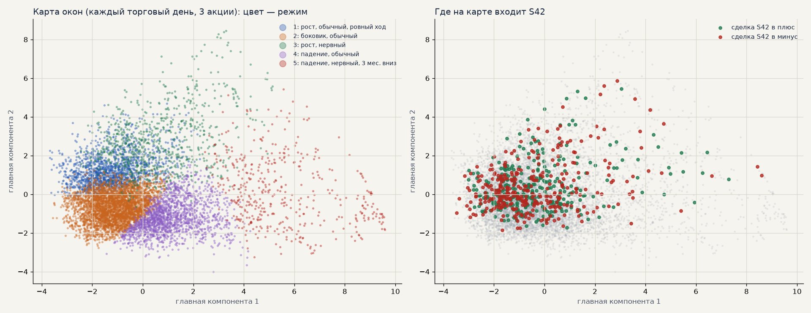
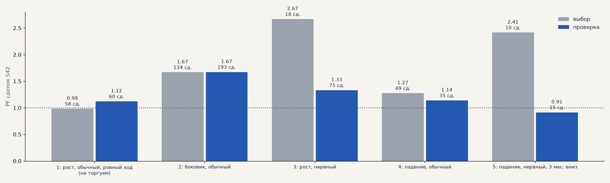
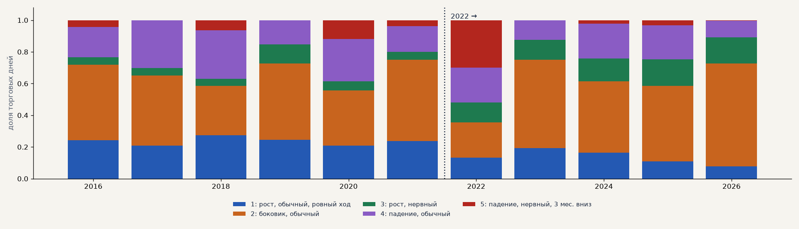
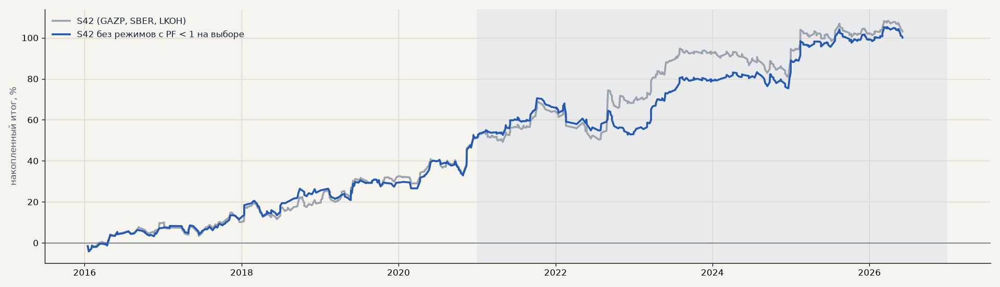

# Карта режимов рынка: S42 только в «своих» режимах (H75)

Идея Дениса (созвон 05.11) по образцу карты рядов TokDiT: описать каждый момент окном часовых свечей, разложить окна на режимы и посмотреть, в каких режимах зарабатывает импульс S42. Тимур: режимы меняются быстро, история до 2022 года может мало что значить. Расчёт — `scripts/h75_regimes.py`; сделки S42 — из журнала (GAZP, SBER, LKOH в лонг, издержки биржи, дивиденды).

**Как:** окно — 70 часовых свечей до сигнала S42 (последняя — свеча сигнала, без будущего); 15 признаков без масштаба цены (ход, волатильность, ATR%, наклон и R² тренда, эффективность хода, автокорреляция, доля растущих часов, асимметрия, эксцесс, просадка в окне, положение в диапазоне, ускорение волатильности, ход за 3 месяца, волатильность к 3 месяцам). Масштаб и KMeans (k = 5) — только по окнам 2016–2020 (каждый торговый день, 3 акции); карта — PCA на 2D.

**Правило и критерий (банк, до расчёта):** режимы, где S42 на выборе с PF < 1, не торгуем; на проверке 2021–2026 с фильтром PF и итог к просадке выше, без 2 лучших > 0, сделок не меньше 60% от S42.

<!-- вывод -->
## Вывод

**H75 не подтвердилась по записанному критерию, но карта режимов дала полезную картину.** В журнале — S64.

* **Фильтр почти проходит, но неустойчив.** При k = 5 на выборе с PF < 1 оказался один режим — «рост ровным ходом»
  (PF 0.98, по сути ноль). Без него на проверке PF 1.37 → 1.43, итог без 2 лучших +30.6 → +36.6, t 1.89 → 2.23, сделок
  84%. Но итог к просадке чуть ниже (2.71 → 2.67), лет в плюсе 5 из 6 — критерий не выполнен. При k = 4 исключать нечего,
  при k = 6 фильтр хуже S42: результат зависит от того, как нарезать режимы, — это признак подгонки, а не закономерности.
* **S42 работает почти во всех режимах.** Главный режим — «боковик» (43–46% дней): PF 1.67 и на выборе, и на проверке.
  Ни один режим не убыточен в обоих периодах. Режима, который стоило бы надёжно отключить, карта не нашла.
* **Рынок после 2022 года другой — это видно.** Доля «ровного роста» упала с 24% до 14% дней, «нервного роста» —
  выросла с 6% до 15%, а 2022 год почти на треть состоял из режима «нервное падение». В «нервном росте» S42 зарабатывал
  и до, и после (PF 2.67 → 1.33), в «нервном падении» — PF 2.41 → 0.91, но сделок там мало (10 и 15).
* **Что взять дальше (шаг «скептика»).** Карту стоит использовать как фон для других гипотез, а не как фильтр:
  описывать, в каком режиме работает каждая стратегия, и проверять новые стратегии отдельно для режима «нервный рост»,
  которого после 2022 года стало больше. Ещё один шаг — признаки режима в модели (CatBoost), а не жёсткое правило.
<!-- /вывод -->

## Режимы

| режим | выбор: сделок | PF | средняя % | проверка: сделок | PF | средняя % | доля дней 2016–2021 | доля дней 2022–2026 |
|---|---|---|---|---|---|---|---|---|
| 1: рост, обычный, ровный ход — **не торгуем** | 58 | 0.98 | -0.02 | 60 | 1.12 | +0.17 | 24% | 14% |
| 2: боковик, обычный | 134 | 1.67 | +0.71 | 193 | 1.67 | +0.56 | 43% | 46% |
| 3: рост, нервный | 18 | 2.67 | +1.56 | 75 | 1.33 | +0.37 | 6% | 15% |
| 4: падение, обычный | 49 | 1.27 | +0.36 | 35 | 1.14 | +0.22 | 23% | 19% |
| 5: падение, нервный, 3 мес. вниз | 10 | 2.41 | +1.77 | 15 | 0.91 | -0.16 | 4% | 7% |

## S42 с фильтром режимов

| вариант | сделок | итог % | PF | без 2 лучших | просадка | итог / просадка | t | лет в плюсе |
|---|---|---|---|---|---|---|---|---|
| S42 · выбор | 269 | +52.3 | 1.52 | +42.9 | -8.1 | 6.46 | 2.55 | 5/5 |
| **с фильтром · выбор** | 211 | +52.7 | 1.67 | +43.3 | -7.6 | 6.93 | 2.75 | 5/5 |
| S42 · проверка | 378 | +50.8 | 1.37 | +30.6 | -18.7 | 2.71 | 1.89 | 6/6 |
| **с фильтром · проверка** | 318 | +47.4 | 1.43 | +36.6 | -17.7 | 2.67 | 2.23 | 5/6 |

## Устойчивость к числу режимов

| k | исключены режимы | проверка: PF без фильтра → с фильтром | сделок | итог / просадка |
|---|---|---|---|---|
| 4 | — | 1.37 → 1.37 | 378 → 378 | 2.71 → 2.71 |
| 5 | 1 | 1.37 → 1.43 | 378 → 318 | 2.71 → 2.67 |
| 6 | 2 | 1.37 → 1.36 | 378 → 364 | 2.71 → 2.60 |

## Центры режимов (в разбросах выбора)

| признак | 1 | 2 | 3 | 4 | 5 |
|---|---|---|---|---|---|
| ход окна | +0.94 | -0.06 | +0.83 | -0.77 | -1.08 |
| волатильность | +0.08 | -0.28 | +1.13 | +0.46 | +3.29 |
| ATR % | +0.07 | -0.27 | +0.61 | +0.43 | +3.18 |
| наклон (t) | +0.86 | -0.08 | +0.37 | -0.72 | -0.45 |
| R² тренда | +0.40 | -0.37 | -0.03 | +0.08 | -0.06 |
| эффективность хода | +0.77 | -0.34 | +0.40 | +0.24 | +0.19 |
| автокорреляция | +0.06 | -0.09 | +0.17 | -0.02 | -0.03 |
| доля растущих часов | +0.69 | -0.10 | +0.03 | -0.52 | -0.47 |
| асимметрия | +0.29 | -0.04 | +2.12 | -0.48 | -0.71 |
| эксцесс | +0.06 | -0.00 | +2.82 | +0.33 | +1.25 |
| просадка в окне | +0.40 | +0.12 | -0.10 | -0.99 | -2.80 |
| положение в диапазоне | +0.48 | -0.09 | +0.23 | -0.55 | -0.24 |
| ускорение волатильности | +0.08 | +0.02 | -0.16 | +0.12 | +0.01 |
| ход за 3 месяца | +0.05 | +0.01 | +0.33 | -0.35 | -0.87 |
| волатильность к 3 месяцам | +0.00 | -0.24 | +1.20 | +0.31 | +2.25 |
