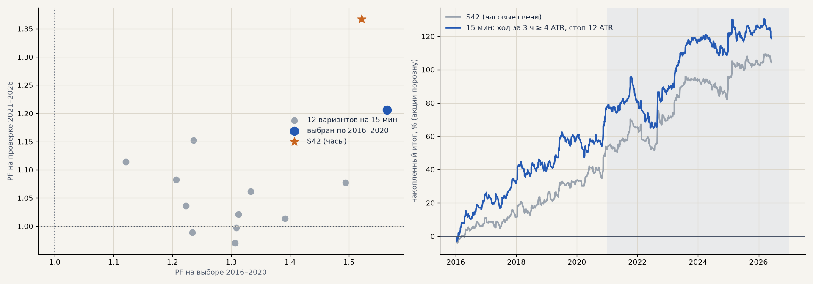

# Импульс S42 на 15-минутных свечах (H77)

Тимур (созвон 05.11): «стоит на пятнадцатиминутках посмотреть». Тот же импульс, что у S42 (ход за N свечей ≥ X ATR при тренд-гейте вверх, стоп и трейлинг в ATR, выход не позже 240 ч), но на 15-минутных свечах: GAZP, SBER, LKOH в лонг, издержки биржи, дивиденды, штатный walk-forward. Сетка (банк, до расчёта): ход за 3 или 6 ч ≥ 2, 3 или 4 ATR(15 мин) × стоп и трейлинг 6 или 12 ATR(15 мин). Выбор — только по 2016–2020, проверка — один раз. Расчёт — `scripts/queues/h77_m15.sh`, `scripts/h77_m15.py`.

**Критерий:** выбранный на проверке не хуже S42 на акциях по PF (1.37) и итогу к просадке (2.71), без 2 лучших > 0.

<!-- вывод -->
## Вывод

**H77 не подтвердилась: на 15-минутных свечах импульс хуже, чем на часовых.** В журнале — S65 (выбранный вариант).

* **Выбор подгоняется под прошлое сильнее.** Лучший по 2016–2020 вариант — ход за 3 ч ≥ 4 ATR(15 мин), стоп и трейлинг
  12 ATR — на выборе даже сильнее S42 (PF 1.56 против 1.52, итог +79% против +52%), но на проверке PF 1.21 против 1.37,
  итог +40% против +51%, просадка −31% против −19%, итог к просадке 1.30 против 2.71. Критерий не выполнен.
* **Остальные 11 вариантов на проверке около нуля** (PF 0.97–1.15). Чем ниже порог и шире окно, тем хуже: при пороге
  2 ATR — PF 0.97–1.04 при 650–1 140 сделках на проверке.
* **Почему так.** На 15-минутках в 1.4–3 раза больше сделок, ход в 3–4 ATR короткой свечи — это обычный шум внутри часа, а
  издержки на каждую сделку те же. Часовая свеча уже усредняет этот шум. Ускорять вход ценой частоты не стоит —
  S42 остаётся на часах.
<!-- /вывод -->

| вариант | выбор: сделок | PF | итог % | проверка: сделок | PF | итог % | без 2 лучших | просадка | итог / просадка |
|---|---|---|---|---|---|---|---|---|---|
| **S42, часы** (ход за 6 ч ≥ 3 ATR, стоп 6 ATR) | 275 | 1.52 | +53.4 | 378 | 1.37 | +50.8 | +30.6 | -18.7 | 2.71 |
| **15 мин: ход за 3 ч ≥ 4 ATR, стоп 12 ATR — выбран** | 370 | 1.56 | +78.6 | 521 | 1.21 | +40.1 | +18.3 | -30.8 | 1.30 |
| 15 мин: ход за 3 ч ≥ 3 ATR, стоп 12 ATR | 422 | 1.49 | +82.3 | 604 | 1.08 | +19.2 | -2.5 | -40.6 | 0.47 |
| 15 мин: ход за 3 ч ≥ 2 ATR, стоп 12 ATR | 460 | 1.39 | +73.7 | 647 | 1.01 | +3.9 | -17.9 | -48.2 | 0.08 |
| 15 мин: ход за 3 ч ≥ 3 ATR, стоп 6 ATR | 614 | 1.33 | +57.5 | 993 | 1.06 | +15.9 | -4.1 | -30.5 | 0.52 |
| 15 мин: ход за 6 ч ≥ 3 ATR, стоп 12 ATR | 479 | 1.31 | +61.8 | 643 | 1.02 | +5.9 | -15.8 | -52.2 | 0.11 |
| 15 мин: ход за 6 ч ≥ 4 ATR, стоп 12 ATR | 451 | 1.31 | +57.9 | 632 | 1.00 | -0.7 | -22.5 | -49.4 | -0.01 |
| 15 мин: ход за 6 ч ≥ 2 ATR, стоп 12 ATR | 490 | 1.31 | +64.4 | 667 | 0.97 | -9.1 | -30.8 | -61.3 | -0.15 |
| 15 мин: ход за 3 ч ≥ 4 ATR, стоп 6 ATR | 518 | 1.24 | +35.4 | 787 | 1.15 | +29.3 | +9.7 | -26.2 | 1.12 |
| 15 мин: ход за 6 ч ≥ 2 ATR, стоп 6 ATR | 753 | 1.23 | +50.5 | 1141 | 0.99 | -3.3 | -23.8 | -33.8 | -0.10 |
| 15 мин: ход за 3 ч ≥ 2 ATR, стоп 6 ATR | 718 | 1.22 | +45.8 | 1100 | 1.04 | +10.7 | -9.3 | -33.6 | 0.32 |
| 15 мин: ход за 6 ч ≥ 3 ATR, стоп 6 ATR | 728 | 1.21 | +43.0 | 1075 | 1.08 | +22.8 | +2.3 | -27.7 | 0.82 |
| 15 мин: ход за 6 ч ≥ 4 ATR, стоп 6 ATR | 676 | 1.12 | +23.5 | 1008 | 1.11 | +28.7 | +8.2 | -28.6 | 1.01 |
