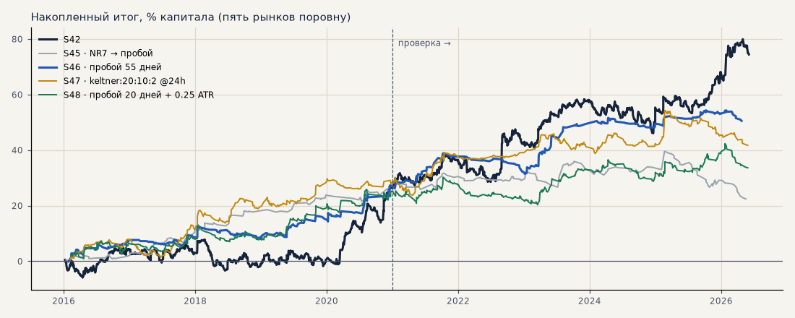
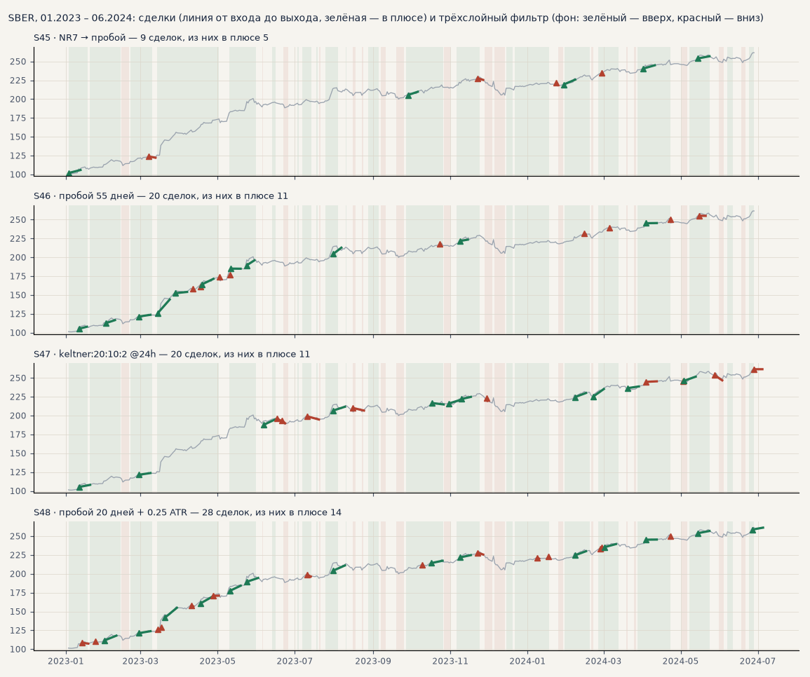
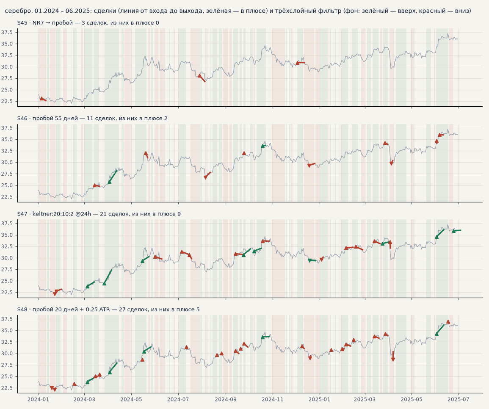

# Прозрачность итератора: четыре стратегии перебора на графике (T36)

Созвон 18.10: Тимур хочет увидеть на 3–4 конкретных стратегиях, как перебор их находит и как они торгуют, посмотреть сделки «глазками», наложить их на тренд-фильтр (H61) и попробовать входить, когда две стратегии согласны (H62). Стратегии — финалисты честного перебора H54 ([second_strategy.md](second_strategy.md)) на наборе для запуска: серебро и золото через CFD в обе стороны, GAZP, SBER, LKOH на бирже только в лонг. Сделки каждой — в журнале экспериментов: **S45–S48** (https://claude.ai/artifact/E4teCbCVvojCf96CJy9UQU, карточка → «Сделки на графике»).

Сделки посчитаны тем же часовым движком, которым считал сам перебор (сверен с минутным симулятором: сделок ±0.5%), — это ровно то, что «видел» итератор; издержки как у S42. Расчёт — `scripts/iterator_walkthrough.py`.

<!-- вывод -->
## Вывод

**Что видно «глазками».**

* **Названия выходов обманчивы.** «Умный» выход почти не срабатывает: сделки закрывает предел 240 ч (NR7 — 54%,
  Кельтнер — 64%) или защитный стоп (пробой 20 дней — 62%, пробой 55 дней — 50%). Стоп меряется в ATR часовых
  свечей, поэтому 3 ATR — узкий стоп: на серебре в росте 2024 года пробои 20 дней выбивает откатами (в плюсе 5 из 27).
* **Все четыре — следование за трендом, почти только в лонг** (лонгов 81–100%): на SBER в росте 2023 года
  зарабатывают все, в боковике — теряют мелкими стопами. Друг на друга они похожи сильнее, чем на импульс.
* **Первый финалист перебора — пример подгонки.** NR7 в лонг при ADX > 25: на выборе PF 2.29 и лучшая устойчивая
  оценка (2.10), на проверке — PF 0.88.

**H61 (тренд-фильтр отсекает минусовые сделки) — не подтвердилась по записанному критерию** (2 из 4, и обе
формально). S46 и S48 уже фильтруют по EMA200 — трёхслойный фильтр согласен с 99–100% их сделок и ничего не меняет.
Там, где он что-то меняет (S45, S47 и сам импульс S42), отсеянные сделки слабее оставшихся в обоих периодах, — в
этом Тимур прав: PF на проверке у S47 1.18 → 1.45, у S45 0.88 → 1.11, у S42 1.26 → 1.39. Но вместе со слабыми уходят
и прибыльные: итог без 2 лучших на выборе падает у всех трёх, t не растёт (S42 на проверке 2.20 → 2.24, S47 на выборе
2.64 → 2.19). Фильтр улучшает среднюю сделку, но не итог.

**H62 (входить, когда обе стратегии согласны) — не подтвердилась**: ни одна из 20 пар не лучше в обоих периодах по
PF и t. Согласие сильно поднимает PF — сделки импульса, когда пробой 55 дней в позиции в ту же сторону: PF 2.10 / 2.30
против 1.19 / 1.26 (выбор / проверка). Но таких сделок 8%, поэтому итог и t падают (на проверке t 2.08 против 2.20).
«Входить, только когда обе согласны» — значит отбросить почти всё.

**Сочетать лучше портфелем «S42 + стратегия»**: обе торгуют одновременно, и при согласии позиция сама удваивается.
На общем капитале все четыре улучшают S42 на выборе (t месяцев 1.33 → 1.95–2.42), а на проверке — только пробой
55 дней (S46): t 2.43 против 1.93, итог к просадке 4.86 против 3.85. Оговорка из H54 остаётся: S46 выбран из пяти
финалистов после взгляда на проверку — это кандидат для бумажного режима, а не доказанная вторая стратегия.
<!-- /вывод -->

## Как итератор собирает стратегию

Стратегия — это шесть блоков: **вход** (одно из 128 правил), до **двух фильтров** (можно ли сейчас лонг или шорт), **выход**, **период ATR** (им меряются стоп и отступы) и **размер** (1 или «по риску» — объём обратно пропорционален расстоянию до стопа). Одна проба перебора проходит так ([путь пробы по коду](strategy_search/guide.md#путь-одной-пробы-по-коду)):

1. **Блоки** — случайные (разведка) или лучшая проба с заменой 1–2 блоков (мутация).
2. **Входы** — часы, где вход дал сигнал и оба фильтра его пропускают; вход по открытию следующего часа.
3. **Сделки** — стоп, трейлинг или выход по сигналу, не дольше 240 ч; пока сделка открыта, новые входы пропускаются (одна позиция на рынок).
4. **Оценка** — PF на выборе 2016–2020 по набору (рынки поровну); проверку 2021–2026 перебор не видит.
5. **Устойчивость** — претенденту считается медиана PF пробы и 6 соседей (один блок заменён): одиночный выброс так не проходит.
6. **Отбор H54** — не меньше 50 сделок за выбор, корреляция месяцев с S42 ниже 0.3, устойчивая оценка не ниже 1.2; финалисты — по приросту t месяцев портфеля «S42 + стратегия» на выборе.

Из 1 029 487 проб отбор прошли 588; ниже — четыре разные по устройству из пяти финалистов (второй финалист — почти копия пробоя 55 дней).

## Четыре стратегии простыми словами

### S45. NR7 → пробой

* **Вход:** если вчерашний дневной диапазон — самый узкий за 7 дней (NR7), первый час сегодня, закрывшийся выше вчерашнего максимума, — сигнал в лонг (ниже минимума — в шорт, но шорты отсекает фильтр).
* **Фильтры:** только лонг; сила тренда ADX(14) на 1 ч выше 25.
* **Выход:** закрытие ниже минимума последних 20 дней (канал Дончиана); защитный стоп 6 ATR(10).
* **Размер:** по риску.

Как нашёлся: 1-й из пяти финалистов H54, устойчивая оценка 2.10, корреляция месяцев с S42 на выборе 0.08. Сделок в год — 23, удержание (медиана) — 8.4 дн., в плюсе — 43% сделок, лонгов — 100%; чем закрываются: время 54%, стоп 41%, сигнал 5% (время — предел 240 ч).

**Выбор → проверка:** PF 2.29 → **0.88**, итог +28.4% → -6.0%, без 2 лучших +22.9 → -17.0, t 3.31 → -0.48.

### S46. пробой 55 дней

* **Вход:** первый за день час, закрывшийся выше максимума последних 55 дней, — лонг; ниже минимума — шорт («Черепахи»; у акций шорты не берутся).
* **Фильтры:** цена на 4 ч по ту же сторону от EMA200; ATR14/ATR100 > 1 — волатильность выше обычной.
* **Выход:** разворот Supertrend (10, 3) на 4 ч против позиции; защитный стоп 3 ATR(20).
* **Размер:** по риску.

Как нашёлся: 3-й из пяти финалистов H54, устойчивая оценка 1.78, корреляция месяцев с S42 на выборе 0.10. Сделок в год — 40, удержание (медиана) — 4.4 дн., в плюсе — 35% сделок, лонгов — 84%; чем закрываются: стоп 50%, время 26%, сигнал 25% (время — предел 240 ч).

**Выбор → проверка:** PF 1.83 → **1.70**, итог +27.1% → +23.4%, без 2 лучших +20.7 → +15.8, t 2.64 → 2.34.

### S47. канал Кельтнера на дневках

* **Вход:** дневное закрытие вышло за EMA20 ± 2 ATR10 — лонг вверх, шорт вниз (сигнал — смена состояния канала; оно держится, пока цена не вернётся к EMA20).
* **Фильтры:** дневная цена по ту же сторону от EMA200 дней.
* **Выход:** обратный сигнал того же канала; защитный стоп 6 ATR(14).
* **Размер:** по риску.

Как нашёлся: 4-й из пяти финалистов H54, устойчивая оценка 2.09, корреляция месяцев с S42 на выборе 0.10. Сделок в год — 54, удержание (медиана) — 9.2 дн., в плюсе — 46% сделок, лонгов — 81%; чем закрываются: время 64%, стоп 36% (время — предел 240 ч).

**Выбор → проверка:** PF 1.53 → **1.18**, итог +28.7% → +13.0%, без 2 лучших +22.7 → +3.8, t 2.64 → 0.98.

### S48. пробой 20 дней + 0.25 ATR

* **Вход:** первый за день час, закрывшийся выше максимума 20 дней с запасом 0.25 ATR, — лонг; ниже минимума — шорт.
* **Фильтры:** дневная цена по ту же сторону от EMA200 дней.
* **Выход:** закрытие за минимумом (максимумом для шорта) 20 дней; защитный стоп 3 ATR(10).
* **Размер:** одинаковый.

Как нашёлся: 5-й из пяти финалистов H54, устойчивая оценка 1.72, корреляция месяцев с S42 на выборе 0.09. Сделок в год — 66, удержание (медиана) — 5.1 дн., в плюсе — 34% сделок, лонгов — 85%; чем закрываются: стоп 62%, время 38% (время — предел 240 ч).

**Выбор → проверка:** PF 1.42 → **1.11**, итог +25.2% → +8.4%, без 2 лучших +17.3 → +2.8, t 2.02 → 0.71.

| стратегия | рынок | выбор: сделок | PF | итог % | проверка: сделок | PF | итог % |
|---|---|---|---|---|---|---|---|
| S42 | серебро | 218 | 1.11 | +25.4 | 243 | 1.18 | +58.1 |
| S42 | золото | 243 | 0.73 | -48.4 | 263 | 1.15 | +24.5 |
| S42 | LKOH | 79 | 1.82 | +65.4 | 123 | 1.23 | +32.3 |
| S42 | GAZP | 96 | 1.45 | +44.1 | 127 | 1.38 | +60.3 |
| S42 | SBER | 100 | 1.39 | +50.8 | 128 | 1.50 | +59.8 |
| S45 | серебро | 17 | 1.35 | +7.9 | 15 | 0.75 | -5.7 |
| S45 | золото | 28 | 1.04 | +0.9 | 14 | 0.32 | -8.9 |
| S45 | LKOH | 18 | 3.03 | +35.3 | 30 | 0.81 | -12.9 |
| S45 | GAZP | 25 | 2.03 | +32.8 | 32 | 1.30 | +20.1 |
| S45 | SBER | 26 | 4.55 | +65.1 | 32 | 0.74 | -22.5 |
| S46 | серебро | 46 | 1.88 | +33.0 | 58 | 0.61 | -19.6 |
| S46 | золото | 55 | 1.75 | +17.8 | 66 | 1.06 | +1.8 |
| S46 | LKOH | 33 | 1.53 | +18.8 | 34 | 2.75 | +46.4 |
| S46 | GAZP | 29 | 1.88 | +25.4 | 16 | 2.38 | +21.4 |
| S46 | SBER | 36 | 2.09 | +40.5 | 40 | 2.58 | +67.2 |
| S47 | серебро | 79 | 0.82 | -18.9 | 78 | 0.72 | -25.2 |
| S47 | золото | 64 | 0.91 | -4.6 | 74 | 1.01 | +0.4 |
| S47 | LKOH | 46 | 2.20 | +46.8 | 48 | 1.36 | +23.7 |
| S47 | GAZP | 36 | 1.96 | +37.1 | 38 | 1.46 | +24.7 |
| S47 | SBER | 41 | 3.16 | +83.1 | 56 | 1.40 | +41.5 |
| S48 | серебро | 78 | 1.44 | +33.5 | 101 | 0.68 | -50.5 |
| S48 | золото | 77 | 1.02 | +1.1 | 95 | 1.16 | +11.2 |
| S48 | LKOH | 60 | 0.94 | -4.5 | 63 | 1.35 | +23.8 |
| S48 | GAZP | 46 | 1.76 | +35.2 | 38 | 1.49 | +20.3 |
| S48 | SBER | 58 | 2.08 | +60.8 | 64 | 1.66 | +37.2 |

## Сделки на графике

Линия — сделка от входа до выхода (зелёная — в плюсе, красная — в минусе), треугольник — вход. Фон — трёхслойный тренд-фильтр (H55): зелёный — вверх, красный — вниз. Интерактивно, со свечами, стопами и каждой сделкой — в журнале (https://claude.ai/artifact/E4teCbCVvojCf96CJy9UQU), эксперименты S45–S48.

## H61 — наложение на тренд-фильтр

Сделка берётся, только если трёхслойный фильтр на последнем закрытом часе до входа смотрит в её сторону (лонг — вверх, шорт — вниз). Критерий: у ≥ 3 из 4 стратегий PF и итог без 2 лучших выше в обоих периодах при доле сделок не меньше трети. S42 — для справки.

**S42**

| вариант | доля сделок (выбор / проверка) | выбор: сделок | выбор: итог % | выбор: PF | выбор: без 2 лучших | выбор: просадка | выбор: t | проверка: сделок | проверка: итог % | проверка: PF | проверка: без 2 лучших | проверка: просадка | проверка: t |
|---|---|---|---|---|---|---|---|---|---|---|---|---|---|
| все сделки | 100% | 736 | +27.5 | 1.19 | +19.9 | -11.2 | 1.64 | 884 | +47.0 | 1.26 | +34.7 | -12.2 | 2.20 |
| фильтр согласен | 60% / 60% | 438 | +22.7 | 1.27 | +15.1 | -10.4 | 1.65 | 533 | +39.8 | 1.39 | +27.5 | -8.0 | 2.24 |
| фильтр против или нейтрален | 40% / 40% | 298 | +4.8 | 1.08 | +0.1 | -11.5 | 0.50 | 351 | +7.2 | 1.09 | +1.7 | -9.2 | 0.60 |

**S45**

| вариант | доля сделок (выбор / проверка) | выбор: сделок | выбор: итог % | выбор: PF | выбор: без 2 лучших | выбор: просадка | выбор: t | проверка: сделок | проверка: итог % | проверка: PF | проверка: без 2 лучших | проверка: просадка | проверка: t |
|---|---|---|---|---|---|---|---|---|---|---|---|---|---|
| все сделки | 100% | 114 | +28.4 | 2.29 | +22.9 | -2.3 | 3.31 | 123 | -6.0 | 0.88 | -17.0 | -17.2 | -0.48 |
| фильтр согласен | 58% / 57% | 66 | +20.7 | 2.74 | +15.9 | -2.2 | 3.08 | 70 | +3.1 | 1.11 | -7.9 | -5.7 | 0.29 |
| фильтр против или нейтрален | 42% / 43% | 48 | +7.7 | 1.77 | +2.8 | -2.8 | 1.44 | 53 | -9.1 | 0.62 | -14.9 | -12.9 | -1.38 |

**S46**

| вариант | доля сделок (выбор / проверка) | выбор: сделок | выбор: итог % | выбор: PF | выбор: без 2 лучших | выбор: просадка | выбор: t | проверка: сделок | проверка: итог % | проверка: PF | проверка: без 2 лучших | проверка: просадка | проверка: t |
|---|---|---|---|---|---|---|---|---|---|---|---|---|---|
| все сделки | 100% | 199 | +27.1 | 1.83 | +20.7 | -4.6 | 2.64 | 214 | +23.4 | 1.70 | +15.8 | -7.4 | 2.34 |
| фильтр согласен | 99% / 100% | 198 | +27.1 | 1.84 | +20.8 | -4.6 | 2.64 | 213 | +23.8 | 1.72 | +16.1 | -7.4 | 2.38 |
| фильтр против или нейтрален | 1% / 0% | 1 | -0.0 | 0.00 | -0.0 | -0.0 | — | 1 | -0.4 | 0.00 | -0.4 | -0.4 | — |

**S47**

| вариант | доля сделок (выбор / проверка) | выбор: сделок | выбор: итог % | выбор: PF | выбор: без 2 лучших | выбор: просадка | выбор: t | проверка: сделок | проверка: итог % | проверка: PF | проверка: без 2 лучших | проверка: просадка | проверка: t |
|---|---|---|---|---|---|---|---|---|---|---|---|---|---|
| все сделки | 100% | 266 | +28.7 | 1.53 | +22.7 | -6.5 | 2.64 | 294 | +13.0 | 1.18 | +3.8 | -12.6 | 0.98 |
| фильтр согласен | 64% / 58% | 171 | +20.5 | 1.56 | +14.5 | -4.7 | 2.19 | 170 | +18.0 | 1.45 | +8.8 | -6.2 | 1.56 |
| фильтр против или нейтрален | 36% / 42% | 95 | +8.3 | 1.46 | +4.5 | -3.7 | 1.47 | 124 | -5.0 | 0.85 | -8.1 | -9.0 | -0.76 |

**S48**

| вариант | доля сделок (выбор / проверка) | выбор: сделок | выбор: итог % | выбор: PF | выбор: без 2 лучших | выбор: просадка | выбор: t | проверка: сделок | проверка: итог % | проверка: PF | проверка: без 2 лучших | проверка: просадка | проверка: t |
|---|---|---|---|---|---|---|---|---|---|---|---|---|---|
| все сделки | 100% | 319 | +25.2 | 1.42 | +17.3 | -5.7 | 2.02 | 361 | +8.4 | 1.11 | +2.8 | -10.0 | 0.71 |
| фильтр согласен | 99% / 100% | 317 | +25.7 | 1.44 | +17.8 | -5.1 | 2.07 | 360 | +8.8 | 1.11 | +3.1 | -10.0 | 0.74 |
| фильтр против или нейтрален | 1% / 0% | 2 | -0.5 | 0.00 | -0.5 | -0.5 | -1.54 | 1 | -0.4 | 0.00 | -0.4 | -0.4 | — |

Стратегий, где фильтр улучшил PF и итог без 2 лучших в обоих периодах при доле ≥ 1/3: **2 из 4** — H61 **не подтвердилась**.

## H62 — согласие двух стратегий

Сделка стратегии A берётся, если на её входе стратегия B держит позицию на том же рынке в ту же сторону (или открыла её за последние 24 ч). Критерий: PF и t выше, чем у всех сделок A, в обоих периодах, сделок не меньше 30 на период.

| A | B | доля сделок A (выбор / проверка) | выбор: сделок | выбор: PF | выбор: t | проверка: сделок | проверка: PF | проверка: t | вывод |
|---|---|---|---|---|---|---|---|---|---|
| S42 | S45 | 11% / 7% | 78 | 0.80 | -0.73 | 59 | 1.01 | 0.03 | — |
| S42 | S46 | 8% / 8% | 61 | 2.10 | 1.89 | 73 | 2.30 | 2.08 | — |
| S42 | S47 | 15% / 15% | 113 | 1.67 | 1.55 | 129 | 1.74 | 2.07 | — |
| S42 | S48 | 16% / 15% | 115 | 1.61 | 1.57 | 134 | 1.62 | 1.72 | — |
| S45 | S42 | 41% / 41% | 47 | 3.20 | 3.15 | 51 | 1.06 | 0.14 | — |
| S45 | S46 | 13% / 4% | 15 | 3.80 | 2.06 | 5 | 1.74 | 0.37 | — |
| S45 | S47 | 21% / 19% | 24 | 2.69 | 1.85 | 23 | 0.53 | -1.23 | — |
| S45 | S48 | 21% / 11% | 24 | 2.33 | 1.64 | 14 | 0.98 | -0.03 | — |
| S46 | S42 | 71% / 79% | 142 | 1.93 | 2.50 | 168 | 1.71 | 2.08 | — |
| S46 | S45 | 13% / 6% | 25 | 1.51 | 0.70 | 13 | 2.81 | 1.16 | — |
| S46 | S47 | 44% / 35% | 88 | 0.86 | -0.49 | 74 | 1.74 | 1.56 | — |
| S46 | S48 | 79% / 81% | 158 | 1.64 | 1.92 | 173 | 1.58 | 1.87 | — |
| S47 | S42 | 52% / 51% | 139 | 1.72 | 2.43 | 150 | 1.47 | 1.50 | — |
| S47 | S45 | 8% / 7% | 20 | 1.98 | 1.25 | 21 | 2.49 | 1.13 | — |
| S47 | S46 | 16% / 14% | 43 | 2.47 | 2.05 | 41 | 4.75 | 2.79 | — |
| S47 | S48 | 41% / 35% | 108 | 2.00 | 2.61 | 104 | 1.66 | 1.79 | — |
| S48 | S42 | 71% / 79% | 228 | 1.42 | 1.68 | 285 | 1.16 | 0.93 | — |
| S48 | S45 | 12% / 7% | 38 | 1.09 | 0.19 | 24 | 3.70 | 1.87 | — |
| S48 | S46 | 39% / 34% | 124 | 1.70 | 1.83 | 121 | 1.58 | 1.88 | — |
| S48 | S47 | 28% / 26% | 88 | 0.96 | -0.16 | 95 | 1.63 | 1.68 | — |

Для сравнения — все сделки: S42 PF 1.19 / 1.26, t 1.64 / 2.20; S45 PF 2.29 / 0.88, t 3.31 / -0.48; S46 PF 1.83 / 1.70, t 2.64 / 2.34; S47 PF 1.53 / 1.18, t 2.64 / 0.98; S48 PF 1.42 / 1.11, t 2.02 / 0.71 (выбор / проверка).

Пар, где согласие лучше в обоих периодах при ≥ 30 сделках: **0 из 20**, из них с S42 — 0 (нет).

## Вместе с импульсом — портфель «S42 + стратегия»

Капитал поровну между S42 и второй стратегией, внутри — рынки поровну (forexmodel/evaluation/portfolio.py). Итог портфеля из двух — среднее их результатов, поэтому сравниваем не по сумме, а по t месяцев и итогу к просадке.

| портфель | выбор: t мес | итог/просадка | просадка | проверка: t мес | итог/просадка | просадка | корр. месяцев с S42 (выбор / проверка) |
|---|---|---|---|---|---|---|---|
| S42 один | 1.33 | 2.46 | -11.2 | 1.93 | 3.85 | -12.2 | — |
| S42 + S45 | 2.42 | 4.63 | -6.0 | 1.41 | 2.89 | -7.1 | 0.09 / 0.12 |
| S42 + S46 | 2.17 | 3.87 | -7.0 | 2.43 | 4.86 | -7.2 | 0.25 / 0.27 |
| S42 + S47 | 2.06 | 3.72 | -7.6 | 1.87 | 3.70 | -8.1 | 0.28 / 0.18 |
| S42 + S48 | 1.95 | 3.28 | -8.0 | 1.83 | 3.16 | -8.8 | 0.29 / 0.28 |

