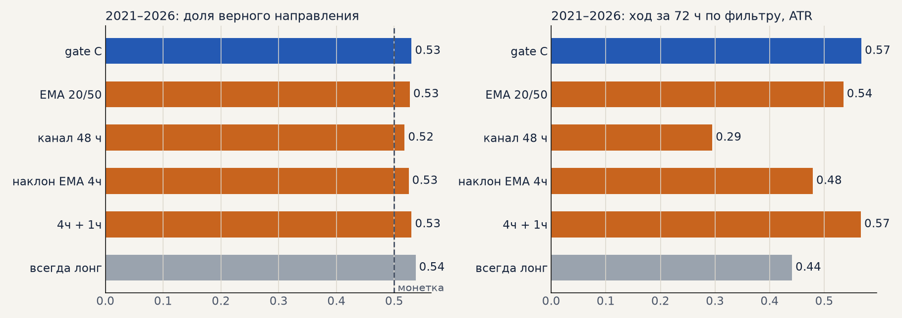

# К встрече в Казани: умный перебор индикаторов и тренд-фильтр

Две темы созвона 11.10, которые «реально сдвинут вперёд» (гипотезы H36–H38 в банке). Здесь — как их
проверять, чтобы результат можно было принять, а не подогнать. Обсудить и выбрать, что делаем после
запуска торговли.

Исходная точка — база B01 (все издержки): портфель 4 около нуля, металлы +41% на проверке 2021–2026.
Ни одна доработка правил импульса на новой базе базу пока не обогнала.

## 1. Умный перебор индикаторов (H36)

**Идея Тимура.** Насчитать сотни показателей теханализа в разных окнах (скользящие, ATR, sin/cos
времени, наклоны, RSI, каналы) и автоматически поискать среди них правила, которые зарабатывают. У
любого правила есть срок жизни — перебор позволяет находить новые, когда старые перестают работать.

**Главный риск — подгонка.** Если перебрать 10 000 правил, несколько сотен окажутся «прибыльными»
просто случайно. Поэтому протокол важнее перебора:

1. **Пространство правил задаём заранее и ограничиваем.** Правило = вход (признак выше / ниже порога,
   по тренд-фильтру или без) + выход из небольшого набора (как у импульса). Признаки — безразмерные (в
   ATR, %, z-оценках), окна — из короткого списка (6, 12, 24, 72, 120 ч).
2. **Поиск — только по 2016–2020**, внутри — walk-forward по годам: правило должно быть в плюсе в
   большинстве лет выбора, а не в сумме. Optuna (TPE) вместо полного перебора — умнее выбирает, куда
   смотреть, но число попыток всё равно записываем.
3. **Нулевая планка — случайные правила.** Тот же перебор на перемешанных во времени сигналах
   (или на случайных входах с той же частотой) даёт распределение «лучшего правила из N попыток
   случайно». Принимаем, только если найденное правило лучше 95% таких «случайных лучших».
4. **Проверка 2021–2026 — один раз**, для 1–3 финалистов, с издержками B01.
5. **Бюджет.** Один прогон импульса на 8 рынках — около 5–10 минут; Optuna на 500 попыток — несколько
   часов на нашей машине. Быстрый движок песочницы (scripts/build_sandbox_data.py) ускоряет в разы, но
   финалистов пересчитываем штатным симулятором.

**Что нужно решить на встрече:** набор признаков и окон, допустимые выходы, целевая метрика
(предлагаю PF на выборе при условии «плюс в 4 из 5 лет»), сколько попыток разрешаем.

## 2. Тренд-фильтр (H37, H38)

**Проблема.** Модель хорошо ловит волатильность, но плохо — направление. Направление в импульсе
задаёт тренд-гейт C, и он «удачный»: лучше 99% случайных фильтров, а в среднем фильтр почти ничего не
добавляет. Гистерезис на бумаге выглядел лучше, но торговать не смог.

**Предложение: оценивать фильтр отдельно от стратегии.**

1. **Эталон «настоящего тренда» задним числом.** Для каждого часа — знак хода цены за следующие
   48–120 ч, если он больше k ATR (иначе «нет тренда»); вариант — размеченные развороты (ZigZag с
   порогом в ATR). Это заглядывание вперёд, но только для оценки, не для торговли.
2. **Метрика — доля ошибок фильтра:** сколько часов фильтр показывал «вверх», когда тренд был вниз
   (и наоборот), и как быстро он замечает разворот (задержка в часах). Отдельно — доля «нейтрали»:
   фильтр, который почти всегда молчит, ошибается мало, но бесполезен.
3. **Кандидаты (H38 — простые эталоны):** пересечение скользящих (разные окна), пробой канала
   Дончиана, наклон регрессии, два таймфрейма (4 ч задаёт направление, 1 ч — разрешение входа),
   гистерезис, текущий гейт C.
4. **Связка со стратегией.** Фильтры с лучшей метрикой на 2016–2020 прогоняются в импульсе с
   издержками B01; принимаем, если лучше гейта C на проверке по PF и итогу без 2 лучших.
5. **Отдельно — «следование тренду» как самостоятельная стратегия.** Если фильтр хорошо определяет
   тренд, простое «стоять за трендом» само может быть стратегией (классика, о которой говорил Тимур).

**Первый замер (12.10, `scripts/trend_filter_metric.py`).** Эталон — знак хода за 72 ч, если он
больше 3 ATR; серебро, золото, SBER, GAZP, LKOH; часовые свечи.

| фильтр | верно, выбор | верно, проверка | ход по фильтру за 72 ч, ATR: выбор | проверка |
|---|---|---|---|---|
| гейт C (стратегия) | 0.49 | 0.53 | 0.06 | 0.57 |
| EMA 20/50 | 0.50 | 0.53 | 0.13 | 0.54 |
| канал Дончиана 48 ч | 0.50 | 0.52 | 0.13 | 0.29 |
| наклон EMA 4ч | 0.50 | 0.53 | 0.07 | 0.48 |
| 4 ч + 1 ч | 0.51 | 0.53 | 0.12 | 0.57 |
| всегда лонг (дрейф) | 0.55 | 0.54 | 0.75 | 0.44 |

Вывод: **ни один фильтр не определяет направление на 3 дня лучше монетки** (49–53% верных), и ни
один не обгоняет простое «всегда лонг» на выборе. Гейт C и связка 4 ч + 1 ч — лучшие на проверке, но
разница с дрейфом мала. Это объясняет прежние результаты: подбор и замена гейта не помогали, а
преимущество стратегии — в самом импульсе (продолжение сильного хода), а не в направлении фильтра.
Подтверждается и решением по акциям: лонговый перекос (S25) лучше «честного» тренд-фильтра.

**Что нужно решить на встрече:** имеет ли смысл дальше искать тренд-фильтр на часах — или лучше
смотреть на старшие масштабы (дни, недели), режимы рынка и лонговый перекос; определение эталона
(горизонт, порог) для следующих замеров.

## 3. Что уже известно и где

* База B01 и все эксперименты — [журнал](https://claude.ai/artifact/E4teCbCVvojCf96CJy9UQU).
* Прошлые подборы тренд-фильтра — [trend_filter_ema.md](trend_filter_ema.md): walk-forward подбора
  хуже фиксированного фильтра, сброс по EMA5 и «плато» не помогли.
* Неделя 12.10, улучшение стратегии — [strategy_week_1012.md](strategy_week_1012.md).
