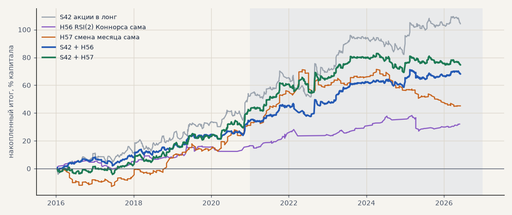

# Известные стратегии на наших акциях (T26)

Задача **T26**: известные публичные стратегии — по шаблону в банке, на тех же акциях, что первый этап запуска (GAZP, SBER, LKOH на бирже, только лонг), с издержками биржи (комиссия 0.1% за круг, проскальзывание 0.05% на сторону), цены с поправкой на дивиденды. Параметры — как в первоисточнике, без подбора. Оценка — сама по себе и вместе с акциями S42 на общем капитале (капитал поровну). Расчёт — `scripts/known_strategies.py`.

* **H56 RSI(2) Коннорса** — цена выше SMA200 и RSI(2) < 10 на закрытии → лонг на открытии следующего дня; выход на открытии после закрытия выше SMA5, не дольше 20 дней (Connors & Alvarez).
* **H57 смена месяца** — лонг с открытия последнего торгового дня месяца до закрытия третьего дня следующего (Lakonishok & Smidt 1988, McConnell & Xu 2008).

<!-- вывод -->
## Вывод

**RSI(2) Коннорса (H56) — лучший кандидат во вторую стратегию на сегодня, но строгий критерий он не прошёл;
смена месяца (H57) не подтвердилась.**

* **H56 сама прибыльна в обоих периодах и на каждой бумаге**: PF 1.62 на выборе и 1.47 на проверке, итог без
  2 лучших в плюсе, 22–23 сделки в год на три бумаги; параметры — из книги, не подбирались, так что выбор для
  неё — честная проверка. Главное — **с импульсом она не связана** (корреляция месяцев −0.04…0.10): покупает
  слабость в восходящем тренде, а импульс — силу. В 2022 году, когда акции были ниже SMA200, она не торговала.
* **С S42 на общем капитале**: на проверке t месяцев 2.00 против 1.62 и итог к просадке 3.58 против 2.71 —
  лучше по обоим; на выборе t выше (2.51 против 2.13), но итог к просадке ниже (5.7 против 6.6). Поэтому по
  заранее записанному критерию — «не подтвердилась», хотя это ближе всего к подтверждению из всех кандидатов
  (S31 и финалисты перебора на проверке не улучшали портфель вовсе).
* **H57 смена месяца** на выборе хороша (PF 1.57), но на проверке PF 1.15, t 0.46 и −32% на GAZP; портфель с ней
  на проверке хуже. Эффект на наших акциях не держится.

**Что предлагаю:** держать RSI(2) рядом с S31 в бумажном режиме второго этапа: сигналы считать, не торговать,
через полгода–год сравнить. Путь проверки для стратегий Тимура готов: описание в банке по шаблону → функция
правила в `scripts/known_strategies.py` → тот же отчёт.
<!-- /вывод -->

## Проверка 2021 — июнь 2026

| стратегия | сделок в год | итог % | PF | без 2 лучших | просадка | t мес | с S42: итог % | t мес | итог / просадка | корр. месяцев с S42 |
|---|---|---|---|---|---|---|---|---|---|---|
| **S42 акции в лонг** | 70.0 | +50.8 | 1.37 | +30.6 | -18.7 | 1.62 | — | 1.62 | 2.71 | — |
| H56 RSI(2) Коннорса | 23.2 | +15.5 | 1.47 | +10.7 | -11.0 | 1.25 | +33.2 | 2.00 | 3.58 | -0.04 |
| H57 смена месяца | 36.3 | +12.0 | 1.15 | +2.0 | -26.6 | 0.46 | +31.4 | 1.52 | 2.31 | 0.03 |

## Выбор 2016–2020

| стратегия | сделок в год | итог % | PF | без 2 лучших | просадка | t мес | с S42: итог % | t мес | итог / просадка | корр. месяцев с S42 |
|---|---|---|---|---|---|---|---|---|---|---|
| **S42 акции в лонг** | 55.2 | +53.4 | 1.52 | +44.1 | -8.1 | 2.13 | — | 2.13 | 6.61 | — |
| H56 RSI(2) Коннорса | 21.8 | +16.5 | 1.62 | +8.2 | -6.2 | 1.65 | +35.0 | 2.51 | 5.69 | 0.10 |
| H57 смена месяца | 35.8 | +33.2 | 1.57 | +25.1 | -12.9 | 1.64 | +43.3 | 2.26 | 7.56 | 0.43 |

## По бумагам — проверка

| стратегия | бумага | сделок | итог % | PF | средняя сделка % |
|---|---|---|---|---|---|
| H56 RSI(2) Коннорса | GAZP | 25 | +7.0 | 1.22 | +0.28 |
| H56 RSI(2) Коннорса | SBER | 55 | +27.6 | 2.11 | +0.50 |
| H56 RSI(2) Коннорса | LKOH | 44 | +12.0 | 1.29 | +0.27 |
| H57 смена месяца | GAZP | 65 | -31.9 | 0.75 | -0.49 |
| H57 смена месяца | SBER | 64 | +26.7 | 1.55 | +0.42 |
| H57 смена месяца | LKOH | 65 | +41.1 | 1.73 | +0.63 |
