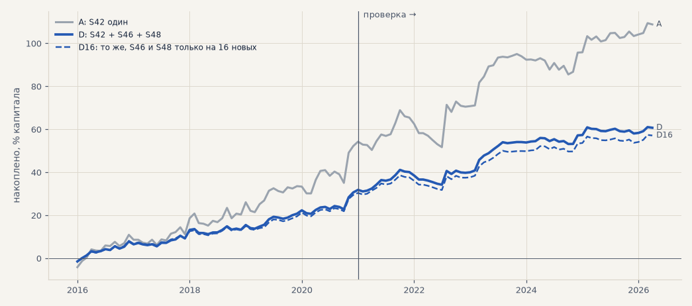
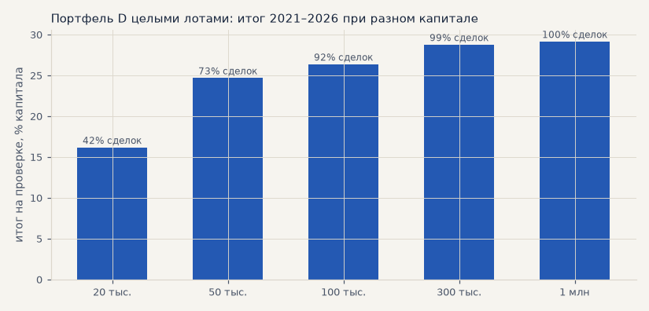

# Портфель для запуска: S42 + S46 + S48 на широком наборе акций (H67)

S42 — импульс на SBER, GAZP, LKOH; S46 «пробой 55 дней» и S48 «пробой 20 дней + 0.25 ATR» — на 19 акциях (SBER, GAZP, LKOH и 16 новых из [H66](new_stocks.md)). Только лонг, издержки биржи, цены с поправкой на дивиденды. Капитал поровну между стратегиями, внутри стратегии — бумаги поровну. Выбор 2016–2020, проверка 2021 — апрель 2026 (общий конец истории S42). Критерий записан в банк (H67) до расчёта. Расчёт — `scripts/launch_portfolio.py`.

<!-- вывод -->
## Вывод

**H67 подтвердилась: портфель D — S42 на SBER, GAZP, LKOH плюс S46 и S48 на 19 акциях, капитал по трети — устойчивее
одного S42 в обоих периодах. t месяцев 2.88 против 2.13 на выборе и 2.42 против 1.79 на проверке, итог к просадке
9.3 против 6.6 и 3.7 против 3.0, просадка на проверке −7.9% против −18.7%. Плечо не нужно: в бумагах максимум 83%
капитала. Но в сумме D зарабатывает меньше: +30% против +55% на проверке. Для портфеля D нужно от 50–100 тыс. ₽.**

1. **Устойчивость, а не прибыль.** S46 и S48 зарабатывают на свой капитал меньше S42, зато месяцы у них другие:
   корреляция с S42 0.42 на выборе и 0.25 на проверке. Поэтому просадка падает сильнее, чем итог: самая глубокая просадка
   на проверке у S42 −18.7%, у портфеля −7.9%.
2. **Не подгонка под бумаги выбора.** Если S46 и S48 торгуют только 16 новых бумаг (D16, без SBER, GAZP, LKOH, на которых
   их выбирали), результат почти тот же: t 2.83 / 2.33, итог к просадке 9.0 / 3.5.
3. **B и C (одна стратегия к S42) тоже лучше S42**, но слабее D. S46 даёт больше по итогу к просадке на проверке (3.8),
   S48 — по t на выборе.
4. **Капитал D в основном лежит деньгами**: в среднем в бумагах 22%, в 95% часов — не больше 48%. Можно давать стратегиям
   больше капитала на бумагу. Это отдельная проверка: сколько, чтобы загрузка не уходила за 100%.
5. **Капитал и целые лоты.** На долю бумаги в D приходится 1/57 капитала, поэтому при малом капитале многих сделок не
   взять:
   * **20 тыс. ₽** — берётся 42% сделок, итог на проверке +16% вместо +29% (на S42 по LKOH при сегодняшней цене не хватает:
     доля 2.2 тыс. ₽ при лоте 6.1 тыс. ₽);
   * **50 тыс. ₽** — 73% сделок, +25%;
   * **100 тыс. ₽** — 92% сделок, +26%;
   * **300 тыс. ₽** — 99% сделок, +29%.

   Один S42 целыми лотами торгуется полностью уже с 20 тыс. ₽. Для ТЗ (T39) это выбор: при 20 тыс. ₽ — S42 один (выше
   итог, выше просадка); от 50–100 тыс. ₽ — портфель D.

Дальше (к обсуждению): S46 и S48 — в бумажный режим контура на 19 бумагах, чтобы копить живые сигналы, пока решается
капитал; отдельно — проверить больший капитал на бумагу в D (пункт 4).
<!-- /вывод -->

## Критерий H67

| пункт | выполнен |
|---|---|
| t месяцев лучше S42: выбор | ✅ |
| t месяцев лучше S42: проверка | ✅ |
| итог к просадке лучше S42: выбор | ✅ |
| итог к просадке лучше S42: проверка | ✅ |
| корр. месяцев с S42 < 0.5: выбор | ✅ |
| корр. месяцев с S42 < 0.5: проверка | ✅ |

## Портфели

| портфель | выбор: сделок в год | итог % | PF | просадка | итог / просадка | t мес | проверка: сделок в год | итог % | PF | без 2 лучших | просадка | итог / просадка | t мес | корр. месяцев с S42 (выбор / проверка) | загрузка капитала: макс / 95% |
|---|---|---|---|---|---|---|---|---|---|---|---|---|---|---|---|
| A: S42 один | 55 | +53.4 | 1.52 | -8.1 | 6.61 | 2.13 | 69 | +55.4 | 1.42 | +35.2 | -18.7 | 2.96 | 1.79 | — | 1.67 / 1.00 |
| B: S42 + S46 | 172 | +35.2 | 1.52 | -4.6 | 7.72 | 2.55 | 169 | +36.6 | 1.44 | +26.5 | -9.6 | 3.82 | 2.23 | 0.33 / 0.21 | 0.93 / 0.56 |
| C: S42 + S48 | 240 | +38.2 | 1.46 | -4.5 | 8.48 | 2.62 | 229 | +35.5 | 1.37 | +25.4 | -11.7 | 3.04 | 2.10 | 0.44 / 0.25 | 0.99 / 0.61 |
| D: S42 + S46 + S48 | 357 | +31.1 | 1.47 | -3.3 | 9.32 | 2.88 | 328 | +29.6 | 1.40 | +22.9 | -7.9 | 3.74 | 2.42 | 0.42 / 0.25 | 0.83 / 0.48 |
| D16: то же, S46 и S48 только на 16 новых | 305 | +30.0 | 1.45 | -3.3 | 9.01 | 2.83 | 280 | +27.2 | 1.36 | +20.4 | -7.8 | 3.50 | 2.33 | 0.36 / 0.11 | 0.81 / 0.46 |

Итог — % капитала портфеля без реинвестирования (у портфеля из нескольких стратегий итог — среднее их итогов, поэтому сравниваем по t месяцев и итогу к просадке). Загрузка капитала — какая доля капитала в бумагах по часам; больше 1 — позиции больше капитала (плечо).

## Капитал и целые лоты

Доля бумаги в капитале постоянна; позиция округляется вниз до целого лота; сделка, на которую лота не хватает, пропускается. Лоты и цены — Т-Инвестиции 24.10.

| портфель | капитал, ₽ | сделок взято | выбор: итог % | t мес | проверка: итог % | t мес | итог / просадка |
|---|---|---|---|---|---|---|---|
| A: S42 один | 20 000 | 100% | +50.8 | 2.17 | +52.9 | 1.96 | 3.56 |
| A: S42 один | 50 000 | 100% | +52.0 | 2.13 | +55.7 | 1.87 | 3.21 |
| A: S42 один | 100 000 | 100% | +52.5 | 2.13 | +55.4 | 1.83 | 3.02 |
| A: S42 один | 300 000 | 100% | +53.1 | 2.13 | +55.0 | 1.80 | 2.95 |
| A: S42 один | 1 000 000 | 100% | +53.3 | 2.13 | +55.3 | 1.79 | 2.96 |
| D: S42 + S46 + S48 | 20 000 | 42% | +20.5 | 2.67 | +16.2 | 2.22 | 5.22 |
| D: S42 + S46 + S48 | 50 000 | 73% | +24.2 | 2.68 | +24.7 | 2.34 | 4.29 |
| D: S42 + S46 + S48 | 100 000 | 92% | +28.6 | 2.89 | +26.4 | 2.37 | 3.94 |
| D: S42 + S46 + S48 | 300 000 | 99% | +30.2 | 2.87 | +28.8 | 2.44 | 3.81 |
| D: S42 + S46 + S48 | 1 000 000 | 100% | +30.9 | 2.88 | +29.1 | 2.41 | 3.73 |

Капитал, при котором на долю бумаги в портфеле D (1/3 ÷ 19 = 1/57 капитала) помещается хотя бы один лот при размере 1:

| бумага | лот, шт. | цена 24.10, ₽ | лот, ₽ | капитал D от, ₽ |
|---|---|---|---|---|
| LKOH | 1 | 6144.5 | 6 144 | 350 236 |
| NVTK | 1 | 1181.8 | 1 182 | 67 363 |
| GAZP | 10 | 114.75 | 1 148 | 65 408 |
| GMKN | 10 | 114.3 | 1 143 | 65 151 |
| PLZL | 1 | 1098.2 | 1 098 | 62 597 |
| TRNFP | 1 | 1062.6 | 1 063 | 60 568 |
| AFKS | 100 | 7.775 | 778 | 44 318 |
| NLMK | 10 | 76.44 | 764 | 43 571 |
| CHMF | 1 | 712.6 | 713 | 40 618 |
| TATN | 1 | 632.4 | 632 | 36 047 |
| RTKM | 10 | 43.31 | 433 | 24 687 |
| SNGSP | 10 | 40.915 | 409 | 23 322 |
| ROSN | 1 | 390.05 | 390 | 22 233 |
| AFLT | 10 | 35.95 | 360 | 20 492 |
| SBER | 1 | 292.32 | 292 | 16 662 |
| IRAO | 100 | 2.812 | 281 | 16 028 |
| MAGN | 10 | 23.505 | 235 | 13 398 |
| ALRS | 10 | 21.07 | 211 | 12 010 |
| VTBR | 1 | 56.94 | 57 | 3 246 |
