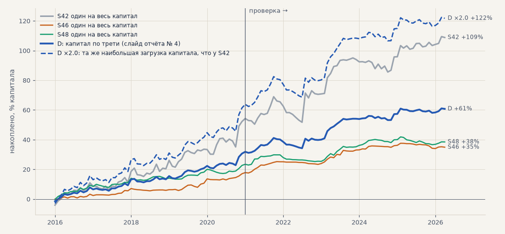
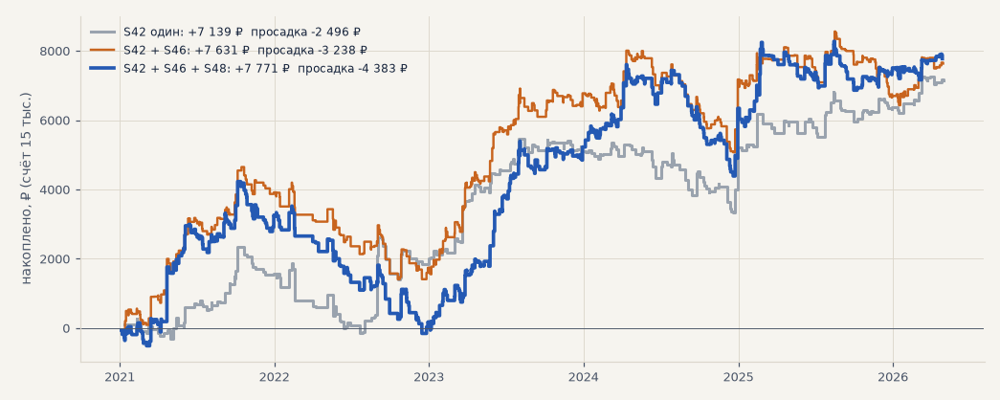
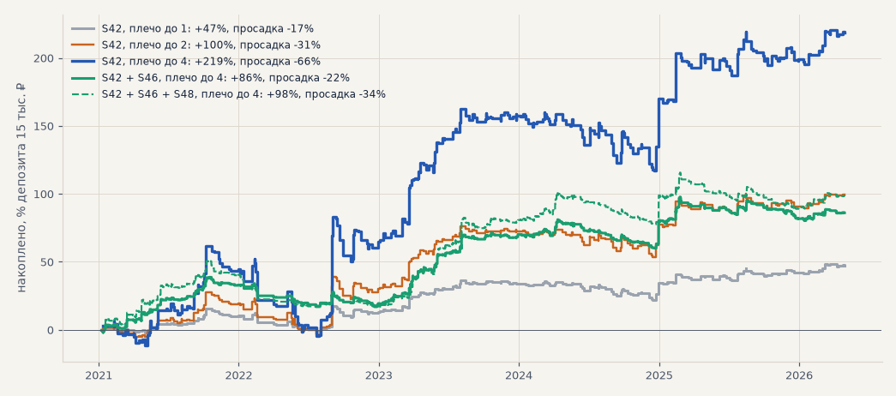

# Разбор вопросов созвона 26.10 к отчёту № 4

Подробные ответы на вопросы, которые возникли на созвоне ([протокол](../meetings/2026-10-26_timur.md)), и разбор слайда
«Ровнее, но меньше», который Тимур просил разобрать отдельно (22:18). Сделки те же, что в H67
([launch_portfolio.md](launch_portfolio.md)): S42 на SBER, GAZP, LKOH, S46 и S48 на 19 акциях, только лонг, издержки
биржи, цены с поправкой на дивиденды. Выбор — 2016–2020, проверка — 2021 — апрель 2026 (5.3 года). Итог везде без
реинвестирования. Расчёт — `scripts/launch_questions.py`, таблицы — [launch_questions/](launch_questions/).

## Коротко

1. **S46 и S48 не минусовые.** Каждая сама в плюсе в обоих периодах: на проверке +17.9% (PF 1.52) и +15.6%
   (PF 1.27). Портфель даёт +61% против +109% у S42, потому что капитал делится по трети, а две трети уходят
   стратегиям, которые на рубль зарабатывают меньше. Кроме того, капитал портфеля в основном лежит деньгами.
2. **При той же загрузке капитала портфель лучше S42 одного.** Если дать каждой стратегии вдвое больше денег
   («D ×2»), портфель берёт капитала не больше, чем S42 один, и на проверке даёт +59% при просадке −15.9%. У S42
   одного — +55% при −18.7%. На выборе — +62% против +53%.
3. **На счёте 15 тыс. ₽ всё наоборот: лучше один S42.** По правилу ТЗ (слот 5 тыс., до 3 позиций, свободные деньги —
   первой сработавшей стратегии) за проверку все варианты зарабатывают почти одинаково: +7.1–7.8 тыс. ₽, ≈ 9–10% в
   год. Но просадка растёт с −17% у S42 одного до −29% у всего набора. S46 и S48 дают вчетверо больше сигналов, занимают
   слоты, и S42 теряет треть своих сделок. Это подтверждает решение созвона: на деньги — пока только S42 (T50).
4. **−10% по бумаге у S42 на истории не было.** Худшая сделка — −9.0% (GAZP, 30.09.2022, гэп через стоп). Стоп 6 ATR
   обычно стоит в 2.8% от входа, у 90% сделок — не дальше 5.3%. На счёте 15 тыс. позиция — треть депозита, поэтому
   худшая сделка — это −3% депозита, с плечом 4 — −12%. Опаснее серия убытков: просадка S42 на счёте — −17% депозита.
5. **«Минус, посчитанный в плюс», — дивидендная отсечка.** Журнал рисует сделки на сырых ценах, а результат считает с
   учётом дивиденда. Таких сделок 111. Скорее всего, Тимур видел S51, SNGSP, июль 2016: на графике −8.5%, в итоге +9.6%,
   дивиденд 16.7% — «плюс 9 против минус 9». Расчёт верный, но не учтён налог на дивиденды 13%.
6. **На слайдах неверно прочитали периоды.** −7.9% — это просадка за 2021–2026, а не за неделю. +29% — итог за 5 лет,
   а не за 4 месяца. «Просадка 66» у S46 — на деле −0.66% на сделку. 33 сделки и +10.8% — тоже не неделя, а четыре
   свежих месяца (раздел 6).
7. **Позиция по стопу с риском 10% капитала на сделку для S42 слишком агрессивна** (раздел 6). Стоп у S42 близко,
   поэтому 1 500 ₽ риска — это позиция в 3–4 счёта. Без плеча правило вырождается во «весь счёт в одну бумагу» и на
   проверке хуже нынешнего слота. С плечом оно обнулило бы счёт (дно — декабрь 2024). Рабочий вариант — риск 1–2% с
   лимитом всех позиций; проверить после пробного этапа.
8. **Брать все сигналы при плече до 4** (раздел 7). S42 один берёт все сделки уже при плече 2, но просадка растёт вместе
   с плечом: −31% депозита при ×2, −66% при ×4. Лучший вариант «взять всё» — S42 + S46, сделка ≈ 3.5 тыс. ₽, плечо до 4:
   все сигналы, ≈ 16–18% в год при просадке −22% на проверке и −10% на выборе. S48 сверху добавляет просадку, а не доход.
9. **Когда останавливать** (раздел 7). Для S42 без плеча на полгода пробного этапа: «внимание» при просадке −8% депозита
   (−1 200 ₽), «стоп» при −12% (−1 800 ₽) — хуже 95% и 99% полугодий истории.
10. **Как возобновлять** (раздел 7). Механически «стоп по просадке → ждём, пока бумага отыграет» на истории вредит: на
   проверке дохода в 1.4–2.2 раза меньше, а просадка не меньше. Стоп по просадке — повод разобраться за 1–2 дня, а не
   выход: возвращаемся, если исполнение и данные в порядке и сверка с бэктестом не сказала «стоп».

## 1. Слайд «Ровнее, но меньше»: +61% против +109%

На слайде — накопленный итог 2016–2026 одного S42 (+109% = +53% на выборе и +55% на проверке) и портфеля D: S42 + S46 +
S48, капитал по трети (+61% = +31% и +30%). Вопрос созвона (22:03): «S46 и S48 генерируют минус?»

Как считается портфель: каждой стратегии — треть капитала, внутри стратегии — бумаги поровну (у S42 — 1/3 на бумагу,
у S46 и S48 — 1/19 трети). Без реинвестирования итог портфеля — это просто среднее итогов стратегий:
(+55.4 + 17.9 + 15.6) / 3 = +29.6% на проверке. Поэтому портфель из сильной и двух слабых плюсовых стратегий по итогу
всегда ниже сильной. Сравнивать с одной стратегией надо при одинаковом риске или одинаковой загрузке капитала.

| вариант | проверка: итог % | в год % | PF | без 2 лучших | просадка % | итог / просадка | t мес | выбор: итог % | просадка % | загрузка капитала: средняя / наибольшая |
|---|---|---|---|---|---|---|---|---|---|---|
| S42 один (3 бумаги) | +55.4 | 10.4 | 1.42 | +35.2 | −18.7 | 2.96 | 1.79 | +53.4 | −8.1 | 54% / 167% |
| S46 один (19 бумаг) | +17.9 | 3.4 | 1.52 | +15.6 | −4.1 | 4.41 | 2.80 | +17.0 | −1.9 | 15% / 105% |
| S48 один (19 бумаг) | +15.6 | 2.9 | 1.27 | +13.5 | −6.9 | 2.25 | 1.93 | +22.9 | −3.3 | 18% / 84% |
| **D: по трети** (слайд) | +29.6 | 5.6 | 1.40 | +22.9 | −7.9 | 3.74 | 2.42 | +31.1 | −3.3 | 22% / 83% |
| **D ×2** — та же наибольшая загрузка, что у S42 | +59.3 | 11.1 | 1.40 | +45.8 | −15.9 | 3.74 | 2.42 | +62.4 | −6.7 | 44% / 167% |

Средняя загрузка — доля капитала в бумагах в часы, когда есть позиции.

Что из этого следует:

* **S46 и S48 в плюсе сами по себе** в обоих периодах. На рубль капитала они зарабатывают втрое меньше S42 (≈ 3% в год
  против 10%), зато у S46 лучше устойчивость (t 2.80 против 1.79) и меньше просадка.
* **Капитал портфеля D почти не работает.** В среднем в бумагах 22%, наибольшая загрузка — 83%. У S42 одного в среднем
  54%, а иногда позиции больше капитала (до 167%, то есть на часть сделок нужно плечо). Слайд сравнивает стратегию,
  которая местами берёт плечо, с портфелем, у которого четыре пятых денег лежат.
* **При одинаковой загрузке портфель лучше.** «D ×2» — каждой стратегии вдвое больше денег — по наибольшей загрузке
  равен S42 одному (167%; 95% часов — 96% против 100%). Он зарабатывает больше в обоих периодах (+59% против +55% и +62%
  против +53%) и проседает меньше (−15.9% против −18.7%). Цена — позиции больше капитала чаще: в 3.3% часов против 0.1%.
* **Как читать такие слайды:** итог портфеля и одной стратегии напрямую не сравниваются. Сравниваем итог к просадке
  (3.74 против 2.96) и t месяцев (2.42 против 1.79) — они от размера позиций не зависят. По ним портфель лучше,
  что и было критерием H67.

Тимур угадал причину на созвоне: портфель «одну и ту же сумму распихивал в разные сделки» (23:09).

## 2. Счёт 15 тыс. ₽: «свободные деньги — первой сработавшей стратегии»

Предложение Тимура (19:06) совпадает с правилом счёта из ТЗ (`configs/account.yaml`): слот 5 тыс. ₽ вниз до целых
лотов (лот дороже слота — один лот, если хватает денег), до 3 позиций, одна позиция на бумагу; кто раньше дал сигнал,
тот и берёт слот, при одновременных — S42, S46, S48. На истории посчитано той же функцией `allocate` из
`scripts/live_account.py`, что работает в контуре. Капитал не растёт: прибыль в слоты не добавляется. Лот — по сырой
цене входа.

| набор на счёте | период | сигналов | взято | итог, ₽ | в год, % депозита | просадка, % депозита | худшая сделка, ₽ | S42 взято из своих | итог по стратегиям, ₽ |
|---|---|---|---|---|---|---|---|---|---|
| S42 один | проверка | 368 | 354 | +7 139 | 8.9 | −16.6 (дно 21.07.2022) | −419 | 354 из 368 | S42 +7 139 |
| S42 + S46 | проверка | 898 | 535 | +7 631 | 9.5 | −21.6 (19.10.2022) | −414 | 289 из 368 | S42 +3 959, S46 +3 673 |
| S42 + S46 + S48 | проверка | 1 745 | 617 | +7 771 | 9.7 | −29.2 (15.12.2022) | −414 | 244 из 368 | S42 +4 472, S46 +4 287, S48 −987 |
| S42 один | выбор | 275 | 271 | +6 754 | 9.0 | −7.9 | −379 | 271 из 275 | S42 +6 754 |
| S42 + S46 | выбор | 862 | 491 | +10 377 | 13.8 | −9.7 | −422 | 173 из 275 | S42 +4 107, S46 +6 270 |
| S42 + S46 + S48 | выбор | 1 791 | 564 | +11 443 | 15.3 | −10.3 | −422 | 147 из 275 | S42 +3 927, S46 +3 664, S48 +3 852 |

Что из этого следует:

* **На проверке набор не добавляет дохода, но добавляет просадку.** Итог почти одинаковый (+7.1 → +7.8 тыс. ₽), а
  просадка растёт с 2.5 до 4.4 тыс. ₽. Причина — три слота. S46 и S48 сигналят в 3.7 раза чаще S42 и занимают слоты
  раньше: S42 теряет до 124 из 368 сделок, а у S42 средняя сделка самая сильная. Ещё 303 сигнала отсеяны, потому что
  бумага уже в позиции по другой стратегии.
* **S48 по правилу слотов на проверке в минусе** (−987 ₽), хотя на весь капитал она в плюсе. Слоты достаются ей
  только на четверть сигналов (210 из 847), и на проверке эта четверть неудачная.
* **На выборе набор лучше** (+15% в год против 9%), поэтому навсегда S46 не отбрасываем: решение — на пробный этап.
* **Вывод для запуска (T50):** на 15 тыс. ₽ — один S42. Доход тот же, просадка меньше, сделок руками вдвое меньше:
  ≈ 66 в год (1–2 в неделю) против 116. Портфель D имеет смысл, когда денег хватает на все сигналы. На 15 тыс. по
  правилу набора не взяты бы 1 128 сигналов, которые вместе дали бы ещё +26.6 тыс. ₽, — это и покажет журнал
  альтернативных сделок. По H67 это капитал от 50–100 тыс. ₽.
* **Почему здесь +48% за проверку, а на слайде «Сколько нужно денег» — +16…+29%.** Это разные правила. На слайде
  портфель D делит капитал на 57 равных долей (по бумагам трёх стратегий), и при малом капитале на долю не хватает
  лота. Слоты ТЗ сосредоточены: каждая сделка получает треть депозита — выше и доход, и просадка.

Не учтено: потолок убытка −10% (`max_loss_pct`) — у S42 сделок хуже −10% не было; налог на дивиденды (раздел 4).

## 3. Деньги и стопы: «импульс даёт −10% по бумаге, с плечом 4 — −40% депозита»

Вопрос созвона (11:19, П 01:19): ограничить убыток сделки 3, 4 или 5% и посмотреть, как меняется стратегия.
Полный пересчёт в симуляторе — задача T46 на эту неделю. Ниже факты из сделок, которые уже есть.

| S42, SBER/GAZP/LKOH | сделок | хуже −3% | хуже −5% | хуже −10% | худшая | стоп 6 ATR от входа: медиана | 90% сделок не дальше | наибольший | стоп дальше 3% / 4% / 5% |
|---|---|---|---|---|---|---|---|---|---|
| выбор 2016–2020 | 275 | 49 | 5 | 0 | −7.7% | 3.4% | 5.0% | 11.8% | 69% / 28% / 10% |
| проверка 2021–2026 | 368 | 43 | 9 | 0 | −9.0% | 2.8% | 5.3% | 26.0% | 41% / 21% / 12% |

Худшие сделки S42 — все закрыты стопом, большинство — в 2022 году:

| бумага | вход | результат | стоп был в | как закрыта |
|---|---|---|---|---|
| GAZP | 30.09.2022 10:01 | −9.0% | 8.8% | стоп, через 31 минуту |
| SBER | 19.01.2016 15:01 | −7.7% | 7.5% | стоп |
| GAZP | 26.05.2022 12:01 | −7.2% | 7.0% | стоп |
| GAZP | 29.08.2024 19:04 | −7.1% | 6.9% | стоп |
| LKOH | 16.05.2022 16:01 | −6.7% | 6.5% | стоп |
| GAZP | 15.02.2022 12:01 | −6.6% | 6.4% | стоп |

Что из этого следует:

* **−10% на сделку у S42 на истории не было.** Стоп 6 ATR считается от часовой волатильности, поэтому обычно он близко:
  2.8% от входа на проверке. Далеко он уходит только в нервные часы (до 26% в 2022 году), и как раз тогда случаются
  худшие сделки.
* **В процентах депозита убыток втрое меньше, чем в процентах сделки.** По правилу счёта позиция — слот 5 тыс. из 15,
  то есть треть депозита. Худшая сделка −9% — это −3% депозита (на счёте 15 тыс. худшая — −419 ₽, −2.8%). С плечом 4 —
  около −12%. «−40% депозита» получается, только если весь депозит с плечом стоит в одной бумаге.
* **Главный денежный риск — серия убытков, а не одна сделка.** Просадка S42 на счёте 15 тыс. — −17% депозита
  (весна — лето 2022). С плечом 4 она стала бы около −67%. Отсюда и вывод созвона: плечо — только после ограничения
  убытка.
* **Что даст потолок 3–5%.** Потолок 5% затронет 12% сделок, 4% — 21%, 3% — 41%. Значит, при 3% меняется сама
  стратегия: часть сделок закроется раньше, чем стоп 6 ATR. Как часто сделка после −3% возвращается в плюс, по готовым
  сделкам не видно — нужен путь цены внутри сделки. Это даст пересчёт в симуляторе (T46). Худшую сделку потолок
  сократил бы втрое: 30.09.2022 стоп GAZP стоял в 8.8% от входа и сработал через полчаса. От гэпа потолок не спасает:
  стоп исполняется по первой цене после разрыва, хуже уровня.

## 4. «Сильно минусовая сделка посчиталась в плюс»

Тимур (07:52): в журнале сделка на графике около −9%, а в итоге +9%. Причина почти наверняка — дивидендная отсечка.

* Результат сделки считается по ценам с поправкой на дивиденды (H01): тот, кто держит бумагу через отсечку, получает
  дивиденд, и он входит в результат. Это правильно.
* График журнала рисует свечи и точки входа и выхода на сырых ценах (`experiments.raw_prices`). В день отсечки цена
  падает на размер дивиденда, и на графике сделка выглядит убыточной.

Среди сделок S42, S46, S48 и экспериментов на 16 новых бумагах (S50, S51, S56) через отсечку прошли 348 сделок. У 111
на графике минус, а в итоге плюс; у 13 дивиденд не меньше 10% цены. Самые заметные:

| эксперимент | бумага | вход — выход | на графике | в итоге | дивиденд |
|---|---|---|---|---|---|
| S51 (S42 на 16 новых) | SNGSP | 05.07 — 15.07.2016 | −8.5% | +9.6% | 16.7% |
| S51 | SNGSP | 14.07 — 22.07.2025 | −12.4% | +4.4% | 16.2% |
| S56 (лонг по фильтру) | SNGSP | 14.07 — 22.07.2025 | −10.7% | +6.3% | 16.2% |
| S56 | TRNFP | 14.07 — 23.07.2025 | −6.5% | +7.5% | 13.2% |
| S48 | TRNFP | 16.07 — 26.07.2025 | −8.5% | +5.2% | 13.2% |
| S56 | TRNFP | 10.07 — 28.07.2023 | −10.9% | +0.9% | 11.9% |
| S48 | SBER | 17.07 — 26.07.2025 | −4.5% | +6.7% | 10.7% |
| S42 | SBER | 14.07 — 24.07.2025 | −2.5% | +9.0% | 10.7% |

Первая строка — ровно «плюс 9 против минус 9». Полный список —
[launch_questions/dividend_trades.csv](launch_questions/dividend_trades.csv). Номер сделки надо сверить с Тимуром (T47).

Что поправить:

* **Налог на дивиденды 13% не учтён.** Брокер удерживает его с дивиденда. Для первой сделки итог был бы +7.4%, а не
  +9.6%. На стратегии в целом это мало: у S42 на проверке через отсечку прошли 3 сделки — минус ≈ 0.9 п. п. из +55%;
  у S46 ≈ 0.3 п. п. из +18%, у S48 ≈ 0.7 п. п. из +16%. Стоит добавить в издержки.
* **Дивиденд приходит на счёт через несколько недель после отсечки.** На счёте 15 тыс. эти деньги какое-то время нельзя
  поставить в слот. А при сверке живой торговли с брокером дивиденд надо учитывать отдельной строкой: у S42 по SBER
  отсечка каждый июль.
* **На графике журнала** — отметить день отсечки и писать у сделки «в т. ч. дивиденд X%», чтобы такие сделки не
  выглядели ошибкой.

## 5. Остальные вопросы

| вопрос на созвоне | ответ | источник |
|---|---|---|
| «Минус 7.9 — просадка за неделю?» (04:49) | Самая глубокая просадка портфеля D на проверке 2021 — апрель 2026; у S42 одного — −18.7%. | [launch_portfolio.md](launch_portfolio.md) |
| «33 из 33 — это за неделю?» (02:44) | Все 33 сделки S42 на свежих данных 12.06–21.10.2026, которые контур открыл бы после исправления (до него — ни одной). На бумаге +11.6% против +10.8% эталона. Все 33 — S42. | отчёт № 4, [paper_replay.md](paper_replay.md) |
| «+29% — за какой период?» (24:17) | Итог портфеля D на проверке, 5.3 года: ≈ 5.6% в год. «×4 плеча = 116%» — тоже за 5 лет, и просадка с плечом 4 — около −32%. | [launch_portfolio.md](launch_portfolio.md) |
| «Просадка 66» у S46 (26:22) | −0.66% на сделку: 29 сделок S46 на 19 акциях 12.06–24.10.2026 против +0.36% в бэктесте, p = 0.06 — на грани «внимания» правила сверки. S48: −0.20% против +0.32%, p = 0.22. На SBER, GAZP, LKOH обе в плюсе. 29 сделок — мало для вывода. | отчёт № 4, `scripts/live_deviation.py` |
| «S45 и S47 будем делать?» (18:25) | Нет: на 16 новых бумагах не переносятся (PF 1.03 и 1.07 на проверке, от случайных входов не отличаются). | [new_stocks.md](new_stocks.md) |
| «Бумаги по истории не отбираем?» (20:29) | Да: «работает на отдельных бумагах» (PF > 1.2 в обоих периодах) у S42, S45, S47, S48 встречается так же часто, как у случайных входов. Отбор по истории был бы подгонкой. | [new_stocks.md](new_stocks.md) |
| Что такое S42, S46, S48 (05:13) | **S42** — импульс: цена за 6 часов прошла не меньше 3 ATR в сторону тренда (гейт C) → лонг на следующем часе; стоп 6 ATR, трейлинг 6 ATR включается после +3 ATR, не дольше 10 дней. **S46** — первый за день час, закрывшийся выше максимума 55 дней; цена на 4 ч выше EMA200, волатильность растёт (ATR14 > ATR100); выход — разворот Supertrend на 4 ч, стоп 3 ATR. **S48** — пробой максимума 20 дней с запасом 0.25 ATR, дневная цена выше EMA200 дней; выход — закрытие ниже минимума 20 дней, стоп 3 ATR. Все — только лонг. | `configs/live.yaml`, `docs/experiments/descriptions.yaml` |

## 6. Вопросы после разбора (27.10)

### «Точно за прошлую неделю было 33 сделки и +10%? За всё время стратегия даёт чуть больше 100%»

Нет, это не неделя. 33 сделки и +10.8% — S42 на четырёх свежих месяцах, 12.06–21.10.2026 (131 день). Этих данных не
было ни в выборе, ни в проверке. На отчёт № 4 они попали потому, что на этой неделе их считали: слайды «Главное за
неделю» и «Стратегии на четырёх свежих месяцах» показывают работу недели, а не торговлю за неделю.

| что | период | сделок S42 | итог |
|---|---|---|---|
| Эталон — бэктест на свежих данных ([fresh_strategies.md](fresh_strategies.md)) | 12.06–21.10.2026 | 33 | +10.8%, PF 2.03 |
| Как исполнил бы контур, час за часом («33 из 33», [paper_replay.md](paper_replay.md)) | то же | 33 | +11.6% |
| Неделя 19–26.10 в живом контуре (бумага, стоп-кран) | 23.10 — сейчас | 2 открыты 23.10 (GAZP, LKOH), ещё не закрыты | — |
| Норма S42 на проверке | 2021 — апрель 2026 | ≈ 70 в год | ≈ 10.4% в год; окно 131 день — в медиане +3.0% |

* +10.8% посчитано на капитал трёх бумаг поровну: каждая сделка весит треть капитала. «Чуть больше 100% за всё время» —
  это +109% за 10 с лишним лет (2016 — апрель 2026), то есть ≈ 10.5% в год. За 4 месяца S42 заработал примерно
  годовую норму: средняя сделка +0.98% против +0.41% на проверке.
* Это удачный, но не исключительный период: на проверке 22% окон по 131 дню дали больше. 33 сделки — мало для вывода,
  отсюда и формулировка на слайде: проверка «не сломалось», а не доказательство.
* «33 из 33» — проверка кода контура: после исправления контур на тех же данных открывает те же 33 сделки, что и бэктест
  (до исправления — ни одной). Это не 33 сделки за неделю.

### Позиция по стопу: «потеря на стопе — 10% капитала (1 500 ₽ из 15 тыс.)»

Предложение: сначала посчитать, где будет стоп, затем — сколько акций купить, чтобы при срабатывании стопа потерять
10% капитала, и только потом покупать. Посчитано на сделках S42 (SBER, GAZP, LKOH) по правилу счёта:
* позиция = 1 500 ₽ / расстояние до стопа 6 ATR, вниз до целых лотов;
* все открытые позиции вместе — не больше «плеча» (1, 2 или 4 капитала);
* что в лимит не влезло — урезается, меньше лота — пропускается;
* без реинвестирования.

Для сравнения — риск 5% и 2% капитала и нынешний слот 5 тыс. ₽. Таблица —
[launch_questions/risk_sizing.csv](launch_questions/risk_sizing.csv).

| правило | проверка: итог, ₽ | без лучшей сделки, ₽ | просадка, % счёта | худшая сделка, ₽ | позиция, медиана ₽ | упёрлись в лимит | выбор: итог, ₽ | просадка, % |
|---|---|---|---|---|---|---|---|---|
| **слот 5 тыс. (сейчас)** | +7 139 | +5 537 | −16.6 | −419 | 4 835 | — | +6 754 | −7.9 |
| риск 10%, без плеча | +4 794 | +2 636 | −29.3 | −1 243 | 13 174 | 99% | +11 017 | −17.5 |
| риск 10%, плечо до 2 | +9 592 | +5 470 | −61.4 | −1 533 | 26 082 | 90% | +19 262 | −34.5 |
| риск 10%, плечо до 4 | +14 499 | +9 011 | **−127.9** | −1 612 | 31 164 | 62% | +38 784 | −40.1 |
| риск 5%, без плеча | +5 279 | +3 316 | −28.3 | −737 | 12 014 | 90% | +9 973 | −17.7 |
| риск 5%, плечо до 2 | +6 870 | +4 126 | −59.9 | −802 | 15 507 | 60% | +18 591 | −20.3 |
| риск 2%, без плеча | +5 613 | +4 449 | −26.2 | −327 | 6 997 | 49% | +8 468 | −11.4 |
| риск 2%, плечо до 2 | +14 553 | +11 349 | −20.9 | −456 | 8 854 | 14% | +10 327 | −16.1 |

Что из этого следует:

* **1 500 ₽ риска для S42 — это позиция в 3–4 счёта.** Стоп 6 ATR обычно стоит в 2.8% от входа, поэтому для потери
  1 500 ₽ нужна позиция около 53 тыс. ₽. Без плеча правило почти всегда упирается в размер счёта (99% сделок) и
  превращается во «весь счёт в одну бумагу». Пока счёт занят, другие сигналы пропускаются — 115 за проверку. Итог:
  на проверке хуже слота по всем пунктам (+4.8 против +7.1 тыс. ₽, просадка −29% против −17%, худшая сделка −1 243
  против −419 ₽). На выборе доход выше, но и просадка больше чем вдвое.
* **С плечом риск 10% на истории обнулил бы счёт.** На проверке просадка −61% (плечо до 2) и −128% (до 4),
  дно — 19.12.2024, падение рынка во второй половине 2024 года. Причина — серии: на проверке у S42 было до 10–12
  убыточных сделок подряд. При 10% капитала на сделку
  такая серия съедает счёт даже без гэпов. А гэп проходит мимо стопа: худшая сделка −1 612 ₽ при плане 1 500.
* **Цифры сильно зависят от случая.** Какие сделки влезли в лимит, а какие пропущены, меняет итог в разы: риск 5% с
  плечом 4 дал на проверке +34 тыс. ₽, риск 10% с тем же плечом — +14.5 тыс. Точным значениям доверять нельзя,
  надёжны только направления.
* **Размер по стопу стратегию не улучшает, а решает, сколько взять плеча.** Лучший компромисс в таблице — риск 2%
  (300 ₽) и все позиции не больше двух капиталов: на проверке +14.6 тыс. ₽ (≈ 18% в год) при просадке −21%. Но на
  выборе по итогу к просадке он хуже слота (4.3 против 5.7), а без плеча риск 2% проседает глубже слота (−26% против
  −17%). То же показала S44: размер обратно волатильности (H07) PF не поднял.
* **Не учтено:** плата брокеру за маржинальные позиции и то, даёт ли Т-Инвестиции плечо по этим бумагам и на каких
  условиях.

Отдельно о смысле «10%». В ТЗ «риск сделки ≤ 10%» сейчас означает: стоп не дальше −10% от цены входа
(`max_loss_pct`), то есть 10% суммы сделки, ≈ 500 ₽ на слот. В предложении — 10% всего капитала, втрое больше.

**Предложение:** на пробном этапе (15 тыс. ₽, руками, без плеча) оставить слот 5 тыс. Позицию по стопу записать
гипотезой в банк: риск 1–2% капитала, лимит всех позиций, стоп с потолком из T46. Проверить после пробного этапа вместе
со стоимостью плеча. 10% капитала на сделку для S42 — слишком много.

## 7. Вопросы Тимура 28.10: как в итоге торговать

Тимур: «по ответу не совсем понятно, как в итоге торговать». Три вопроса: какой вариант выбрать на пробном этапе, чтобы
заключать все возможные сделки при плече до 4; при какой просадке останавливать стратегию; как решать, когда
возобновлять. Расчёт — `scripts/launch_rules.py`, таблицы — [launch_rules/](launch_rules/). Те же сделки и то же
правило счёта, что в контуре (`allocate`). Итог и просадка — в процентах депозита 15 тыс. ₽, без реинвестирования и
**без платы брокеру за плечо**. Из истории убраны 5 сделок-дублей: 3 января годовой прогон бэктеста открывал новую
сделку, пока декабрьская ещё не закрылась, а живой контур так не сделает.

### Простыми словами: как мы торгуем

1. Каждый час контур смотрит на цены Сбера, Газпрома и Лукойла.
2. Если цена резко пошла вверх (импульс S42), бот пишет в группу: «🟢 ОТКРЫТЬ — купить 16 акций Сбера».
3. Нажимаем «Исполнить». Бот покупает примерно на 5 000 ₽ и сразу ставит у брокера стоп — автоматическую продажу,
   обычно около 3% ниже цены покупки. Пошла цена вверх — стоп ползёт за ней (трейлинг) и забирает часть роста.
4. Выход: сработал стоп (небольшой убыток или сохранённая прибыль) или через 10 дней бот пишет «ЗАКРЫТЬ».
5. Одновременно — не больше трёх таких покупок, то есть не больше 15 000 ₽ своих денег. Без плеча.
6. Чего ждать: 1–2 сделки в неделю, около 9% в год. В плохие периоды счёт проседал до −17% (≈ 2 500 ₽) и потом
   отыгрывал. Дошла просадка до −12% (1 800 ₽) — `/stop` и разбор, возобновить, если всё исправно.

**Почему не взять плечо побольше.** Плечо — деньги брокера в долг: на свои 15 тыс. покупаем на 30 или 60 тыс. Прибыль
растёт во столько же раз, но и убыток тоже, а сама стратегия лучше не становится: те же сделки, только ставка больше.
* Плохой период S42 на истории — −17% счёта без плеча. С плечом 2 это −31%, с плечом 4 — −66% (из 15 тыс. осталось бы
  около 5), с плечом 6 — счёт обнулился бы.
* Задолго до нуля брокер сам продаёт позиции, чтобы вернуть свой долг (margin call). Продаёт в самый плохой момент, и
  следующего отскока, ради которого держали стратегию, мы уже не дождёмся.
* Стоп не спасает от разрыва цены: если бумага утром открылась сразу ниже стопа, продадим хуже. С плечом такой разрыв
  бьёт в несколько раз сильнее.
* За деньги в долг брокер берёт процент за каждый перенос позиции через ночь — это съедает часть дохода. В расчётах выше
  эта плата не учтена.
* Брокер сам ограничивает плечо по каждой бумаге и в кризис может поднять требования — именно тогда, когда больнее всего.

Поэтому сначала без плеча проверяем, что всё исполняется как в расчётах. Потом, если решим, — плечо до 2 или S42 + S46
(ниже).

### Какой вариант берёт все сделки при плече до 4

Чтобы не пропускать сигналы, мест должно хватать в самый загруженный момент истории. У S42 одновременно открыто не
больше 3 сделок (по одной на бумагу). У S42 + S46 — до 17, у всех трёх стратегий — до 31. Поэтому размер сделки —
депозит × плечо, делённый на это число. Одна бумага может быть сразу в двух стратегиях: у брокера это одна позиция,
а стопы ставятся на свои части.

| вариант | сделка | взято сигналов (проверка) | проверка: в год, % депозита | просадка | выбор: в год | просадка | в бумагах, макс | сделок в год |
|---|---|---|---|---|---|---|---|---|
| S42, без плеча (сейчас) | 5 000 ₽ | 96% — 14 LKOH не влезли | 8.9 | −16.6% | 9.0 | −7.9% | 1.0 депозита | ≈ 69 |
| S42, плечо до 2 | 10 000 ₽ | 100% | 18.7 | −30.8% | 20.5 | −16.5% | 1.9 | ≈ 69 |
| S42, плечо до 4 | 20 000 ₽ | 100% | 41.1 | **−65.9%** | 40.8 | −33.2% | 4.0 | ≈ 69 |
| S42 + S46, плечо до 2 | 1 765 ₽ | 99.4% | 11.0 | −17.7% | 11.1 | −6.8% | 2.0 | ≈ 168 |
| **S42 + S46, плечо до 4** | **3 529 ₽** | **100%** | **16.2** | **−21.8%** | **17.7** | **−9.8%** | 3.7 | ≈ 168 |
| S42 + S46 + S48, плечо до 4 | 1 935 ₽ | 99.9% | 18.4 | −34.2% | 21.3 | −10.7% | 4.0 | ≈ 327 |

* **S42 один.** Все его сделки берутся уже при плече 2: 14 пропусков без плеча — это сигналы LKOH, когда лот
  (6.1 тыс. ₽) дороже свободных денег. Но плечо умножает просадку так же, как доход: −31% депозита при ×2 и −66% при ×4.
  Качество от плеча не меняется, меняется только ставка.
* **S42 + S46 с плечом до 4** — единственный вариант, где берутся все сигналы, а просадка остаётся умеренной. Доход к
  просадке у него лучший на обоих периодах: 0.74 на проверке (у S42 — 0.54–0.62) и 1.81 на выборе (у S42 — 1.14–1.24).
  Это тот же эффект, что в разделе 1: S46 торгует в другие месяцы, и при достаточном капитале он не разбавляет S42, а
  сглаживает его.
* **S48 сверху** добавляет 2–4% в год, но поднимает просадку на проверке до −34% и удваивает число сделок — это 6 сделок
  в неделю.
* **Что держать в голове перед выбором S42 + S46 с плечом:**
  * S46 на свежих месяцах 12.06–24.10 был в минусе (−0.66% на сделку, p = 0.06) — поэтому 26.10 его и не взяли на деньги;
  * плата брокеру за перенос позиций с плечом в расчёте не учтена, и плечо по этим бумагам ещё надо проверить у
    Т-Инвестиций;
  * ≈ 3 сделки в неделю по кнопкам;
  * капитал в бумагах доходит до 3.7 депозита — это уже 55 тыс. ₽ при 15 тыс. своих.

**Ответ на вопрос.** Взять все сделки при плече до 4 — это S42 + S46, сделка ≈ 3.5 тыс. ₽ (17 мест × 3.5 тыс. = 60 тыс.).
Для пробного этапа, где задача — проверить исполнение, а не заработать, разумнее S42 без плеча, как сейчас, или с плечом
до 2, чтобы не пропускать LKOH. S46 включать после того, как его свежие сделки догонят бэктест. Решение — ваше. Стратегия
включается командой бота `/strategy S46 on`. Плечо — это капитал счёта больше своих 15 тыс. ₽, а его командой не поставить:
лимит пробного этапа. Для плеча нужна правка настроек по общему решению.

### При какой просадке останавливать

Просадка — от пика счёта, в процентах депозита: закрытые сделки плюс открытые позиции на вечер. Пороги взяты из
распределения наибольшей просадки на горизонте пробного этапа. Месяцы проверки 2021–2026 переставлены случайно 20 000 раз;
рядом — худшее реальное окно истории той же длины.

| вариант | за сколько | обычно (медиана) | хуже 5% — «внимание» | хуже 1% — «стоп» | худшее окно истории |
|---|---|---|---|---|---|
| S42 без плеча | 3 месяца | −1.9% | −6.0% | −8.3% | −6.1% |
| S42 без плеча | 6 месяцев | −3.5% | **−8.8%** | **−11.9%** | −10.0% |
| S42 без плеча | 12 месяцев | −5.2% | −12.3% | −16.4% | −14.5% |
| S42, плечо до 2 | 6 месяцев | −6.4% | −15.8% | −20.8% | −19.9% |
| S42, плечо до 4 | 6 месяцев | −13.9% | −33.3% | −43.7% | −43.1% |
| S42 + S46, плечо до 4 | 6 месяцев | −4.5% | −11.5% | −15.3% | −14.4% |
| S42 + S46 + S48, плечо до 4 | 6 месяцев | −5.3% | −15.1% | −20.7% | −23.5% |

**Ответ на вопрос.** Для пробного этапа, S42 без плеча, на полгода:
* **«внимание» при −8% депозита (−1 200 ₽)** — разобраться, но торговать дальше;
* **«стоп» при −12% (−1 800 ₽)** — стоп-кран и разбор.

На проверке хуже −10% за полгода не было ни разу. С плечом пороги растут вместе с ним. Для S42 + S46 с плечом до 4 —
−11% и −15%. Этот стоп дополняет то, что уже есть в контуре. Сверка в 23:00 (`live_deviation.py`) смотрит не на
деньги, а на качество: средняя живая сделка хуже 99% случайных выборок бэктеста — стратегия сама выключается со счёта.

### Как решать, когда возобновлять

Проверено на истории: торгуем, пока просадка от пика меньше порога. Пробили порог — стратегия идёт на бумаге.
Возвращаемся по одному из трёх правил: бумага отыграла от своего дна половину порога; бумага поднялась на полпорога выше
точки остановки; прошло 10 бумажных сделок и они в плюсе.

| S42 на проверке 2021–2026 | итог, ₽ | просадка | сделок | остановок | вне рынка |
|---|---|---|---|---|---|
| без плеча, без остановок | **+7 118** | −16.6% | 353 | 0 | 0% |
| стоп −10%, возврат: отыграла половину / выше точки остановки | +3 898 | −18.6% | 309 | 2 | 16% времени |
| стоп −10%, возврат: 10 бумажных сделок в плюсе | +5 186 | −18.6% | 321 | 2 | 12% |
| стоп −15%, любое правило возврата | +4 560 | −23.4% | 342 | 1 | 4% |
| стоп −20% | не срабатывал | | | | |
| плечо до 2, без остановок | **+14 928** | −30.8% | 367 | 0 | 0% |
| плечо до 2, стоп −20%, любое правило | +6 738…6 744 | −35.8% | 342–347 | 2 | 6–8% |
| плечо до 2, стоп −30% | +8 624…9 636 | −40.1…−46.8% | 357–360 | 1 | 2–3% |

На выборе 2016–2020 ни одно правило не сработало: просадка там не глубже −8% (−16.5% с плечом 2).

* **Механическая остановка по просадке S42 только вредит.** Дохода в 1.4–2.2 раза меньше, а просадка не меньше, а
  больше. У S42 убытки идут кучно (2022 год, вторая половина 2024-го), а за ними — резкие отскоки (осень 2022-го, начало
  2025-го). Остановка пропускает отскок, а возврат часто приходится на следующую волну падения.
* **Поэтому стоп по просадке — повод разобраться, а не выход из стратегии.** Порядок:
  1. «Стоп» (−12%) → `/stop`; контур продолжает считать S42 на бумаге.
  2. За 1–2 торговых дня ответить на три вопроса:
     * **Исполнение и данные.** Проскальзывание, пропущенные сигналы, ошибки данных — сверка, раздел 2 отчёта
       `reports/live/deviation.md`. Нашлась ошибка — исправить и возобновить сразу.
     * **Стратегия.** Сверка с бэктестом не сказала «стоп» (средняя сделка не хуже 99% выборок бэктеста), а просадка
       не глубже худшего окна истории (−10…−12% за полгода)? Значит, это обычный плохой период: **возобновить**.
       Ждать, пока бумага отыграет, не нужно — история говорит, что это дорого.
     * **Рынок.** Чрезвычайное: закрытие биржи, санкции по бумагам, война? Ждать, пока торги и данные станут обычными,
       и затем решать по предыдущему пункту.
  3. Сверка сказала «стоп» (стратегия хуже 99% выборок бэктеста) → не возобновлять, пока на бумаге не наберётся ещё
     10–15 сделок и средняя не вернётся хотя бы к границе 5%. Тогда — заново проверить гипотезу в банке.
  4. Решение о возобновлении — вместе, командой `/resume` в группе.

Если пороги подходят, «внимание» и «стоп» по просадке можно добавить в контур как уведомления: решение тогда остаётся
за вами, а бот только сообщит.

### Попутно: сделки в выходные (T51)

Сделок S42 с входом в субботу или воскресенье — 13 из 638 за всю историю, 11 из них с 2025 года, когда появились торги
выходного дня. Средняя такая сделка −0.74%, в плюсе 38%; у сделок в будни с 2025 года — +0.52%. Сделок мало для
вывода, но решение 26.10 не брать выходные это не опровергает. Оговорка: правило «суббота и воскресенье» отсекает и
рабочие субботы-переносы — в истории это 27.04.2024 и 02.11.2024.

## Что это меняет в плане недели

* **T50** (на деньги только S42) — подтверждено расчётом раздела 2.
* **T49** (разбор слайда и правило счёта) — по сути закрыта этим разбором.
* **T46** (стопы) — факты есть (раздел 3); остаётся пересчёт в симуляторе с потолком 3/4/5% и путём цены внутри сделки.
* **T47** (подозрительная сделка) — найдена вероятная сделка и причина; сверить номер с Тимуром. Предложения: налог на
  дивиденды в издержки, отсечки на графике журнала.
* **T51** (выходные) — сделано в контуре 28.10; на истории сделки выходного дня у S42 слабее будних (раздел 7).
* **Решить вместе** (раздел 7): плечо на пробном этапе (сейчас без плеча), брать ли S46 при плече, пороги остановки
  −8% и −12% и порядок возобновления. Пороги можно добавить в контур как уведомления.
